# CUTLASS Kernel Schedule：从 SM90 执行流程理解调度

理解 kernel schedule，可以先跟着一个 CTA（线程块）走完它的工作：**哪些线程准备输入，哪些线程发射矩阵计算，什么时候转入输出处理，处理完以后是退出还是继续下一项任务。**

本文依据本地 CUTLASS 的 `include/cutlass/gemm/kernel/` 中九个 SM90 GEMM kernel 编写，源码版本为 `e406c186f510a15091cce01f782020ceb7ba8eb5`。保留 Multistage 作为 SM80 的对照，其余围绕 **Hopper / SM90 的实际分支**展开。结合对应源码、执行流程图、异步重叠时间线和交接条件理解策略，不展开模板，也不摘录实现代码。

**TMA Load、WGMMA 和 TMA Store 要分别判断。** 输入使用 TMA，不能推出输出也使用 TMA；kernel 调用名为 `store` 的 epilogue 接口，也不能推出它发射了 TMA Store。后文先描述 kernel 如何组织 epilogue，再追到具体 epilogue 说明写回方式。

## 一个输出 tile 怎样经过输入、计算与输出

### 先区分输出 tile 与 K 分块

GEMM 计算 $D=\alpha AB+\beta C$。把 D 按 M、N 方向切成 output tile（输出分块），为了得到其中一块，沿 K 维连续取 A/B 分块并累加。

用 R 表示寄存器里的 accumulator（累加结果）：

$$
R=\sum_j A_jB_j,\qquad D=\alpha R+\beta C
$$

- **输出 tile** 是一块最终结果，由 M、N 坐标确定。不同输出 tile 可以独立计算。
- **K 分块** 为某个输出 tile 提供一部分乘积贡献。同一输出 tile 通常要消费很多个 K 分块。
- **Mainloop（主循环）** 准备这些 A/B 分块，发射 MMA（矩阵乘累加）并推进 R。
- **Epilogue（输出处理）** 使用完成的 R，按需读取 C 或其他输入，执行缩放、转换、融合操作并写回 D。

因此，**一个输出 tile 内的 K 循环，与一个 CTA 跨多个输出任务的循环，是两个层次。** Stream-K 还会把一个输出 tile 的 K 范围拆给多个工作单元，后文会单独说明。

### Kernel、mainloop、epilogue 分别决定什么

| 层次 | 本文从源码中观察的内容 |
| --- | --- |
| Kernel | CTA 内的线程角色、输出任务循环、角色之间的交接、何时调用各类收尾 |
| Mainloop collective | 如何搬 A/B、如何消费输入 stage、如何发射和等待 WGMMA、何时释放输入 |
| Epilogue collective | 是否需要额外输入、如何处理 R、通过普通线程 Store 还是 TMA Store 写回 |
| Tile scheduler | 当前工作对应哪个输出 tile、处理哪段 K、谁执行最终 epilogue、下一项工作是什么 |

Kernel 把 mainloop 和 epilogue 接起来。只读 kernel 能看到它何时进入输出阶段；判断输出是否使用 TMA，还必须继续读它实际匹配的 epilogue。


图表示一块输出最终完成时的数据依赖。普通完整 tile 不需要归并，直接进入 epilogue；拆分 K 的工作则可能先保存部分结果，由另一项工作完成归并和输出。输入准备可以与 mainloop 重叠，写回是否异步取决于 epilogue。

后面的多角色图中，**实线表示同一角色的执行顺序，虚线表示另一角色需要的就绪或释放通知**。箭头表示依赖，不表示等长时间，也不保证所有允许的重叠都会发生。

### 时间线怎样表示异步重叠

流程图说明线程先执行什么、在哪个条件上等待。Gantt 时间线则把 **线程提交指令与硬件继续推进的在途工作**分开，沿同一横轴观察它们怎样重叠。

- **线程条带**表示提交、算术、准备或等待；发射函数返回以后，硬件条带仍然可能延续。
- **异步条带**表示从提交到相应完成条件之间的在途区间，包含可能的排队。多个 WGMMA 批次的条带相交，表示多个批次在途，并不表示 Tensor Core 吞吐量翻倍。
- **输出 TMA 条带**只用于实际采用 TMA epilogue 的例子，画到 shared 源读取结束。它的终点对应源槽位可复用的条件，global 目的端的完整写入完成是另一个条件。

**所有横轴数字和条带长度都是示意刻度，不是实测耗时。** Mermaid 用毫秒格式承载这些数字；阅读时只比较先后、相交和等待关系。同一分区中的不同任务行用于展开批次，不代表额外的线程组或硬件引擎；空白也不能直接解释成硬件空闲。图中省略了部分同步和指令，只展示源码允许的一种进度，实际重叠还受输入延迟、stage 容量和硬件资源约束。

## 三种资源分别在什么时候归还

### 输入 stage：搬到以后可读，用完以后才可覆盖

Input stage（输入缓冲阶段）是 shared memory 中容纳一个 K 分块 A/B 的槽位。多个槽位组成环形缓冲区，producer 循环向它们投放输入。

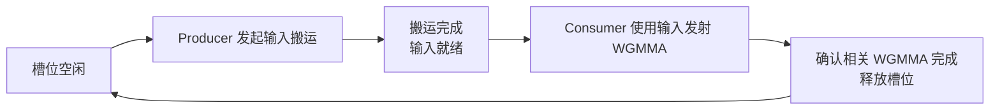

输入搬运完成，意味着 consumer 可以使用数据。WGMMA 发射以后，硬件仍可能使用该槽位，所以 producer 要等相关计算完成、consumer 释放槽位以后才能覆盖它。这是两个不同的通知：**输入就绪允许读，输入释放允许再次写。**

在 shared/shared 操作数主循环中，WGMMA 直接使用 shared 数据；register/shared 路径还要把部分输入读到寄存器。具体释放点由 mainloop 实现安排，不能只凭线程已经发出计算指令就认定输入可覆盖。[TMA 主循环][mma-tma-ws]、[cp.async 主循环][mma-cp-ws]都明确把发射和释放分开。

### Accumulator：发完计算不等于结果已经完成

一个 mainloop 可以在最近的 WGMMA 仍在途时返回到 kernel 的后续控制步骤。Kernel 随后调用的 `mma_tail` 会等待剩余 WGMMA，并释放最后一批输入槽位。

**Epilogue 使用的是完成的 R。** 这解释了为什么后面的 Pingpong 可以先通知另一组接着发射 mainloop，再等待本组的 R：通知移交的是计算发射轮次，本组的结果仍由本组确认完成。

### 输出区域：是否有异步使用，先看 epilogue

普通线程直接写 global 的 epilogue，可以没有 shared 输出槽位，也没有输出 TMA 在途批次。

采用 TMA epilogue 时，线程先把输出子块放进 shared，再发起 TMA Store。此时输出槽位要保留到 **TMA 不再读取它**以后才能覆盖。输入 stage 的释放、R 的完成、输出槽位的释放，各自保护不同资源。

## Multistage：同一批线程交错准备与计算

这一节作为 SM80 对照，依据 [sm80_mma_multistage.hpp][mma-sm80]。它有助于理解后续 SM90 warp specialization 改变了什么。

### 执行流程：预热输入，再交错搬运与计算

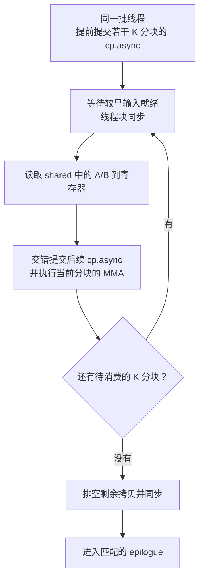

先预热多个输入槽位，使后续计算有数据可用。稳态中，线程读取当前 A/B 的寄存器片段，提交后续 global-to-shared 拷贝，再执行当前片段的矩阵计算。读写位置绕回输入环，较早输入已经消费完的区域被下一份输入复用。

SM80 的典型 Tensor Core 路径使用 `mma.sync`。这里主要异步推进的是 `cp.async` 输入搬运；同一批线程持续交错搬运准备和计算，没有另外一组线程长期只负责输入。

### 重叠时间线：后续输入在当前 MMA 期间搬运

```mermaid
gantt
    title Multistage 的输入重叠（示意刻度）
    dateFormat x
    axisFormat %L
    tickInterval 4millisecond
    todayMarker off
    section 同一批线程
    提交 K0 与 K1 拷贝 : ms_issue01, 0, 2ms
    等 K0 后读入寄存器 : crit, ms_wait0, 2, 3ms
    提交 K2 拷贝 : ms_issue2, 5, 1ms
    执行 K0 的 MMA : ms_mma0, 6, 4ms
    读 K1 并提交 K3 拷贝 : ms_issue3, 10, 2ms
    执行 K1 的 MMA : ms_mma1, 12, 4ms
    section 异步输入搬运
    K0 输入在途 : active, ms_load0, 1, 3ms
    K1 输入在途 : active, ms_load1, 2, 3ms
    K2 输入在途 : active, ms_load2, 6, 5ms
    K3 输入在途 : active, ms_load3, 12, 5ms
```

这是 K 循环的一段，后续 K2、K3 还会继续被消费。刻度 6—10 内，线程执行 K0 的 MMA，已经提交的 K2 拷贝仍在搬运；刻度 12—16 内同理。图把一个 K 分块内部的寄存器读取、拷贝与 MMA 交错压缩成几个区间。**SM80 的 `mma.sync` 放在线程执行条带中，异步输入另画一条；这里没有把它画成 SM90 的 WGMMA 在途流水线。**

### 取舍

多级缓冲覆盖输入延迟，但地址计算、拷贝发射和计算准备仍占用同一批线程的执行机会。更多 stage 会增加 shared memory 占用。后面的 warp specialization 则把输入准备从计算线程的日常流程中分出去。

## KernelTma：由统一流程驱动 TMA 与 WGMMA

对应 [sm90_gemm_tma.hpp][k-tma]，其统一主循环实现为 [sm90_mma_tma_gmma_ss.hpp][mma-tma]。

### 执行流程：同一批计算线程协调输入与计算

Kernel 由 CTA 坐标确定一块输出，建立 A/B 的视图和 R，然后调用完整 mainloop；mainloop 返回以后，直接调用 epilogue。**入口里没有输出任务循环，也没有把线程永久分成输入 producer 和计算 consumer。**

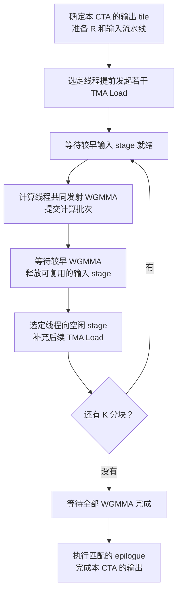

图把预热和稳态压缩成一个循环。源码先预热 TMA 输入，再预热计算批次；稳态中，选出的线程发射 TMA，其所在计算组也参与 WGMMA。等待较早计算完成后释放输入槽位，再补进后续输入。

**TMA 发起线程可以很少，WGMMA 则需要一个 warpgroup 的线程共同参与。** 两种工作的参与人数不同，但在这条路径里仍由统一线程流程协调，搬运发起者随后也参与计算。

主循环末尾等待全部 WGMMA，使 R 可供 epilogue 使用。Kernel 为 mainloop 与 epilogue 预留的 shared 容量取两者需求的最大值，同一缓冲地址先后交给两个阶段；两阶段的使用顺序必须成立。

### 重叠时间线：同一组发射，硬件独立推进

下面选取一个 warpgroup、三个输入 stage S0/S1/S2、四个 K 分块，并假设稳态允许最近一个 WGMMA 批次仍在途。每个 K 分块对应一个提交批次，批次内部可以有多条矩阵指令。

```mermaid
gantt
    title KernelTma 的发射与在途工作（示意刻度）
    dateFormat x
    axisFormat %L
    tickInterval 4millisecond
    todayMarker off
    section 同一 Warpgroup 的线程流程
    选定线程预热 K0 到 K2 : u_preload, 0, 3ms
    等 K0 输入 : crit, u_wait0, 3, 1ms
    发射 K0 批次 : u_issue0, 4, 1ms
    发射 K1 批次 : u_issue1, 5, 1ms
    等 K0 完成并释放 S0 : crit, u_release0, 6, 2ms
    选定线程向 S0 提交 K3 : u_refill3, 8, 1ms
    后续等待与发射 K2 和 K3 : u_rest, 9, 4ms
    等最后 WGMMA 完成 : crit, u_tail, 13, 3ms
    使用完整 R 执行 epilogue : u_epi, 16, 4ms
    section 输入 TMA 在途
    K0 搬入 S0 : active, u_load0, 1, 3ms
    K1 搬入 S1 : active, u_load1, 2, 3ms
    K2 搬入 S2 : active, u_load2, 3, 3ms
    K3 复用 S0 : active, u_load3, 9, 3ms
    section WGMMA 在途
    K0 更新 R : active, u_mma0, 5, 3ms
    K1 更新 R : active, u_mma1, 6, 4ms
    K2 更新 R : active, u_mma2, 10, 3ms
    K3 更新 R : active, u_mma3, 13, 3ms
```

沿横轴读图，有三个关键关系：

- **刻度 4**：只要 K0 已到，warpgroup 就可以发射它的 WGMMA；K2 的输入此时仍在搬运，不必等全部预热输入到齐。
- **刻度 8—12**：K0 的计算完成，S0 才能装 K3；K3 的 TMA 搬运又与 K1 的尾部、K2 的 WGMMA 重叠。提交搬运的线程随后仍参与矩阵发射，CTA 没有专用输入 warpgroup。
- **刻度 16**：四个 K 分块都已经贡献到同一个 R，剩余 WGMMA 也完成，才能开始 epilogue。较早批次完成时，主循环回收的是输入槽位，输出还未完整。

线程发射按统一顺序推进，已经提交的 TMA 与 WGMMA 在硬件侧继续工作。**是否有 warp 特化，决定谁负责发射；是否能重叠，还取决于异步工作能保留多久、输入能提前准备多少。**

### 输出与取舍

这个入口通过 epilogue 的完整调用处理输出，没有单独组织一个输出 TMA 流水线。具体写回动作由 epilogue 实现决定，不能从主循环中的 TMA 推出 TMA Store。

统一流程省下专用输入线程组，但输入发射与矩阵发射仍要由计算线程协调。它主要用软件流水线保持输入和计算连续推进，CTA 做完这一块输出后结束。

## WarpSpecialized：输入准备与计算输出分工

Warp specialization（warp 职责分工）把 CTA 内的线程分成长期承担不同任务的组。基础版本仍然由 CTA 坐标确定一块输出；改变的是 **同一个输出 tile 内，输入准备和矩阵计算由不同线程推进**。

### cp.async 版本：搬运组供给，计算组消费

对应 [sm90_gemm_warpspecialized.hpp][k-cp-ws]，输入使用 [SM90 cp.async 主循环][mma-cp-ws]。这是 SM90 的 `cp.async` 加 WGMMA 路径，与前面的 SM80 Multistage 对照分开看。

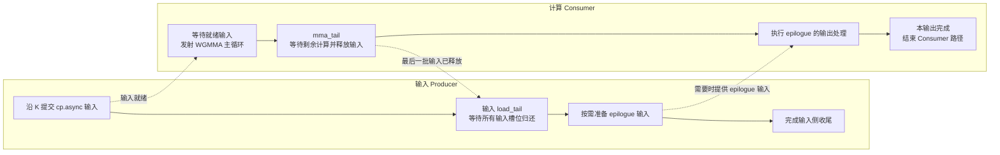

两条链并行推进。Producer 在空闲 stage 中提交拷贝，拷贝完成以后通过流水线通知 consumer；consumer 使用输入发射 WGMMA，在确认较早计算完成以后释放 stage，让 producer 继续投放。

这个 cp.async 入口按拷贝配置和 MMA 配置划分搬运、计算线程，计算侧的参与 warpgroup 数并非由基础策略名称固定。

这个 kernel 的 mainloop 和 epilogue tensor storage **明确复用了同一段 shared memory**。因此，producer 提交完当前 tile 的全部 A/B 后，先执行输入 `load_tail`，等待所有输入槽位归还，再把相同区域用于 epilogue 输入。Consumer 也先执行 `mma_tail`，确认 R 完成，才进入输出处理。

Epilogue 是否需要 producer 加载，由具体实现决定。比如直接写 global 的默认 epilogue，可以由计算线程自己读取所需的 C，producer 侧的 epilogue Load 分支就不会执行。

这里还要保留源码中的一个差异：**该入口在最后调用 epilogue 的 `store`，没有另外调用 collective 的 `store_tail`。** 不能把下一节 TMA 基础版本的最后一步自动补到这个执行流中。写回行为仍要继续追到实际 epilogue。

### TMA 版本：一个输入 warp 驱动搬运，一组 consumer 计算

对应 [sm90_gemm_tma_warpspecialized.hpp][k-tma-ws]。

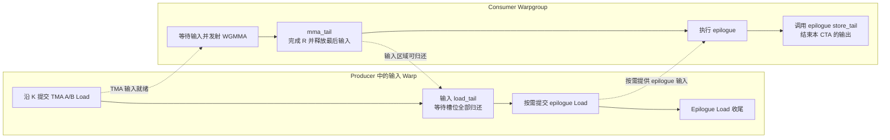

入口先建立流水线和必要的 CTA/cluster 初始化同步，随后按线程角色分支。Producer warpgroup 中选定的一个 warp 负责 mainloop 和 epilogue 输入；实际 TMA 发起者由 collective 进一步选择。Consumer warpgroup 完成 WGMMA 和输出。

这条路径同样采用 mainloop/epilogue shared 区域复用。Producer 的执行顺序是 **当前 tile 的 A/B Load、输入收尾、按需 epilogue Load**；consumer 的执行顺序是 **MMA、计算收尾、epilogue、输出收尾**。

这里确实有 epilogue 的 `store_tail` 调用。但如果匹配的是普通线程 Store 的 adapter，它的 collective `store_tail` 不承担 TMA 输出等待；如果匹配的是 TMA epilogue，才会处理相应输出在途工作。接口名字和实际异步工作要分开判断。

### 重叠时间线：输入组与计算组独立推进

下面展开基础 TMA WarpSpecialized 的一个实例：epilogue 不需要额外 C 输入，实际使用 TMA Store。与上一图采用相同的三个输入 stage S0/S1/S2、四个 K 分块，稳态允许最近一个 WGMMA 批次仍在途；区别是输入发射有独立 producer。K0、K1、K2 分别使用 S0、S1、S2，K3 再次使用 S0。

```mermaid
gantt
    title 基础 WarpSpecialized 的单块输出（示意刻度）
    dateFormat x
    axisFormat %L
    tickInterval 4millisecond
    todayMarker off
    section 输入 Producer
    提交 K0 到 S0 : w_issue0, 0, 1ms
    提交 K1 到 S1 : w_issue1, 1, 1ms
    提交 K2 到 S2 : w_issue2, 2, 1ms
    等 S0 释放 : crit, w_acquire, 3, 5ms
    向 S0 提交 K3 : w_refill, 8, 1ms
    load_tail 等全部输入归还 : crit, w_loadtail, 9, 7ms
    section 当前输出的 Consumer
    等 K0 输入到达 S0 : crit, w_wait0, 0, 4ms
    使用 S0 发射 K0 批次 : w_mma_issue0, 4, 1ms
    使用 S1 发射 K1 批次 : w_mma_issue1, 5, 1ms
    等 K0 完成并释放 S0 : crit, w_release0, 6, 2ms
    使用 S2 发射 K2 批次 : w_mma_issue2, 8, 1ms
    等 K1 完成并释放 S1 : crit, w_release1, 9, 1ms
    等 K3 输入到达 S0 : crit, w_wait3, 10, 2ms
    发射 K3 批次后释放 S2 : w_mma_issue3, 12, 1ms
    mma_tail 等 K3 并释放 S0 : crit, w_mmatail, 13, 3ms
    Epilogue 准备并提交输出 : w_epi, 16, 4ms
    store_tail 等输出源释放 : crit, w_storetail, 20, 3ms
    section 输入 TMA 在途
    K0 搬入 S0 : active, w_load0, 1, 3ms
    K1 搬入 S1 : active, w_load1, 2, 3ms
    K2 搬入 S2 : active, w_load2, 3, 3ms
    K3 搬入 S0 : active, w_load3, 9, 3ms
    section WGMMA 在途
    K0 使用 S0 更新 R : active, w_mma0, 5, 3ms
    K1 使用 S1 更新 R : active, w_mma1, 6, 4ms
    K2 使用 S2 更新 R : active, w_mma2, 9, 4ms
    K3 使用 S0 更新 R : active, w_mma3, 13, 3ms
    section 输出 TMA 源读取在途
    输出子块逐份提交与读取 : active, w_store, 18, 5ms
```

Producer 和 consumer 的线程流程各自推进，硬件在途工作再与它们重叠。沿每个 K 分块读图，可以看到：

- **K0、K1 的启动**：K0 的输入在刻度 4 到达，consumer 便发射 K0；K1 在刻度 5 就绪，随后发射 K1。此时 K2 的输入仍在搬运，K0 的 WGMMA 也还没有完成。
- **S0 的交还**：producer 在刻度 3—8 等 S0。Consumer 发射 K1 以后，等较早的 K0 完成才释放 S0；K1 仍然可以在途。Producer 随后将 K3 装入 S0。
- **K2 与 K3 的重叠**：刻度 8—9，consumer 发射 K2，producer 同时提交 K3 的 TMA。刻度 9—12，K3 的输入搬运与 K2 的 WGMMA 重叠；consumer 在刻度 10—12 等 K3 输入，已经提交的 K2 仍在计算。
- **最后一份输入的归还**：consumer 发射 K3 后，确认 K2 已完成，释放 S2；随后 `mma_tail` 等 K3 完成并释放 S0。K0 到 K3 都在更新同一个 R，最后这个等待完成以后，R 才能交给 epilogue。

刻度 16 前，输入区域仍属于 mainloop；最后输入归还且 R 完成后，才能交给 epilogue。刻度 18—20 展示输出子块的 TMA 与后续线程准备重叠，**此时本 CTA 没有下一块输出的 WGMMA**。输出子块内部的展开见后文 TMA epilogue 时间线。

cp.async 基础版本的输入部分也能按“producer 发射、异步拷贝、consumer 计算”分开观察；其输入就绪通知和入口末尾的输出收尾调用仍以该版本源码为准。若实例采用普通线程 Store，就不画这里的输出 TMA 条带，也没有相应的 TMA 源读取等待。

### 取舍：覆盖输入等待，同时保留一个输出边界

这两个基础 kernel 都没有跨输出任务的循环。输入 producer 可以提前推进当前 tile 的 A/B，计算 consumer 也可以在输出子块之间进行 epilogue 内部的流水化，但 **consumer 做本 tile 的 epilogue 时，本 CTA 没有另一块输出的计算任务接上来**。

阶段间复用 shared memory 降低了容量需求，同时也形成明确的输入到输出边界。后面的持久化 Cooperative 与 Pingpong 把 mainloop、epilogue 存储分开，为跨任务的持续输入或计算与输出重叠留出空间。

## Persistent：跨输出 tile 延续流水线

Cooperative 与 Pingpong 的 SM90 实现都在 kernel 内保留工作循环。**同一个 CTA 处理完当前工作以后，更新任务与流水线位置，继续下一项工作。**

### 四个 CTA 连续处理十二块输出

假设有十二块输出，使用四个 CTA worker。一个简单的静态持久化分配可以是：

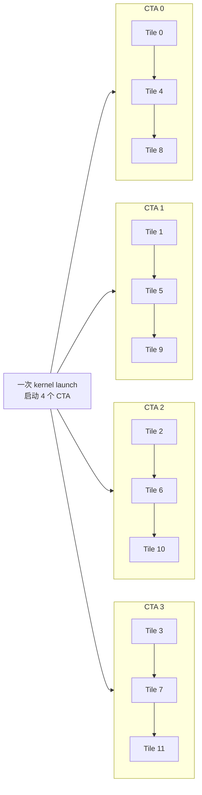

每条链都在同一个 CTA 内执行，箭头对应输出任务循环；链中的每个 tile 自己还包含 K 维 mainloop。非持久化版本则总共启动十二个 CTA，每个完成一块输出，由硬件陆续安排这些 CTA 驻留。

两个方案都只需要一次 kernel launch。持久化减少的是重复启动 CTA、建立任务上下文的成本，并允许输入和输出流水线状态跨任务延续。任务足够多时，持久化 grid 的 CTA 数通常少于输出 tile 数；任务少时，每个 CTA 也可能只得到一项工作。

### 任务顺序与角色进度分别管理

SM90 的普通 persistent scheduler 使用静态映射。[静态调度基类][sched-static]推进任务时，增加的是 grid 的 CTA 总数乘以指定的推进次数，再映射回 tile 坐标；不需要每次通过全局原子操作抢任务。

Producer 和 consumer 在各自的控制分支里维护任务与 pipeline state。它们可以沿相同任务顺序以不同速度推进：producer 为后续任务搬输入，consumer 还在计算或输出当前任务。**它们依靠输入槽位和任务顺序对齐数据，整个 CTA 不需要在每个 tile 边界一起停下来。**

Pingpong 的两组 consumer 会各自跳过另一组的任务；Cooperative 则让参与同一工作的 consumer 取得相同任务。下面两节会把这个区别画出来。

## Cooperative：分担同一输出，延续输出流水线

Cooperative 的计算线程共同处理同一项工作。常见的两组配置把一个输出 tile 沿 M 分成两部分，各组保存对应部分的 R。cp.async Cooperative 按 MMA 配置确定参与组数；本文的 TMA Cooperative 与 Array TMA Cooperative 入口都明确要求 256 个计算线程，即两组 consumer。

### cp.async Cooperative：同一任务，独立推进输入与计算循环

对应 [sm90_gemm_warpspecialized_cooperative.hpp][k-cp-coop]。

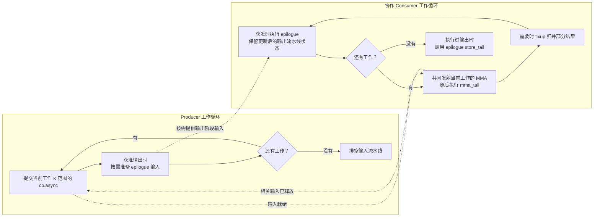

Producer 每轮取得当前工作的输出坐标、K 起点和 K 分块数，搬入这段 A/B。如果 scheduler 允许这项工作执行 epilogue，且 epilogue 需要 producer 输入，再准备对应数据，然后取得下一项工作。

Consumer 的每轮顺序是 **当前范围的 MMA、`mma_tail`、必要的结果归并、获准时的 epilogue、下一项工作**。普通完整 tile 的归并步骤为空；Stream-K 等工作分解会在这里补齐结果。

输出的 Load/Store pipeline state 从 epilogue 返回后被保存，下一轮沿其位置继续推进。**Collective 的 `store_tail` 位于 consumer 工作循环之后。** Producer 的输入 `load_tail` 也放在自己的工作循环之后，跨 tile 时不把整个输入流重新排空。

### TMA Cooperative：A/B 输入与 epilogue 输入进一步分工

对应 [sm90_gemm_tma_warpspecialized_cooperative.hpp][k-tma-coop]。Consumer 工作循环保留上面的计算、归并和输出顺序，producer 内部则把 A/B Load 和 epilogue Load 交给不同 warp。

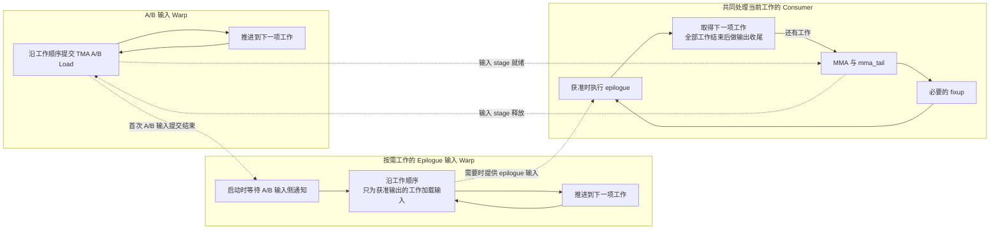

图画的是普通完整 tile 的启动情况。A/B 输入 warp 完成第一项工作的输入提交以后，通知 epilogue 输入 warp 开始；**这个启动通知不等待 consumer 完成第一块输出，也不表示排空输入流水线**。随后两类输入 warp 各自沿任务顺序推进，直到工作耗尽再做输入收尾。需要单独 reduction 工作的 scheduler 有对应的启动条件。

Consumer 在每轮 mainloop 之后确认 WGMMA 完成，执行 scheduler 的归并，再由 scheduler 决定是否进入 epilogue。输出 state 跨轮次保存，最终 `store_tail` 仍然放在整个工作循环之后。

TMA Cooperative 的 producer 和 consumer 还采用不同寄存器预算：输入组让出部分预算，计算组为 accumulator 保留更多预算。若 mainloop 需要辅助数据，还可能启用额外输入角色；这属于实际 mainloop 的需求，不能仅凭 Cooperative 名称判断。

### 为什么它们能够跨 tile 继续供给输入

两个 Cooperative kernel 都分别分配 mainloop 和 epilogue 的 tensor storage。Producer 因而可以向 mainloop 区域准备下一项工作的输入，而 consumer 正在 epilogue 区域处理当前输出。

两组协作 consumer 处理同一项工作，输入流水线的释放计数包含参与的全部计算线程。一个 shared 槽位即使已经被其中一组用完，也要满足其他相关使用者的释放条件，才能让 producer 覆盖它。

这与后面的 Pingpong 有实质区别：**Cooperative 的一份输入服务同一输出工作的多个计算参与者；Pingpong 的输入流按任务分别交给对应组。**

### 输出流水线延续的条件与取舍

如果使用 TMA epilogue，循环中没有每轮 collective `store_tail`，就允许上一轮提交的部分输出 Store 在下一轮计算期间继续推进。真正复用输出槽位时，epilogue 内的 acquire 和同步仍会等待必要的旧源读取完成。Batch/group 切换还可能引入描述符更新等待。

如果使用普通线程 Store，输出流程没有这类 TMA 在途项；持久化输入流和同一 tile 的协作分工仍然成立。

### 重叠时间线：下一块输入先行，上一块 Store 延续

下面取普通 persistent scheduler 的两项完整 tile 工作，采用 TMA 输入和 TMA epilogue，不涉及 K 范围拆分或描述符切换。两组协作 consumer 始终处理同一项工作。

```mermaid
gantt
    title Cooperative 跨输出 tile 的重叠（示意刻度）
    dateFormat x
    axisFormat %L
    tickInterval 4millisecond
    todayMarker off
    section A/B 输入 Producer
    提交 Tile 0 输入 : c_issue0, 0, 3ms
    按空闲 stage 提交 Tile 1 输入 : c_issue1, 6, 5ms
    section 协作 Consumer 的线程流程
    Tile 0 mainloop 发射与等待 : c_main0, 3, 5ms
    Tile 0 mma_tail : crit, c_tail0, 8, 2ms
    Tile 0 epilogue : c_epi0, 10, 4ms
    Tile 1 mainloop 发射与等待 : c_main1, 14, 5ms
    Tile 1 mma_tail : crit, c_tail1, 19, 2ms
    Tile 1 epilogue : c_epi1, 21, 4ms
    工作耗尽后 store_tail : crit, c_storetail, 25, 3ms
    section 输入 TMA 在途
    Tile 0 A/B 逐份就绪 : active, c_load0, 1, 5ms
    Tile 1 A/B 逐份就绪 : active, c_load1, 7, 7ms
    section WGMMA 在途
    两组共同计算 Tile 0 : active, c_mma0, 4, 6ms
    两组共同计算 Tile 1 : active, c_mma1, 15, 6ms
    section 输出 TMA 源读取在途
    Tile 0 输出子块 : active, c_store0, 12, 5ms
    Tile 1 输出子块 : active, c_store1, 23, 5ms
```

这张图同时展示两种跨 tile 的重叠：

- **刻度 10—14**：consumer 做 Tile 0 的 epilogue，producer 已经给 Tile 1 准备 A/B。Mainloop 和 epilogue 使用分开的 shared 区域，输入 stage 仍按相关计算完成情况逐个归还。
- **刻度 15—17**：consumer 开始 Tile 1 的矩阵计算，Tile 0 的部分输出 TMA 仍在读取源。前一轮 epilogue 返回了更新后的输出 state，下一轮沿这个状态继续，最后才执行 collective `store_tail`。

但 consumer 的 **Tile 0 epilogue 与 Tile 1 mainloop 发射没有交错**：同一批线程先完成前者，再进入后者。图中跨过去的是异步 Store，另外还有 producer 提前准备的输入。下一次写输出槽位时，必要的 acquire 与同步仍会保护旧源；这张图选择旧源在下一次 epilogue 前已经释放的进度。

Cooperative 可以把较大 tile 的 accumulator 分摊到更多线程，提高 A/B 复用，同时增加线程和 shared memory 的资源需求。**同一批 consumer 仍然依次经历当前工作的 mainloop 与 epilogue。** 持久化本身没有增加另一个专门计算下一块输出的 consumer。

## Pingpong：独立输出，共享 CTA 内的资源

Pingpong 的两个 consumer warpgroup 分别负责不同输出任务。为便于说明，以下 Tile 0、Tile 1、Tile 2 表示 **某个 CTA 所得到的任务顺序**；它们不一定是整个输出矩阵中相邻的坐标。

Consumer 0 处理 Tile 0、Tile 2，Consumer 1 处理 Tile 1、Tile 3。两组各有自己的 accumulator，最终输出地址互不覆盖。它们共用输入流水线，并按有序轮次使用 epilogue 所需的区域。

### cp.async Pingpong：每轮移交计算与 epilogue 两种轮次

对应 [sm90_gemm_warpspecialized_pingpong.hpp][k-cp-ping]。

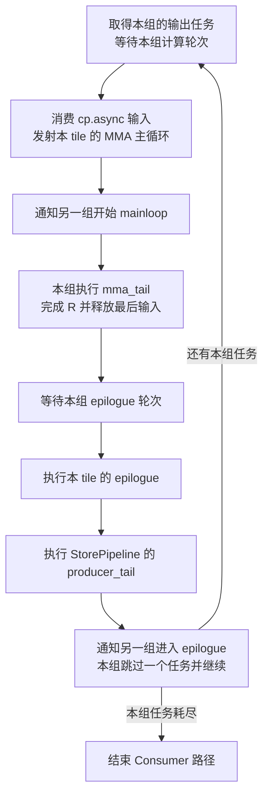

Consumer 1 启动时先跳过 Consumer 0 的第一项工作，同时把输入、epilogue pipeline state 推进到自己应消费的位置。之后每组每轮跨过两项工作，形成交错任务序列。

Producer 沿完整任务序列准备 A/B，提交一项工作的输入以后，再按需准备该项工作的 epilogue 输入，然后继续下一项。它不会为两组各分配一套输入环。

Consumer 的 **mainloop 通知位于 `mma_tail` 之前**，允许另一组尽早接上矩阵发射；epilogue 通知则位于输出收尾之后，保护共享输出区域的下一轮使用。

这里调用的是 StorePipeline 的 `producer_tail`，并没有调用 collective 的 `store_tail`。这是本文件的实际收尾位置和接口，与 TMA Pingpong 的入口保持区分；是否存在 TMA 输出工作，仍取决于实际 epilogue。

### TMA Pingpong：另一组的 mainloop 接在本组收尾期间

对应 [sm90_gemm_tma_warpspecialized_pingpong.hpp][k-tma-ping]。A/B 输入和按需 epilogue 输入使用不同 producer warp，consumer 的两种轮次继续分开控制。

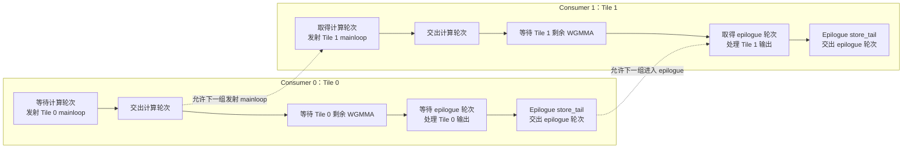

图把两个独立交接画开。Consumer 0 发出 mainloop 工作后就通知 Consumer 1，随后等待自己的剩余 WGMMA，得到完成的 R0，再执行 epilogue。Consumer 1 可以在此期间推进 Tile 1 的 mainloop。

Consumer 0 的 epilogue 结束后调用 collective 的 `store_tail`，再通知 Consumer 1 使用 epilogue 区域。若采用 TMA epilogue，这里会等待本组已提交 Store 的 shared 源读取结束，并完成需要的 epilogue 输入槽位释放；若采用普通线程 Store 的 adapter，相应 collective tail 没有 TMA 输出工作可处理。

随后 Consumer 0 继续 Tile 2，Consumer 1 继续 Tile 3。计算轮次和 epilogue 轮次各自交替，**本组交出了计算轮次，不代表本组 R 已经完成，也不代表输出区域已经交还。**

### 重叠时间线：一组处理输出，另一组供给矩阵工作

以下选择实际使用 TMA epilogue 的普通 TMA Pingpong，把三个输出 tile 的输入、计算和输出完整展开。图中用 T0、T1、T2 简写 Tile 0、Tile 1、Tile 2，采用以下配置：

- **每个 tile 只有 K0、K1 两个 K 分块**，各对应一个 WGMMA 提交批次，批次内部可以包含多条矩阵指令。Consumer 0 累加 T0、T2，Consumer 1 累加 T1，各 tile 的 R 分别保存。
- **输入有三个 stage S0/S1/S2**，沿完整任务流循环投放。稳态等待较早批次完成，允许最近一个 WGMMA 批次仍在途。
- **每个输出 tile 有 U0、U1 两个 epilogue 子块**，分别使用两个输出 stage O0、O1。三个 tile 共用这些 stage，按 epilogue 轮次先后进入。
- Epilogue 不需要额外 C 输入，C/D shared 缓冲不复用，Store 不延迟发射。图中的 acquire 包含必要的输出槽位检查，发布步骤包含 shared 写入发布、参与线程同步、TMA Store 提交和 commit。

为方便逐项对照，下面分成三张时间线，**都使用刻度 0—40**。第一行只是固定观察范围，不代表某个线程或硬件一直工作；菱形表示结果就绪或轮次移交的瞬间。所有长度仍是示意值。

#### 输入环：六份 A/B 怎样依次投放

输入流中的 stage 对应关系如下，两个 consumer 消费各自任务的输入：

| 输入流位置 | 装入的 A/B | 输入 stage | Consumer |
| --- | --- | --- | --- |
| 1 | T0 / K0 | S0 | 0 |
| 2 | T0 / K1 | S1 | 0 |
| 3 | T1 / K0 | S2 | 1 |
| 4 | T1 / K1 | S0，复用 | 1 |
| 5 | T2 / K0 | S1，复用 | 0 |
| 6 | T2 / K1 | S2，复用 | 0 |

```mermaid
gantt
    title Pingpong 输入环：投放与源使用（示意刻度）
    dateFormat x
    axisFormat %L
    tickInterval 4millisecond
    todayMarker off
    section 时间参照
    示例观察范围 : p_a_window, 0, 40ms
    section 共用 A/B 输入 Producer
    提交 T0 K0 到 S0 : p_a_issue00, 0, 1ms
    提交 T0 K1 到 S1 : p_a_issue01, 1, 1ms
    提交 T1 K0 到 S2 : p_a_issue10, 2, 1ms
    等 T0 K0 释放 S0 : crit, p_a_wait0, 3, 5ms
    提交 T1 K1 到 S0 : p_a_issue11, 8, 1ms
    等 T0 K1 释放 S1 : crit, p_a_wait1, 9, 1ms
    提交 T2 K0 到 S1 : p_a_issue20, 10, 1ms
    等 T1 K0 释放 S2 : crit, p_a_wait2, 11, 3ms
    提交 T2 K1 到 S2 : p_a_issue21, 14, 1ms
    全部投放后 load_tail : crit, p_a_tail, 15, 11ms
    section 输入 TMA 在途
    T0 K0 搬入 S0 : active, p_a_load00, 1, 3ms
    T0 K1 搬入 S1 : active, p_a_load01, 2, 3ms
    T1 K0 搬入 S2 : active, p_a_load10, 3, 3ms
    T1 K1 搬入 S0 : active, p_a_load11, 9, 3ms
    T2 K0 搬入 S1 : active, p_a_load20, 11, 3ms
    T2 K1 搬入 S2 : active, p_a_load21, 15, 3ms
    section 相关 WGMMA 的源使用（对照）
    T0 K0 使用 S0 : active, p_a_use00, 5, 3ms
    T0 K1 使用 S1 : active, p_a_use01, 6, 4ms
    T1 K0 使用 S2 : active, p_a_use10, 9, 5ms
    T1 K1 使用 S0 : active, p_a_use11, 13, 4ms
    T2 K0 使用 S1 : active, p_a_use20, 21, 3ms
    T2 K1 使用 S2 : active, p_a_use21, 22, 4ms
```

Producer 可以先把 T1 / K0 放进空闲的 S2，此时 Consumer 0 甚至还没有发射 T0 / K0。但下一份 T1 / K1 要绕回 S0，必须等 T0 / K0 的相关 WGMMA 完成，并由 Consumer 0 释放 S0，才能在刻度 8 提交。

随后两次复用同理：S1 在刻度 10 归还，S2 在刻度 14 归还。**T2 的输入在刻度 18 已全部到达，Consumer 0 此时仍在处理 T0 的输出。** 已搬到的 A/B 可以留在输入环中等待消费，输入与 epilogue 使用分开的 shared 区域。

Producer 在刻度 15 提交完本例全部输入，最后的 `load_tail` 一直等到刻度 26，确认包括 T2 在内的最后输入槽位都已归还。它的收尾不要求三个 tile 的 epilogue 都完成；T2 的输出会继续到刻度 40。

#### 计算轮次：逐个 K 发射，随后等待自己的最终 R

```mermaid
gantt
    title Pingpong 计算：K 批次与轮次移交（示意刻度）
    dateFormat x
    axisFormat %L
    tickInterval 4millisecond
    todayMarker off
    section 时间参照
    示例观察范围 : p_c_window, 0, 40ms
    section Consumer 0 的线程流程
    等 T0 K0 输入 : crit, p_c_wait00, 0, 4ms
    发射 T0 K0 使用 S0 : p_c_issue00, 4, 1ms
    发射 T0 K1 使用 S1 : p_c_issue01, 5, 1ms
    等 T0 K0 并释放 S0 : crit, p_c_release00, 6, 2ms
    T0 交出计算轮次 : milestone, p_c_handoff0, 8, 0ms
    mma_tail 等 T0 K1 并释放 S1 : crit, p_c_tail0, 8, 2ms
    R0 完整 : milestone, p_c_ready0, 10, 0ms
    准备 T0 输出并做 Store 收尾 : p_c_output0, 10, 10ms
    发射 T2 K0 使用 S1 : p_c_issue20, 20, 1ms
    发射 T2 K1 使用 S2 : p_c_issue21, 21, 1ms
    等 T2 K0 并释放 S1 : crit, p_c_release20, 22, 2ms
    T2 交出计算轮次 : milestone, p_c_handoff2, 24, 0ms
    mma_tail 等 T2 K1 并释放 S2 : crit, p_c_tail2, 24, 2ms
    R2 完整 : milestone, p_c_ready2, 26, 0ms
    等 T1 交还输出区域 : crit, p_c_epiwait2, 26, 4ms
    准备 T2 输出并做 Store 收尾 : p_c_output2, 30, 10ms
    section Consumer 1 的线程流程
    等 Consumer 0 的计算交接 : crit, p_c_turn1, 0, 8ms
    发射 T1 K0 使用 S2 : p_c_issue10, 8, 1ms
    等 T1 K1 搬入 S0 : crit, p_c_wait11, 9, 3ms
    发射 T1 K1 使用 S0 : p_c_issue11, 12, 1ms
    等 T1 K0 并释放 S2 : crit, p_c_release10, 13, 1ms
    T1 交出计算轮次 : milestone, p_c_handoff1, 14, 0ms
    mma_tail 等 T1 K1 并释放 S0 : crit, p_c_tail1, 14, 3ms
    R1 完整 : milestone, p_c_ready1, 17, 0ms
    等 T0 交还输出区域 : crit, p_c_epiwait1, 17, 3ms
    准备 T1 输出并做 Store 收尾 : p_c_output1, 20, 10ms
    section WGMMA 在途
    T0 K0 更新 R0 : active, p_c_mma00, 5, 3ms
    T0 K1 更新 R0 : active, p_c_mma01, 6, 4ms
    T1 K0 更新 R1 : active, p_c_mma10, 9, 5ms
    T1 K1 更新 R1 : active, p_c_mma11, 13, 4ms
    T2 K0 更新 R2 : active, p_c_mma20, 21, 3ms
    T2 K1 更新 R2 : active, p_c_mma21, 22, 4ms
```

每个 tile 的两个批次都累加到自己的 R。发射 K1 以后，主循环等待较早的 K0 完成，释放它的输入 stage，再返回到 kernel。**计算轮次就在这个返回点交给另一组，K1 则留给本组的 `mma_tail` 确认完成。** 所以 T0 在刻度 8 交轮次，R0 到刻度 10 才完整。

Consumer 1 在刻度 8 取得轮次，T1 / K0 的输入早已于刻度 6 到达，可以立即发射；但 T1 / K1 要到刻度 12 才到，所以它仍会等待。刻度 9—10，T0 / K1 和 T1 / K0 都在途，Consumer 0 等自己的尾批次，Consumer 1 推进独立的 R1。

T1 在刻度 14 已经交还计算轮次，Consumer 0 却要到刻度 20 才开始 T2：**它自己的 T0 输出准备与 Store 收尾还没有结束。** 轮次允许进入，只是其中一个条件；当前组还要先走完自己的上一项任务。到了刻度 20，T2 两份输入也都已到达，所以这次可以连续发射 K0、K1。

这张图中的输出区间，下一张会继续拆成子块算术、shared 写入、TMA 提交和 Store 等待。

#### 输出轮次：逐个子块准备，等待全部旧源后换组

```mermaid
gantt
    title Pingpong 输出：子块准备与 TMA Store（示意刻度）
    dateFormat x
    axisFormat %L
    tickInterval 4millisecond
    todayMarker off
    section 时间参照
    示例观察范围 : p_e_window, 0, 40ms
    section Consumer 0 的输出流程
    R0 完整并取得首个输出轮次 : milestone, p_e_ready0, 10, 0ms
    T0 U0 算术 : p_e_math00, 10, 1ms
    T0 U0 Acquire O0 并转换写入 : p_e_fill00, 11, 1ms
    T0 U0 发布同步并提交 Store : p_e_issue00, 12, 1ms
    T0 U1 算术 : p_e_math01, 13, 1ms
    T0 U1 Acquire O1 并转换写入 : p_e_fill01, 14, 1ms
    T0 U1 发布同步并提交 Store : p_e_issue01, 15, 1ms
    T0 store_tail 等全部输出源 : crit, p_e_tail0, 16, 4ms
    T0 交还输出轮次 : milestone, p_e_handoff0, 20, 0ms
    R2 完整 : milestone, p_e_ready2, 26, 0ms
    等 T1 交还输出轮次 : crit, p_e_wait2, 26, 4ms
    T2 U0 算术 : p_e_math20, 30, 1ms
    T2 U0 Acquire O0 并转换写入 : p_e_fill20, 31, 1ms
    T2 U0 发布同步并提交 Store : p_e_issue20, 32, 1ms
    T2 U1 算术 : p_e_math21, 33, 1ms
    T2 U1 Acquire O1 并转换写入 : p_e_fill21, 34, 1ms
    T2 U1 发布同步并提交 Store : p_e_issue21, 35, 1ms
    T2 store_tail 等全部输出源 : crit, p_e_tail2, 36, 4ms
    T2 交还输出轮次 : milestone, p_e_handoff2, 40, 0ms
    section Consumer 1 的输出流程
    R1 完整 : milestone, p_e_ready1, 17, 0ms
    等 T0 交还输出轮次 : crit, p_e_wait1, 17, 3ms
    T1 U0 算术 : p_e_math10, 20, 1ms
    T1 U0 Acquire O0 并转换写入 : p_e_fill10, 21, 1ms
    T1 U0 发布同步并提交 Store : p_e_issue10, 22, 1ms
    T1 U1 算术 : p_e_math11, 23, 1ms
    T1 U1 Acquire O1 并转换写入 : p_e_fill11, 24, 1ms
    T1 U1 发布同步并提交 Store : p_e_issue11, 25, 1ms
    T1 store_tail 等全部输出源 : crit, p_e_tail1, 26, 4ms
    T1 交还输出轮次 : milestone, p_e_handoff1, 30, 0ms
    section 输出 TMA 源读取在途
    T0 U0 使用 O0 : active, p_e_store00, 13, 5ms
    T0 U1 使用 O1 : active, p_e_store01, 16, 4ms
    T1 U0 使用 O0 : active, p_e_store10, 23, 5ms
    T1 U1 使用 O1 : active, p_e_store11, 26, 4ms
    T2 U0 使用 O0 : active, p_e_store20, 33, 5ms
    T2 U1 使用 O1 : active, p_e_store21, 36, 4ms
    section 另一组的 WGMMA（对照）
    Consumer 1 的 T1 两个批次 : active, p_e_mma1, 9, 8ms
    Consumer 0 的 T2 两个批次 : active, p_e_mma2, 21, 5ms
```

T0 / U0 的 Store 在刻度 13 提交后，TMA 继续读取 O0，Consumer 0 则在 O1 准备 U1。**同一个 tile 内，较早子块的 Store 与后续子块的线程准备重叠**；与此同时，另一组的 T1 WGMMA 也在推进。刻度 13—16 因而同时存在输出准备、输出源读取与矩阵计算。

Consumer 1 在刻度 17 已经得到完整 R1，但 T0 / U0、U1 的 Store 都还可能使用输出源。O0 到刻度 18 已经安全，O1 却要到刻度 20；这个 kernel 要先完成当前组全部已提交 Store 的源读取收尾，再交接整个 epilogue 轮次。**下一组在刻度 20 才开始输出，不能仅凭自己的 R 完整，或某一个输出槽位先空出来，就提前进入。**

刻度 20 以后，两组交换工作：Consumer 1 处理 T1 的两个输出子块，Consumer 0 发射 T2 的两个 K 批次。刻度 23—26，T1 的 Store、后续输出准备与 T2 的 WGMMA 再次重叠。R2 在刻度 26 完整以后，Consumer 0 又要等到刻度 30，才能取得输出轮次，处理 T2。

三个 tile 的关键时间点可以对应起来：

| 当前 tile | 交出计算轮次 | 本 tile 的 R 完整 | Store 源读取收尾并交还输出轮次 |
| --- | --- | --- | --- |
| T0 | 8 | 10 | 20 |
| T1 | 14 | 17 | 30 |
| T2 | 24 | 26 | 40 |

计算轮次允许下一组继续发射，R 完整允许本组使用结果，输出轮次允许下一组使用共享输出区域。**它们是三个不同的时间点，保护的对象也不同。** 本例特意选择输出源释放较慢的进度，使等待位置可见；实际等待可以更短或不存在。所有异步条带表示在途工作，SM 的矩阵吞吐量、TMA 带宽和 shared 容量仍是共同约束。

### 共用输入：一条输入流，槽位跨任务复用

沿用时间线的三个输入 stage 和每 tile 两个 K 分块。Producer 按 T0 / K0、T0 / K1、T1 / K0、T1 / K1、T2 / K0、T2 / K1 的顺序投放，S0/S1/S2 的地址固定，存放的数据与负责消费的组则会变化。

上面的输入表描述投放顺序，不表示六次搬运和计算依次串行结束。输入属于哪项任务，就由负责该任务的 consumer 消费；producer 可以在空闲的 S2 中提前准备 T1 / K0，而不必为 Consumer 1 另建一套输入环。

例如，Consumer 0 确认 T0 / K0 的相关 WGMMA 完成并释放 S0，producer 就能把 T1 / K1 放进 S0。**这里只等这份输入被用完，不等 T0 的最终 R 或整个 epilogue 完成。** 原先供 Consumer 0 使用的槽位，归还后便能服务 Consumer 1 的任务。

同一 CTA 内的两组之间，不要求 Consumer 1 也读取 Tile 0 的输入后才释放。两个 Pingpong kernel 的输入消费者计数对应一个 warpgroup，与 Cooperative 的共同消费计数不同。

### 共用输出区域：计算结果独立，临时存储先后交接

采用 TMA epilogue 时，Consumer 0 把 Tile 0 的结果子块写到 shared 输出槽位 O，再发起 TMA Store。Store 已提交以后，TMA 仍可能读取 O。

此时 Consumer 1 在自己的 R1 中计算不会影响 Tile 0；但如果它把 Tile 1 的结果写进同一个 O，就可能覆盖 TMA 尚未读完的数据。**两个 global 输出区域互不重叠，也不能消除这个 shared 源覆盖问题。**

所以 consumer 可以先接上 mainloop，而进入下一轮 epilogue 需要另一个交接。前一组确认输出区域不再被异步读取，再通过有序屏障把复用权限传给下一组。

普通线程直接写 global 的 epilogue 没有这类 shared 输出源约束，但 kernel 的 epilogue 有序轮次仍存在。它执行的是同一套调度框架，实际收尾成本由 epilogue 决定。

### 共用 SM：调度利用独立任务覆盖输出阶段

两个 consumer 属于同一个 CTA，驻留在同一个 SM。它们各自保有 accumulator，矩阵指令使用这个 SM 的 Tensor Core 能力。增加一组 consumer 提供了另一项可推进的任务，SM 的峰值吞吐量仍由硬件决定。

交替推进 mainloop 是这两个 kernel 明确安排的软件轮次。交接以后，上一组的最后 WGMMA 仍可能在途，下一组也可能已经发出矩阵指令。**计算轮次控制的是主循环发射顺序，不能理解成整个 SM 被某组完全独占。**

相对于 Cooperative，Pingpong 增加了另一块输出的计算上下文：一个组做 epilogue 算术、类型转换、输出准备或等待时，另一个组继续供给矩阵工作。代价是两组分别持有完整输出 tile 的 accumulator，还有额外的轮次交接和资源需求。

## Array 与 Grouped：任务切换时还要更新寻址信息

对应 [sm90_gemm_array_tma_warpspecialized_cooperative.hpp][k-array-coop] 和 [sm90_gemm_array_tma_warpspecialized_pingpong.hpp][k-array-ping]。它们保留 Cooperative/Pingpong 的计算组织，但任务还包含矩阵或 group 的编号。

Pointer-array batched GEMM 可以为每个矩阵提供不同指针；grouped GEMM 还可能有不同的 M、N、K 和 stride。因此下一项任务到来以后，要更新相应矩阵视图和 TMA tensor map（寻址描述符）。

当前这两个 Array 入口都限制为默认 scheduler，或 grouped 场景对应的 GroupScheduler。它们保留 `fixup` 和 epilogue 判定接口，但这些支持组合中的工作覆盖完整 K，不发生 Stream-K 那类跨工作归并。

### Array Cooperative：协作流程外再加矩阵切换

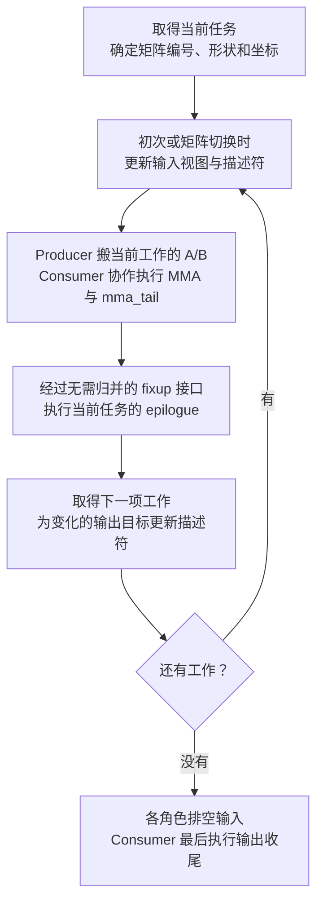

图表示每个任务需要满足的前后关系，输入与 consumer 仍在各自角色分支中独立循环。开始时各角色准备自己的描述符副本；后续同一矩阵内切换输出 tile，一般只改变 tile 坐标；跨矩阵或 group 时，则更新地址，grouped 路径还更新形状和 stride。

Consumer 每轮仍是 MMA、`mma_tail`、经过 scheduler 接口、执行 epilogue，再取得下一项工作。**Collective 输出 tail 放在整个 consumer 循环之后。** 但是矩阵切换时的描述符发布有自己的等待，因此不能把这一点扩展成所有边界都完全没有等待。

输出若采用 pointer-array TMA epilogue，计算组要更新对应的 D 描述符；源码按 consumer warpgroup 维护相应输出描述符。普通线程 epilogue 的 adapter 则通过指针数组寻址，描述符相关接口不承担真实 TMA 操作。

### Array Pingpong：跳过的任务也有不同 K 长度

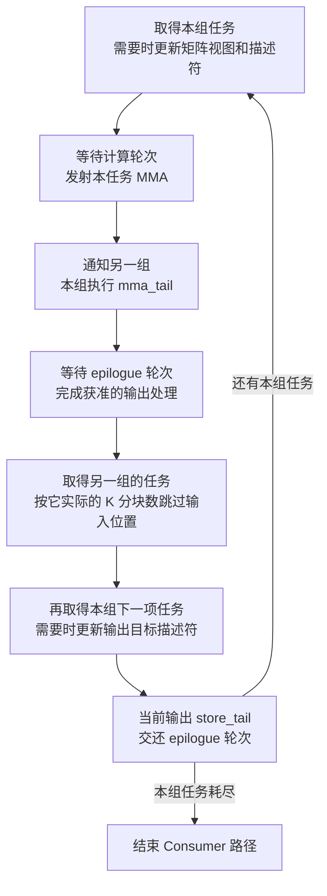

普通 Pingpong 在固定形状的 GEMM 内交替处理任务，可以按固定 K 分块数推进输入状态。Array/Grouped Pingpong 要按每项工作的实际 K 长度对齐输入流。

例如，本组刚完成的任务有两个 K 分块，被跳过的另一组任务有五个 K 分块，那么本组的输入消费位置要先越过自己的两个分块，再越过另一组的五个分块，才能对准下一项本组任务。**跳过任务只改变本组读取位置，另一组仍然会实际消费那段输入。**

启动时 Consumer 1 先取下一项任务，并按第一项任务的 K 长度调整输入位置。每轮输出后，consumer 依次取被跳过的任务和本组下一项任务；在需要时更新矩阵形状、寻址描述符，最后完成当前 epilogue 收尾并交还轮次。

这节图中“取得下一个任务”位于当前输出 tail 之前，是源码中的实际控制顺序。提前确定下一项工作的寻址信息，并不允许另一组提前覆盖当前输出源；输出区域仍要等 tail 和有序交接完成。

### 描述符发布也有自己的完成条件

TMA 描述符不是普通的矩阵元素。Array collective 先在 shared 中准备新的地址、形状或 stride，再将描述符发布到供 TMA 使用的位置，并通过 release/acquire fence 使新版本生效。

真正的 [pointer-array TMA epilogue][epi-array]在发布新描述符之前，还会等待旧描述符关联的 TMA 操作满足修改条件。这个等待保护寻址信息；输出 Store 的源读取等待保护 shared 输出数据。**描述符可更新，与输出槽位可覆盖，是两类不同保证。**

## TMA Store 是否采用：追到具体 epilogue

### 普通线程 Store：计算线程直接写 global

[DefaultEpilogue][epi-default]按 accumulator 对应的输出位置，按需读取 C，执行输出算术和转换，然后通过普通 global Store 写 D；其 shared storage 不承担输出暂存。

它可以通过 [SM90 adapter][epi-adapter]接入 warp-specialized kernel 的 epilogue 接口。这个 adapter 的 producer Load 判定为不需要，collective `load_tail`、`store_tail` 也不管理真实输出 TMA。

```mermaid
flowchart LR
    A["完成的 R"] --> B["计算线程按需读取 global C"]
    B --> C["算术、转换与边界处理"]
    C --> D["计算线程直接 Store 到 global D"]
```

这条输出路径没有“结果先写 shared、TMA 再读 shared”的阶段。所以讨论这个实例时，不应给它添加 shared 输出槽位和 TMA Store 在途批次。

在本文对应版本的 [SM90 epilogue builder][epi-builder]中，`EpilogueScheduleAuto` 选择的就是 `NoSmemWarpSpecialized`。因此，**即使 mainloop 用 TMA，甚至 epilogue 使用 Auto，也不能据此认定输出采用 TMA Store。** Auto 是构建时的选择，不是 kernel 运行过程中动态切换策略。

### TMA epilogue：输出子块经过 shared，再由 TMA 写回

依据 [sm90_epilogue_tma_warpspecialized.hpp][epi-tma]。以实际启用 D 输出的分支为例，它把一个输出 tile 划分为多个 epilogue 子块。

```mermaid
flowchart TB
    A["使用完成的 R<br>按需等待 epilogue 输入"] --> B["读取当前 R 子块<br>执行融合算术"]
    B --> C["Acquire 当前输出 stage<br>等待必要的旧 Store 源读取"]
    C --> D["转换输出类型<br>参与线程写入 shared"]
    D --> E["发布 shared 写入并同步"]
    E --> F["选定发起 Warp 提交 TMA Store<br>Commit 输出批次"]
    F --> G["推进输出 stage 与子块位置"]
    G --> H{"还有输出子块？"}
    H -->|"有"| B
    H -->|"没有"| I["返回更新后的输出状态<br>由 kernel 决定何时做 tail"]
```

图采用 C 输入和 D 输出缓冲不复用、Store 不延迟发射的分支。源码还有 C/D shared 复用和延迟提交 Store 的配置：它们会调整 acquire、C 输入释放或 Store 发射的位置，但都要满足 **覆盖某个输出槽位前，旧 Store 已经不再读取它**。

线程侧的 epilogue 算术、转换和 register-to-shared 写入仍由 consumer 执行。TMA 异步推进的是已经准备好的 shared-to-global 搬运。一个子块的 Store 在途时，线程可以准备后续子块；输出 stage 数量决定这类在途工作能够保留多少。

### 重叠时间线：准备后续子块，同时保留旧输出源

假设有两个输出 stage O0/O1，三个输出子块依次使用 O0、O1、O0。采用上一图的 C/D 缓冲不复用、Store 不延迟发射的分支，R 已经完整，所需 epilogue 输入也已就绪。

```mermaid
gantt
    title TMA epilogue 的子块流水线（示意刻度）
    dateFormat x
    axisFormat %L
    tickInterval 4millisecond
    todayMarker off
    section Consumer 的输出准备与发射
    准备子块 0 并填入 O0 : e_prep0, 0, 3ms
    发布并提交 Store 0 : e_issue0, 3, 1ms
    准备子块 1 并填入 O1 : e_prep1, 4, 3ms
    发布并提交 Store 1 : e_issue1, 7, 1ms
    子块 2 的寄存器算术 : e_math2, 8, 2ms
    Acquire 等 O0 并同步 : crit, e_acquire2, 10, 2ms
    转换子块 2 并填入 O0 : e_prep2, 12, 2ms
    发布并提交 Store 2 : e_issue2, 14, 1ms
    需要 tail 时等待剩余源读取 : crit, e_tail, 15, 5ms
    section 输出 TMA 源读取在途
    Store 0 使用 O0 : active, e_store0, 4, 8ms
    Store 1 使用 O1 : active, e_store1, 8, 8ms
    Store 2 再次使用 O0 : active, e_store2, 15, 5ms
```

刻度 4—7，线程准备子块 1，Store 0 同时使用 O0；两项工作接触不同输出槽位。刻度 8—10，线程还可以先做子块 2 的寄存器算术，此时 Store 0、Store 1 都可能在途。

但子块 2 要再次写 O0，所以在刻度 10—12 等待旧源读取结束，并把等待结果同步给参与线程；**算术可以先推进，覆盖 shared 源必须取得复用保证。** 图末尾的 tail 等待剩余源读取；具体由 kernel 在本 tile 后调用，还是延后到整个任务循环结束，分别对应前面的基础版本、Pingpong 与 Cooperative 安排。

### Store tail 等待什么，以及谁得到复用保证

[PipelineTmaStore][store-pipe]的 acquire 等待较早输出批次，tail 等待全部已提交批次的源读取完成。它调用的 [CuTe 等待封装][store-wait]使用 `.read` 形式；这里保护的是 shared 源的复用，不能把它解释成逐个确认所有 global 写入已经完成。

等待首先发生在发起相关 Store 的线程中。让其他线程重新写这个区域，还需要相应同步把等待结果传给它们：epilogue 内使用参与线程同步，Pingpong 跨 consumer 组使用有序交接。

这也解释了前面两种 tail 位置的差别：

- **Cooperative**：同一批计算线程继续下一项工作，输出 pipeline state 延续；循环内由槽位 acquire 限制复用，collective tail 放在全部工作结束后。
- **Pingpong**：下一轮 epilogue 换成另一组线程；当前组先完成输出收尾，再移交 epilogue 轮次，把输出区域的复用保证传给下一组。

Kernel 完成后的 global 输出使用仍按 CUDA 的 kernel/stream 依赖关系安排。以上内部等待解释的是 CTA 内的数据就绪与临时存储复用，不替代 kernel 之间的依赖。

## TileScheduler：工作范围与最终输出由谁决定

### 普通 PersistentScheduler：一项工作覆盖完整 K

[SM90 persistent scheduler][sched-sm90]基于静态调度基类。一项工作是一块输出 tile 的完整 K 范围，不需要跨工作归并，允许该工作执行 epilogue。各角色按相同映射推导自己的下一项工作。

Cooperative 的相关调用因而可以简化为“算完一块，输出一块，再取下一块”。Pingpong 则在这份任务流中交替取得两组各自的工作。

### Stream-K：先算一段 K，再决定如何完成输出

[sm90_tile_scheduler_stream_k.hpp][sched-stream]可以把 K 迭代空间拆成工作单元。一项工作可能只覆盖某个输出 tile 的部分 K；一个工作单元也可能继续跨到另一块输出。

```mermaid
flowchart TB
    A["取得输出坐标与本工作的 K 范围"] --> B["只计算这段 K<br>得到部分 R"]
    B --> C["Fixup<br>保存、累加或归并 workspace 中的结果"]
    C --> D{"本工作获准执行最终 epilogue？"}
    D -->|"是"| E["对完整结果执行 epilogue"]
    D -->|"否"| F["继续下一项工作"]
    E --> F
```

普通完整 tile 可以直接输出；非最终 K 部分先把结果放入 workspace 或参与归并，最终工作取得合并结果再执行 epilogue。配置独立 reduction 工作时，还会有不执行 A/B mainloop、专门完成归并和输出的工作。

所以 Cooperative kernel 每轮都包含 `fixup` 和 epilogue 判定。它们在普通 persistent 情况下很简单，在 Stream-K 情况下则决定正确性；不能把每次 mainloop 返回都画成一次最终输出。

本文读取的普通 TMA Pingpong 入口明确不支持 Stream-K，Array Pingpong 也限制为默认或对应 GroupScheduler；不能把 Cooperative 的工作分解直接套过去。

### GroupScheduler：调度 warp 提前提供任务信息

[sm90_tile_scheduler_group.hpp][sched-group]把不同 group 的输出任务组织起来。Array/Grouped kernel 的 producer warpgroup 中有专门的 scheduler warp，沿静态工作序列查找对应 group 和 tile，将结果放入任务信息流水线。

```mermaid
flowchart LR
    A["Scheduler Warp<br>查找 group 与输出坐标"] --> B["Shared 任务信息流水线"]
    B --> C["A/B 输入 Warp<br>更新寻址并准备数据"]
    B --> D["Consumer<br>计算对应任务"]
    B --> E["按需工作的 epilogue 输入 Warp"]
```

图中的这条流水线传递任务信息，A/B 输入流水线传递矩阵数据，两者分别管理自己的槽位。专门的 scheduler warp 可以提前准备后续任务，其他角色按发布顺序取得信息。

这里存在任务信息 producer，并不意味着通过全局原子队列动态抢任务。SM90 GroupScheduler 本身仍按静态线性工作位置推进，只是 group 查找和信息发布被单独流水化。

## 附加变体：进入 mainloop 以后增加哪些工作

MixedInput、FP8FastAccum、FP8Blockwise 没有各自独立的 SM90 kernel 入口文件。它们匹配上面的基础或持久化 kernel，差别继续发生在 mainloop collective 中。因此应保留外层任务流程，再在 K 分块的计算路径里展开实际变化。

### MixedInput：输入就绪后还要读取、转换或反量化

[MixedInput mainloop][mma-mixed]在输入到达以后，把需要变换的操作数读到寄存器，执行数据类型转换；带 scale/zero 的配置还加载对应参数并反量化，再把准备好的寄存器操作数交给 WGMMA。

```mermaid
flowchart LR
    A["输入 stage 就绪<br>包含配置所需的参数"] --> B["读取需变换的操作数到寄存器"]
    B --> C["转换或带参数反量化"]
    C --> D["发射 WGMMA<br>保持操作数生命周期"]
```

输入搬运完成只代表原始输入到达，consumer 还要完成矩阵指令前的准备。额外算术和寄存器占用会改变 mainloop 的供给速度，但 Cooperative 仍协作同一工作，Pingpong 仍交错不同输出。

### FP8FastAccum：改变计算内部的累加路径

[带软件累加的 FP8 mainloop][mma-fp8]会使用临时 accumulator，周期性等待并将它的结果累加到软件维护的 R，再处理尾部剩余量。这些操作位于 mainloop 内部。

`FP8FastAccum` 对应的 [SM90 builder 分支][main-builder]选择常规 WGMMA mainloop，减少这类周期性软件累加处理。它改变计算路径与数值行为，外层 producer/consumer 分工和任务循环仍由对应 kernel 决定。选择时需要结合数值要求验证，不能只依据少了多少等待。

### FP8Blockwise：辅助输入与分块缩放进入流水线

[FP8 分块缩放 mainloop][mma-blockwise]还要准备 scale。根据布局和配置，scale 可以通过 TMA 或辅助输入角色的 `cp.async` 搬运；consumer 使用对应 scale 处理分块累计结果。

因此有些 TMA Cooperative/Pingpong 入口会启用辅助输入 warp。输入就绪条件要涵盖实际参与这一计算 stage 的数据，不能把“主输入已到”直接等同于“所有计算输入已齐”。这些变化增加搬运、算术和状态管理，具体哪条路径发生要继续看匹配的 collective。

## 把实际执行流放进同一张表

| SM90 Kernel | 当前工作的计算分工 | 是否持续取得工作 | 源码中的输出收尾位置 |
| --- | --- | --- | --- |
| 统一 TMA | 同一批线程协调输入和计算 | 否 | 完整 epilogue 调用；没有独立输出 pipeline 编排 |
| cp.async 基础 WarpSpecialized | 输入组与当前输出的计算线程分工 | 否 | 最后调用 collective `store`，未另调用 collective `store_tail` |
| TMA 基础 WarpSpecialized | 输入 warp 与一个 consumer warpgroup 分工 | 否 | 本 tile 的 epilogue 后调用 collective `store_tail` |
| cp.async Cooperative | Consumer 共同处理同一工作 | 是 | Consumer 全部工作结束后，按需调用 collective `store_tail` |
| TMA Cooperative | Consumer 共同处理同一工作；两类输入 warp 分工 | 是 | Consumer 全部工作结束后，按需调用 collective `store_tail` |
| cp.async Pingpong | 两组 consumer 轮换不同输出 | 是 | 每轮 epilogue 后调用 StorePipeline `producer_tail`，再交接 |
| TMA Pingpong | 两组 consumer 轮换不同输出；两类输入 warp 分工 | 是 | 每轮 epilogue 后调用 collective `store_tail`，再交接 |
| Array TMA Cooperative | 同一任务协作，增加矩阵寻址更新 | 是 | 全部工作结束后输出收尾；描述符更新另有等待 |
| Array TMA Pingpong | 不同任务交错，按实际 K 长度对齐输入 | 是 | 每轮输出收尾后交接；中间提前取得下一项任务信息 |

表里的接口位置来自对应 kernel，不表示所有实例都发射 TMA Store。**输出是什么指令、tail 是否有真实输出工作可等待，要由实际 epilogue 确认。**

## 从阻塞位置理解策略的取舍

| 观察到的等待 | 它在等什么 | 可以沿执行流继续检查什么 |
| --- | --- | --- |
| Consumer 等输入 stage | 当前任务的 A/B 或必要附加输入尚未就绪 | Producer 是否在准备正确任务、输入 stage 深度、搬运与转换吞吐量 |
| Producer 等空闲输入 stage | 前一份数据还没有被安全释放 | 相关 WGMMA 是否完成、释放涉及一组还是多组 consumer |
| Consumer 等 `mma_tail` | 最终 R 和最后输入使用尚未完成 | 主循环保留了多少计算在途、是否及时交出下一组的计算轮次 |
| Consumer 等 epilogue 输入 | C 或融合操作所需输入尚未到达 | 是否真的启用了 producer Load、是否存在独立输入角色和启动通知 |
| 输出 stage acquire 等待 | 较早 TMA Store 仍在读取要复用的 shared 源 | 实际输出是否为 TMA、输出 stage 数量、写回带宽 |
| Pingpong 等 epilogue 轮次 | 另一组尚未交还输出区域 | 前一组输出准备、Store 源释放和有序通知的位置 |
| Array/Grouped 切换等待 | 旧描述符使用尚未结束或新版本尚未发布 | 矩阵切换频率、描述符更新与输出数据等待分别在哪里 |
| Fixup 等待 | 同一输出 tile 的其他 K 部分尚未归并 | 工作分解、workspace 开销、是否采用独立 reduction 工作 |

这些等待分别保护输入、结果、输出或任务寻址。沿源码把等待对应到具体资源，才能判断增加 stage、改变分工或换一种任务组织是否能覆盖当前空档。

## 源码依据

九个 SM90 GEMM kernel 的入口均在前文对应小节链接。阅读主线是：**线程角色分支 → 工作循环 → mainloop → 计算收尾 → 归并与 epilogue 判定 → 输出收尾 → 下一项工作**。

需要继续追踪某个动作时，对照以下层次：

- **输入和 WGMMA**：[统一 TMA 主循环][mma-tma]、[warp-specialized TMA 主循环][mma-tma-ws]、[warp-specialized cp.async 主循环][mma-cp-ws]。
- **输出是否为 TMA**：[默认线程 epilogue][epi-default]、[SM90 adapter][epi-adapter]、[TMA epilogue][epi-tma]、[pointer-array TMA epilogue][epi-array]、[SM90 epilogue builder][epi-builder]。
- **下一项工作和归并**：[SM90 static persistent scheduler][sched-sm90]、[静态调度基类][sched-static]、[Stream-K scheduler][sched-stream]、[GroupScheduler][sched-group]。
- **Store 源读取等待**：[PipelineTmaStore][store-pipe]、[CuTe TMA 等待封装][store-wait]。指令细节可继续读 [CuTe TMA](#/blog/gpu-programming/cute-tma) 与 [CuTe WGMMA](#/blog/gpu-programming/cute-wgmma)。

[k-tma]: https://github.com/NVIDIA/cutlass/blob/e406c186f510a15091cce01f782020ceb7ba8eb5/include/cutlass/gemm/kernel/sm90_gemm_tma.hpp#L203
[k-cp-ws]: https://github.com/NVIDIA/cutlass/blob/e406c186f510a15091cce01f782020ceb7ba8eb5/include/cutlass/gemm/kernel/sm90_gemm_warpspecialized.hpp#L226
[k-tma-ws]: https://github.com/NVIDIA/cutlass/blob/e406c186f510a15091cce01f782020ceb7ba8eb5/include/cutlass/gemm/kernel/sm90_gemm_tma_warpspecialized.hpp#L269
[k-cp-coop]: https://github.com/NVIDIA/cutlass/blob/e406c186f510a15091cce01f782020ceb7ba8eb5/include/cutlass/gemm/kernel/sm90_gemm_warpspecialized_cooperative.hpp#L265
[k-tma-coop]: https://github.com/NVIDIA/cutlass/blob/e406c186f510a15091cce01f782020ceb7ba8eb5/include/cutlass/gemm/kernel/sm90_gemm_tma_warpspecialized_cooperative.hpp#L357
[k-cp-ping]: https://github.com/NVIDIA/cutlass/blob/e406c186f510a15091cce01f782020ceb7ba8eb5/include/cutlass/gemm/kernel/sm90_gemm_warpspecialized_pingpong.hpp#L272
[k-tma-ping]: https://github.com/NVIDIA/cutlass/blob/e406c186f510a15091cce01f782020ceb7ba8eb5/include/cutlass/gemm/kernel/sm90_gemm_tma_warpspecialized_pingpong.hpp#L356
[k-array-coop]: https://github.com/NVIDIA/cutlass/blob/e406c186f510a15091cce01f782020ceb7ba8eb5/include/cutlass/gemm/kernel/sm90_gemm_array_tma_warpspecialized_cooperative.hpp#L426
[k-array-ping]: https://github.com/NVIDIA/cutlass/blob/e406c186f510a15091cce01f782020ceb7ba8eb5/include/cutlass/gemm/kernel/sm90_gemm_array_tma_warpspecialized_pingpong.hpp#L438
[mma-sm80]: https://github.com/NVIDIA/cutlass/blob/e406c186f510a15091cce01f782020ceb7ba8eb5/include/cutlass/gemm/collective/sm80_mma_multistage.hpp#L163
[mma-tma]: https://github.com/NVIDIA/cutlass/blob/e406c186f510a15091cce01f782020ceb7ba8eb5/include/cutlass/gemm/collective/sm90_mma_tma_gmma_ss.hpp#L261
[mma-tma-ws]: https://github.com/NVIDIA/cutlass/blob/e406c186f510a15091cce01f782020ceb7ba8eb5/include/cutlass/gemm/collective/sm90_mma_tma_gmma_ss_warpspecialized.hpp
[mma-cp-ws]: https://github.com/NVIDIA/cutlass/blob/e406c186f510a15091cce01f782020ceb7ba8eb5/include/cutlass/gemm/collective/sm90_mma_multistage_gmma_ss_warpspecialized.hpp
[epi-default]: https://github.com/NVIDIA/cutlass/blob/e406c186f510a15091cce01f782020ceb7ba8eb5/include/cutlass/epilogue/collective/default_epilogue.hpp#L165
[epi-adapter]: https://github.com/NVIDIA/cutlass/blob/e406c186f510a15091cce01f782020ceb7ba8eb5/include/cutlass/epilogue/collective/detail.hpp#L269
[epi-tma]: https://github.com/NVIDIA/cutlass/blob/e406c186f510a15091cce01f782020ceb7ba8eb5/include/cutlass/epilogue/collective/sm90_epilogue_tma_warpspecialized.hpp#L535
[epi-array]: https://github.com/NVIDIA/cutlass/blob/e406c186f510a15091cce01f782020ceb7ba8eb5/include/cutlass/epilogue/collective/sm90_epilogue_array_tma_warpspecialized.hpp#L1169
[epi-builder]: https://github.com/NVIDIA/cutlass/blob/e406c186f510a15091cce01f782020ceb7ba8eb5/include/cutlass/epilogue/collective/builders/sm90_builder.inl#L611
[store-pipe]: https://github.com/NVIDIA/cutlass/blob/e406c186f510a15091cce01f782020ceb7ba8eb5/include/cutlass/pipeline/sm90_pipeline.hpp#L655
[store-wait]: https://github.com/NVIDIA/cutlass/blob/e406c186f510a15091cce01f782020ceb7ba8eb5/include/cute/arch/copy_sm90_tma.hpp#L1248
[sched-sm90]: https://github.com/NVIDIA/cutlass/blob/e406c186f510a15091cce01f782020ceb7ba8eb5/include/cutlass/gemm/kernel/sm90_tile_scheduler.hpp
[sched-static]: https://github.com/NVIDIA/cutlass/blob/e406c186f510a15091cce01f782020ceb7ba8eb5/include/cutlass/gemm/kernel/static_tile_scheduler.hpp#L192
[sched-stream]: https://github.com/NVIDIA/cutlass/blob/e406c186f510a15091cce01f782020ceb7ba8eb5/include/cutlass/gemm/kernel/sm90_tile_scheduler_stream_k.hpp
[sched-group]: https://github.com/NVIDIA/cutlass/blob/e406c186f510a15091cce01f782020ceb7ba8eb5/include/cutlass/gemm/kernel/sm90_tile_scheduler_group.hpp#L462
[mma-mixed]: https://github.com/NVIDIA/cutlass/blob/e406c186f510a15091cce01f782020ceb7ba8eb5/include/cutlass/gemm/collective/sm90_mma_tma_gmma_rs_warpspecialized_mixed_input.hpp#L757
[mma-fp8]: https://github.com/NVIDIA/cutlass/blob/e406c186f510a15091cce01f782020ceb7ba8eb5/include/cutlass/gemm/collective/sm90_mma_tma_gmma_ss_warpspecialized_fp8.hpp#L485
[mma-blockwise]: https://github.com/NVIDIA/cutlass/blob/e406c186f510a15091cce01f782020ceb7ba8eb5/include/cutlass/gemm/collective/sm90_mma_tma_gmma_ss_warpspecialized_fp8_blockwise_scaling.hpp
[main-builder]: https://github.com/NVIDIA/cutlass/blob/e406c186f510a15091cce01f782020ceb7ba8eb5/include/cutlass/gemm/collective/builders/sm90_gmma_builder.inl#L540
