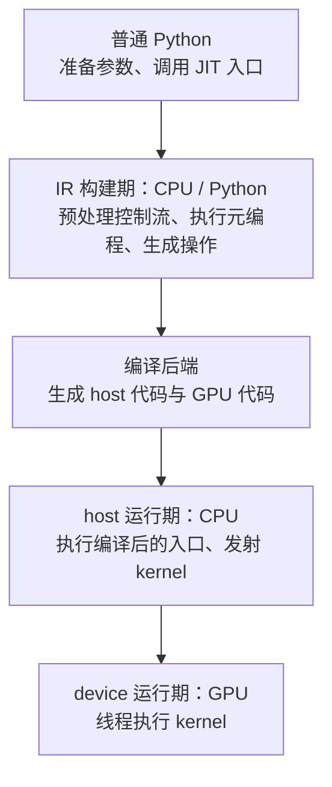
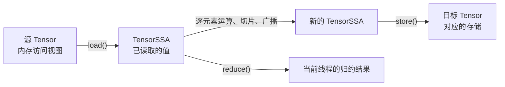
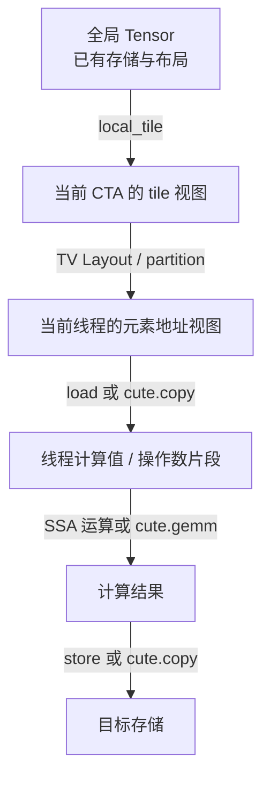
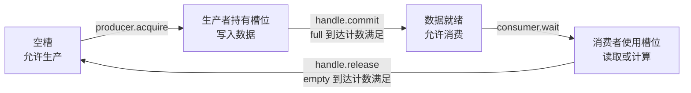
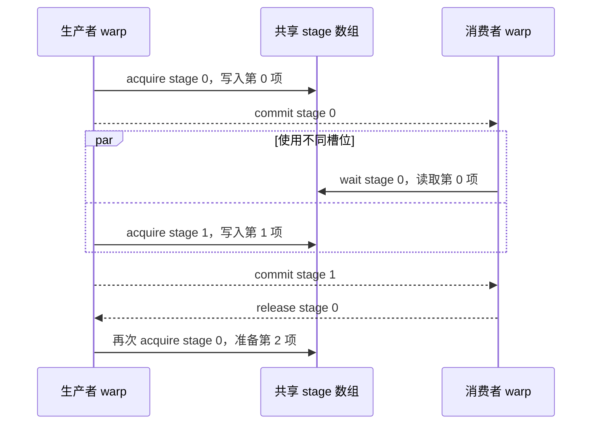

# CuTe Python DSL

已经熟悉 CUDA 和 C++ CuTe 后，学习 Python DSL 可以先关注一件事：**怎样用 Python 构建熟悉的 GPU 程序，以及哪些代码在构建程序时执行、哪些代码留到程序运行时执行。** Layout、线程分区和数据搬运等概念可以直接沿用，后续再逐步补充它们对应的 Python 接口。

## 从 Hello World 理解编译与执行

本章参考 CUTLASS 的 [hello_world.ipynb](https://github.com/NVIDIA/cutlass/blob/main/examples/python/CuTeDSL/cute/notebooks/hello_world.ipynb)，本地位置为 `examples/python/CuTeDSL/cute/notebooks/hello_world.ipynb`，在最小程序的基础上补充函数调用关系和参数特化。对照阅读可以使用本站的 [Triton 基础概念](/blog/gpu-programming/triton-basic-concepts)。

### 安装与版本

本文示例在 Linux、Python 3.10 和 `nvidia-cutlass-dsl` **4.4.2** 下验证。建议先创建并激活虚拟环境，再安装对应版本：

```shell
# 安装本文使用的 CuTe DSL 版本，默认对应 CUDA 12.9。
python -m pip install "nvidia-cutlass-dsl==4.4.2"
```

使用 CUDA 13.1 时，可改为 `python -m pip install "nvidia-cutlass-dsl[cu13]==4.4.2"`。运行示例需要兼容的 NVIDIA GPU 和驱动；具体要求参见 [官方安装说明](https://docs.nvidia.com/cutlass/4.4.2/media/docs/pythonDSL/quick_start.html)。若需要打开 notebook，再安装 `jupyter` 即可。

原 notebook 使用 `if cutlass.dynamic_expr(tidx == 0)`。在本章使用的版本中，`dynamic_expr` 已标记弃用；默认预处理模式下，直接写 `if tidx == 0` 就能生成运行期分支。下面统一采用这个写法。

### 一个完整的最小程序

先把程序保存为 `hello_world.py`。它只发射一个 CTA，每个 CTA 有 32 个线程，由线程 0 打印问候语。

```python
"""验证 CuTe DSL 的最小 host/device 程序。"""

from cuda.bindings import driver as cuda

import cutlass
import cutlass.cute as cute


@cute.kernel
def hello_kernel() -> None:
    """在 GPU 上由第一个线程输出问候语。"""
    tidx, _, _ = cute.arch.thread_idx()  # 获取当前 GPU 线程的 x 坐标。
    if tidx == 0:  # 生成运行期分支，让一个线程负责输出。
        cute.printf("[device] Hello world")  # GPU 执行到这里时输出。


@cute.jit
def hello_world() -> None:
    """在 host 上输出消息，并异步发射一个 GPU kernel。"""
    cute.printf("[host] Hello world")  # 编译后的 host 函数运行时输出。
    hello_kernel().launch(
        grid=(1, 1, 1),  # 发射一个 CTA。
        block=(32, 1, 1),  # CTA 内包含一个 warp。
    )


def main() -> None:
    """初始化 CUDA 上下文，执行两种调用方式并等待 GPU 完成。"""
    cutlass.cuda.initialize_cuda_context()  # 为独立脚本建立 CUDA 上下文。
    hello_world()  # 按需编译并执行 host 入口。
    cutlass.cuda.checkCudaErrors(cuda.cuCtxSynchronize())  # 等待 GPU 输出完成。
    compiled_hello = cute.compile(hello_world)  # 显式编译，此处不执行函数。
    compiled_hello()  # 执行已经编译的 host 函数。
    cutlass.cuda.checkCudaErrors(cuda.cuCtxSynchronize())  # 等待第二次发射完成。


if __name__ == "__main__":
    main()  # 普通 Python 负责程序入口和资源初始化。
```

运行命令：

```shell
python hello_world.py
```

两次执行分别输出：

```shell
[host] Hello world
[device] Hello world
[host] Hello world
[device] Hello world
```

这里有三个容易忽略的细节：

- **`.launch()` 才表达 kernel 发射。** `hello_kernel()` 在 DSL 构建上下文中准备 kernel 调用，随后 `.launch(grid=..., block=...)` 生成 host 侧的发射操作。
- **`grid` 与 `block` 使用 CUDA 的维度语义。** `grid=(1, 1, 1)` 表示一个 CTA，`block=(32, 1, 1)` 表示每个 CTA 有 32 个线程；`tidx` 对应 `threadIdx.x`。
- **发射默认是异步的。** `cuCtxSynchronize()` 在这里用于等待 GPU 完成并收集设备输出，方便观察执行边界；它不属于每次 kernel 发射都必须附加的操作。此版本的 `cute.printf` 会自动添加换行，无须再写 `\n`。


### 发射参数：共享内存大小与 cluster

除了 `grid` 和 `block`，常见的发射配置还包括 `smem`、`cluster` 与 `stream`。这些参数写在 host JIT 函数的 `.launch(...)` 中，与传进 kernel 的函数参数分开：

| 参数 | 写法示例 | 含义 |
| --- | --- | --- |
| `grid` | `grid=(8, 1, 1)` | 整个 grid 的 CTA 数量，设置 cluster 后仍按 CTA 计数。 |
| `block` | `block=(128, 1, 1)` | 每个 CTA 的线程数量。 |
| `smem` | `smem=4096` | **每个 CTA** 的动态共享内存容量，单位为字节。 |
| `cluster` | `cluster=(2, 1, 1)` | 每个 Thread Block Cluster 包含的 CTA 维度；省略时不显式配置 cluster。 |
| `stream` | `stream=stream` | 发射使用的 CUDA stream，可从 host 入口传入。 |

`smem` 省略或写为 `None` 时，DSL 会根据 kernel 内 `SmemAllocator` 的使用量自动推导所需的动态共享内存；显式写 `0` 则指定零字节，不能把它当作自动推导的写法。显式数值需要覆盖该 kernel 使用的动态区，包括多块分配之间的对齐填充。分配与指针访问的完整代码见后面的“共享内存分配与指针视图”。

沿用前面的 `hello_kernel`，cluster 发射可以这样写。**此片段需要支持 Thread Block Cluster 的 GPU 与编译目标，例如 Hopper sm_90。**

```python
@cute.jit
def cluster_entry(cluster_shape: cutlass.Constexpr) -> None:
    """按构建期指定的 cluster 形状发射 8 个 CTA。"""
    hello_kernel().launch(
        grid=(8, 1, 1),  # 总共 8 个 CTA，不是 8 个 cluster。
        block=(32, 1, 1),  # 每个 CTA 有 32 个线程。
        cluster=cluster_shape,  # 传入 (2,1,1) 时，每个 cluster 包含 2 个 CTA，共有 4 个 cluster。
        smem=0,  # hello_kernel 不使用动态共享内存。
    )
```

cluster 配置中，grid 各维应是对应 cluster 维度的整数倍，cluster 大小还要满足设备限制。`cluster=(2,1,1)` 会把 CTA 组织为 cluster，但不会自动生成跨 CTA 的数据交换或同步；共享内存容量依然按**每个 CTA** 指定，不是整个 cluster 的总量。[CUDA Thread Block Cluster 说明](https://docs.nvidia.com/cuda/cuda-programming-guide/05-appendices/cpp-language-extensions.html)

在支持的 GPU 上，调用 `cluster_entry((2, 1, 1))` 即可按需编译并执行。也可以先 `compiled = cute.compile(cluster_entry, (2, 1, 1))`，再执行 `compiled()`；这里的 cluster 形状是 constexpr 参数，不进入显式编译对象的运行时参数列表。

这几个发射配置也不需要一律标成 `Constexpr`。例如，`grid` 的 CTA 数量与 `smem` 的字节数都可以来自 host 运行期的 `cutlass.Int32` 参数；本例的线程数和 cluster 形状则使用构建期已知的配置。它们何时确定，取决于传入值的来源与接口约束。

### 普通 Python、host 入口与 GPU kernel

CuTe DSL 的两个装饰器承担不同职责：

| 写法 | 从普通 Python 调用时的作用 | 放在 DSL 函数内部调用时的作用 |
| --- | --- | --- |
| 普通 Python 函数 | Python 解释器执行，适合准备数据和组织程序。 | 在 IR 构建期执行，可计算静态元信息，也可通过 DSL 操作生成 IR。 |
| `@cute.jit` | 作为 JIT 入口，编译并执行 host 函数。 | 作为 helper 在构建期展开，把操作内联到当前 host 或 device 上下文。 |
| `@cute.kernel` | 不能在普通 Python 中直接按 `.launch()` 模式发射。 | 从 host JIT 函数中通过 `.launch()` 生成 GPU 发射操作。 |

因此，**`@cute.jit` 既可以定义 host 入口，也可以定义 GPU kernel 使用的内联 helper**。它的执行位置需要结合调用上下文判断，不能只凭装饰器名字判断。

在本例中，`hello_world` 是 host 入口，`hello_kernel` 是 GPU kernel，`main` 是普通 Python 函数。最常见的组织方式就是：Python 准备参数 → host JIT 函数发射 → GPU kernel 执行。

完整的调用关系如下，规则对应 [CuTe DSL 官方调用关系说明](https://docs.nvidia.com/cutlass/4.4.2/media/docs/pythonDSL/cute_dsl_general/dsl_introduction.html#calling-conventions)：

| 调用方 | 被调用方 | 是否支持 | 具体含义 |
| --- | --- | --- | --- |
| 普通 Python | 普通 Python | 支持 | 普通解释执行。 |
| 普通 Python | `@cute.jit` | 支持 | 进入 DSL 的编译与 host 执行路径。 |
| 普通 Python | `@cute.kernel` | 不支持直接发射 | 需要由 host JIT 入口生成 launch。 |
| `@cute.jit` | 普通 Python | 支持 | 在 IR 构建期调用 Python helper。 |
| `@cute.jit` | `@cute.jit` | 支持 | helper 在构建期展开，操作进入当前上下文。 |
| host `@cute.jit` | `@cute.kernel` | 支持 | `.launch()` 生成运行期 GPU 发射。 |
| `@cute.kernel` | 普通 Python | 支持 | 在 IR 构建期调用 Python helper。 |
| `@cute.kernel` | `@cute.jit` | 支持 | helper 内联生成 device 操作，不额外发射 kernel。 |
| `@cute.kernel` | `@cute.kernel` | 不支持 | 不能通过这种写法在设备端嵌套发射 kernel。 |

这里的“普通 Python helper 在构建期执行”有一个约束：**它不会自动获得被装饰函数的控制流预处理能力。** 它可以处理 Python 静态值，也可以对 DSL 代理值调用重载算术或 DSL API；若需要根据动态值写 `if`、`for` 等控制流，应把这段逻辑写在受预处理的 DSL 函数中。

### 编译期与运行期的三个阶段

JIT（即时编译）通常在程序运行过程中触发，所以“Python 程序正在运行”和“GPU kernel 已经在运行”是两回事。本文把执行过程划分为三个阶段：



Python 先参与生成 IR（中间表示），再由后端编译。运行时执行的是生成的 host/device 程序；GPU 上不需要 Python 解释器逐行执行这些源代码。

**构建 IR 时，动态参数表现为代理值，而不是这次调用传进来的具体数值。** 例如 `value * 2` 可以生成一个乘法操作，但此时 Python 无法通过代理读到 GPU 最终使用的 `value`。

同一份 DSL 源码里可以混合静态计算和动态操作：Python 已知的常量在构建期求值，依赖 IR 值的运算生成代码。判断一条语句何时执行，需要看它使用的值和调用的接口，不能仅凭它出现在 `@cute.kernel` 函数体里就断定是在 GPU 上执行。

### 用 `print` 和 `cute.printf` 观察边界

这两个打印接口可以帮助区分执行阶段：

| 所在位置与接口 | 执行阶段 | 能观察什么 |
| --- | --- | --- |
| 普通 Python 中的 `print(...)` | Python 解释执行时 | 真实的 Python 对象和值。 |
| DSL 函数中的普通 `print(...)` | IR 构建期 | Python 静态值，或动态值的类型/代理表示。 |
| host JIT 入口中的 `cute.printf(...)` | 编译后的 host 函数运行期 | 传入 host 函数的实际运行时值。 |
| kernel 或内联 device helper 中的 `cute.printf(...)` | GPU 运行期 | 当前 GPU 线程中的实际值。 |

例如在 `@cute.kernel` 内写 `print("value =", value)`，输出可能是 `?`，表示构建期还没有实际数值。改用 `cute.printf("value={}", value)`，才会在设备执行时输出对应值。

**`cute.printf` 的执行位置取决于生成操作所在的上下文。** 最小示例中的 `[host]` 和 `[device]` 使用同一个 API，却分别来自 CPU 和 GPU。

另外，不能只根据构建期 `print` 是否重复出现判断是否重新编译：**4.4.2 的隐式 JIT 会重新生成 IR 来检查程序是否变化，即使随后命中编译缓存，构建期打印仍可能重复。** 命中缓存跳过的是后端编译，不等于跳过所有 Python 元编程。后面的实验使用显式编译对象，把“构建一次”和“执行多次”分开观察。[官方缓存边界说明](https://docs.nvidia.com/cutlass/4.4.2/media/docs/pythonDSL/cute_dsl_general/dsl_jit_caching.html#limitations)

### `cutlass.Constexpr` 与运行时参数

对于从 Python 进入的 JIT 入口，普通标量参数默认按动态参数处理；用 `cutlass.Constexpr` 明确标记的参数则作为编译期静态值。类型注解还参与参数类型检查。[官方 JIT 参数说明](https://docs.nvidia.com/cutlass/4.4.2/media/docs/pythonDSL/cute_dsl_general/dsl_jit_arg_generation.html)

| 参数形式 | 编译期如何使用 | 运行期如何使用 | 常见用途 |
| --- | --- | --- | --- |
| `value: cutlass.Int32` | 构建一个整数 IR 参数，具体数值未知。 | 调用编译对象时传入实际整数。 | 数据长度、运行时计数、偏移等。 |
| `alpha: cutlass.Float32` | 构建浮点 IR 参数。 | 每次执行可传入不同系数。 | 缩放系数等。 |
| `scale: cutlass.Constexpr` | Python 直接获得静态值，并据此构建代码。 | 不作为独立运行时参数传入。 | 特化配置、静态分支、tile 大小等。 |
| `num_threads: cutlass.Constexpr = 32` | 本例选择把线程数固定为静态配置。 | 发射使用该特化版本确定的配置。 | 配合固定线程布局生成代码。 |

需要区分几个问题：

- **调用时传入字面量，不代表参数自动变成 `Constexpr`。** 下面的实验给 `value: cutlass.Int32` 传入 `7`，它仍然是动态参数。`int` 这类普通类型注解也不能代替 `cutlass.Constexpr`。
- **默认参数值不等于编译期参数。** `num_threads` 的静态属性来自 `cutlass.Constexpr` 标注，默认值 `32` 只是 Python 的调用规则。
- **静态参数也可以参与运行期运算。** `value * scale` 中的 `value` 是动态值，因此乘法仍由生成的代码执行；只是 `scale` 已被固定为常量。
- **动态参数不是一个任意类型都能通用的接口。** 编译对象仍要求兼容的参数类型。Tensor 还可能同时包含静态布局信息与动态指针、shape/stride；具体哪些信息静态，要看该对象的构造方式，后续 Tensor 章节再展开。

也不能简单按变量名称判断：`N` 可以是运行时尺寸，也可以为了特化而标记为静态尺寸；`alpha` 可以动态传入，也可以固定到代码中。选择取决于是否需要按这个值生成不同结构的代码，以及这个值在实际调用中变化有多频繁。

### 一个观察特化与参数复用的实验

下面用 `result = value * scale + (scale + 1)` 串起调用关系：

- `value` 是动态整数，在 host 与 GPU 运行期都可以读到实际值。
- `scale` 是静态整数，普通 Python helper 用它在构建期计算 `bias`。
- `affine_value` 是 `@cute.jit` helper，由 GPU kernel 调用后内联生成乘加操作。
- `num_threads` 是本例选定的静态发射配置。线程数不一定在所有程序中都必须采用这种标注。

保存为 `compile_boundary.py`：

```python
"""观察普通 Python、内联 JIT helper、静态参数与动态参数的边界。"""

from cuda.bindings import driver as cuda

import cutlass
import cutlass.cute as cute


def make_bias(scale: int) -> int:
    """在构建 IR 时用普通 Python 计算静态偏置。"""
    print(f"[build] Python helper: scale={scale}", flush=True)  # 构建期输出。
    return scale + 1  # 输入为 Python 整数，计算也在 Python 中完成。


@cute.jit
def affine_value(
    value: cutlass.Int32,
    scale: cutlass.Constexpr,
    bias: cutlass.Constexpr,
) -> cutlass.Int32:
    """内联到调用处，生成整数乘加操作；不独立发射 kernel。"""
    return value * scale + bias  # value 是 IR 值，乘加留给生成的代码执行。


@cute.kernel
def inspect_kernel(
    value: cutlass.Int32,
    scale: cutlass.Constexpr,
) -> None:
    """由第一个 GPU 线程计算并输出动态值与静态配置的乘加结果。"""
    bias = make_bias(scale)  # 普通 Python helper 在 IR 构建期返回静态值。
    print(f"[build] kernel: scale={scale}, bias={bias}", flush=True)  # 构建期输出。
    print("[build] value =", value, flush=True)  # 看到 IR 代理，无法读到 GPU 数值。
    tidx, _, _ = cute.arch.thread_idx()  # 线程编号由 GPU 运行时提供。
    if tidx == 0:  # 这个条件生成 GPU 运行期分支。
        result = affine_value(value, scale, bias)  # JIT helper 在这里内联生成操作。
        cute.printf("[device] value={}, scale={}, result={}", value, scale, result)  # GPU 输出实际计算结果。


@cute.jit
def inspect_entry(
    value: cutlass.Int32,
    scale: cutlass.Constexpr,
    num_threads: cutlass.Constexpr = 32,
) -> None:
    """生成 host 发射逻辑，并固定本次特化使用的 scale 和线程数。"""
    print(f"[build] entry: scale={scale}, num_threads={num_threads}", flush=True)
    cute.printf("[host] value={}", value)  # host 运行期可以读到真实标量。
    inspect_kernel(value, scale).launch(
        grid=(1, 1, 1),  # 固定发射一个 CTA。
        block=(num_threads, 1, 1),  # 本例把 CTA 线程数作为编译期配置。
    )


def main() -> None:
    """显式编译两个特化版本，并复用第一个版本处理不同运行时值。"""
    cutlass.cuda.initialize_cuda_context()  # 创建运行示例需要的 CUDA 上下文。
    print("[python] compile scale=2", flush=True)  # 普通 Python 运行期输出。
    compiled_scale_2 = cute.compile(inspect_entry, 7, 2, 32)  # 7 用于提供参数类型。
    print("[python] run value=7", flush=True)  # 开始执行已经编译的版本。
    compiled_scale_2(7)  # 只传动态参数；scale 和 num_threads 已被固定。
    cutlass.cuda.checkCudaErrors(cuda.cuCtxSynchronize())  # 等待本次 GPU 工作完成。
    print("[python] run value=9", flush=True)  # 更换动态值，复用相同代码。
    compiled_scale_2(9)  # 输出 9 * 2 + 3 = 21。
    cutlass.cuda.checkCudaErrors(cuda.cuCtxSynchronize())  # 分隔两次发射的输出。
    print("[python] compile scale=3", flush=True)  # 为新的静态配置生成另一版本。
    compiled_scale_3 = cute.compile(inspect_entry, 7, 3, 32)  # 新版本固定 scale=3。
    compiled_scale_3(7)  # 输出 7 * 3 + 4 = 25。
    cutlass.cuda.checkCudaErrors(cuda.cuCtxSynchronize())  # 等待所有 GPU 输出完成。


if __name__ == "__main__":
    main()  # 从普通 Python 进入编译与执行实验。
```

运行命令：

```shell
python compile_boundary.py
```

本地验证得到以下输出：

```shell
[python] compile scale=2
[build] entry: scale=2, num_threads=32
[build] Python helper: scale=2
[build] kernel: scale=2, bias=3
[build] value = ?
[python] run value=7
[host] value=7
[device] value=7, scale=2, result=17
[python] run value=9
[host] value=9
[device] value=9, scale=2, result=21
[python] compile scale=3
[build] entry: scale=3, num_threads=32
[build] Python helper: scale=3
[build] kernel: scale=3, bias=4
[build] value = ?
[host] value=7
[device] value=7, scale=3, result=25
```

这个实验可以从三个角度阅读：

- **构建期知道什么：** `scale=2`、`bias=3` 都是具体 Python 值，`value` 却显示为 `?`。虽然编译调用传入了 `7`，它只用于描述动态参数的类型，并没有被固定到代码中。
- **运行期能改变什么：** `compiled_scale_2(7)` 和 `compiled_scale_2(9)` 使用同一个编译对象，结果随动态参数变化；执行过程中没有再次调用 Python helper 构建 IR。
- **更换静态配置如何处理：** 要使用 `scale=3`，需要编译另一个配置对应的版本。本例固定偏置也随之变为 `4`。

### 显式编译对象的参数签名

`cute.compile` 与直接调用 JIT 入口的区别是：**它完成编译并返回一个可调用的 JIT Executor，不执行编译后的 host 函数。** 若入口包含 kernel 发射，相关设备代码也在这个过程中准备好。

本例的编译调用与执行调用分别是：

```python
# 构建程序时提供动态参数的类型样例，以及需要固定的静态配置。
compiled_scale_2 = cute.compile(inspect_entry, 7, 2, 32)

# 执行时只提供动态参数：Constexpr 参数已经从运行时签名中移除。
compiled_scale_2(9)
```

`compiled_scale_2` 已经固定 `scale=2` 和 `num_threads=32`，不能通过 `compiled_scale_2(9, 3, 32)` 来更换它们。若要更换静态配置，应构建对应版本；若希望每次执行都能更换 `scale`，就应将它设计成动态参数，例如 `scale: cutlass.Int32`。

直接调用 `inspect_entry(7, 2, 32)` 则会进入隐式 JIT 路径：根据参数描述构建程序，查询编译缓存，并执行 host 入口。`cute.compile` 提供显式编译路径，返回的 Executor 可直接复用；此版本中它会绕过隐式编译缓存，因此不应为了复用同一个版本而在循环里重复调用 `cute.compile`。[官方 JIT 缓存与 Executor 说明](https://docs.nvidia.com/cutlass/4.4.2/media/docs/pythonDSL/cute_dsl_general/dsl_jit_caching.html)

原 notebook 还演示了在显式编译时保存设备产物：

```python
from cutlass.cute import KeepCUBIN, KeepPTX

# 为 Hello World 保留 PTX 和 CUBIN，便于检查生成的 GPU 代码。
compiled_with_dumps = cute.compile[KeepPTX, KeepCUBIN](hello_world)
```

PTX 是设备指令的中间表示，CUBIN 是设备二进制。后面遇到访存、线程分区或向量化问题时，可以使用这些产物核对 DSL 最终生成了什么代码。

### 静态参数与静态控制流是两个接口

`cutlass.Constexpr` 用于声明参数的静态属性；`cutlass.const_expr(...)` 用于明确要求条件在构建期求值。两者名字相似，作用位置不同。

```python
@cute.kernel
def debug_kernel(
    value: cutlass.Int32,
    enable_debug: cutlass.Constexpr,
) -> None:
    """按静态开关决定是否生成 GPU 调试输出。"""
    if cutlass.const_expr(enable_debug):  # 构建期选择是否生成这段代码。
        tidx, _, _ = cute.arch.thread_idx()  # 静态开关打开时才生成线程编号操作。
        if tidx == 0:  # GPU 运行期决定当前线程是否输出。
            cute.printf("value={}", value)  # 设备运行时读取真实数值。
```

当 `enable_debug=False` 时，不会为这段分支生成调试输出；当它为 `True` 时，生成的代码再根据运行期 `tidx` 决定哪个线程输出。

`cutlass.const_expr` 不能把动态值“变成常量”。例如 `cutlass.const_expr(value > 0)` 依赖动态参数，无法在构建期确定，应直接使用普通动态 `if`。

循环也要区分相同的边界：默认预处理模式下，`range(...)` 和 `cutlass.range(...)` 生成 IR 循环，而 `cutlass.range_constexpr(...)` 在构建期展开，要求边界是静态值。后续再结合具体算子讨论展开与软件流水线。[官方控制流说明](https://docs.nvidia.com/cutlass/4.4.2/media/docs/pythonDSL/cute_dsl_general/dsl_control_flow.html)

### 与 Triton 的 JIT 和 constexpr 对照

两种 DSL 都通过 Python 源码生成 GPU 程序，也都允许使用静态参数进行特化；具体的函数职责与执行模型需要分别理解。

| 对比项 | CuTe DSL | Triton |
| --- | --- | --- |
| host 组织逻辑 | 普通 Python 加上 `@cute.jit` host 入口。 | 常见模式是普通 Python wrapper 组织数据和发射。 |
| GPU kernel | 用 `@cute.kernel` 定义。 | 用 `@triton.jit` 定义，通过 launch 语法发射。 |
| 内联计算 helper | 可使用 `@cute.jit`，展开到调用处的 host/device 上下文。 | 可使用 `@triton.jit` helper，由其他 JIT 函数调用；不是每个 JIT 函数都独立发射。 |
| kernel 发射 | host JIT 函数中 `kernel(...).launch(grid=..., block=...)`。 | Python 中 `kernel[grid](..., num_warps=...)`。 |
| 静态参数 | `config: cutlass.Constexpr`。 | `CONFIG: tl.constexpr`。 |
| 动态参数 | 本章用 `value: cutlass.Int32` 显式标注。 | 例如向量加法中的 `n_elements`，不是 `tl.constexpr`。 |
| 静态分支 | 用 `if cutlass.const_expr(condition)` 明确表达。 | 对 constexpr 条件的分支可在编译期选择。 |
| 编译期输出 | DSL 函数中的普通 Python `print`。 | `tl.static_print`。 |
| GPU 运行期输出 | device 上下文中的 `cute.printf`。 | `tl.device_print`，JIT 函数中的普通 `print` 也映射到设备打印。 |
| 线程组织 | 显式 `thread_idx`、CTA 线程数和 CuTe 线程布局。 | 常用 program 与逻辑向量描述，编译器负责线程映射。 |

Triton 的 kernel 与 helper 都使用 `@triton.jit`；CuTe 则用 `@cute.kernel` 明确标记设备入口，并让 `@cute.jit` 同时承担 host 入口和内联 helper 的职责。两者都有 JIT，不代表装饰器可以一一替换。[Triton JIT 接口](https://triton-lang.org/main/python-api/generated/triton.jit.html)

已有 Triton 文章中的 `BLOCK_SIZE: tl.constexpr` 决定 `tl.arange` 的逻辑元素数量，CuTe 示例中的 `num_threads: cutlass.Constexpr` 决定这个 CTA 的实际线程数。**二者都是静态配置，但配置的对象不同。** Triton 的 `BLOCK_SIZE` 不等于 CUDA `blockDim.x`；CuTe 的 `block=(32, 1, 1)` 则直接使用 CUDA 线程维度。[Triton 官方向量加法示例](https://triton-lang.org/main/getting-started/tutorials/01-vector-add.html)

迁移调试习惯时尤其需要注意打印接口：**CuTe DSL 里的普通 `print` 用于观察构建期，Triton JIT 里的普通 `print` 映射到设备运行期打印。** 在 Triton 中要观察静态配置，应显式使用 `tl.static_print`。[Triton 静态打印说明](https://triton-lang.org/main/python-api/generated/triton.language.static_print.html)、[设备打印说明](https://triton-lang.org/main/python-api/generated/triton.language.device_print.html)

静态参数能够影响形状、常量折叠和生成的代码结构，动态参数则保留运行时可变性；但**动态参数不意味着任何变化都不会影响特化**。类型、Tensor 的静态布局以及编译配置等信息仍可能决定编译版本，Triton 也可能根据运行时参数的某些属性进行特化。本章实验能保证的是：已经取得的同一个 CuTe Executor 可以接收兼容类型的不同 `value`。

## 数据类型：Python 值与 DSL 标量

本章参考 [data_types.ipynb](https://github.com/NVIDIA/cutlass/blob/main/examples/python/CuTeDSL/cute/notebooks/data_types.ipynb)，继续使用第一章验证过的 CuTe DSL **4.4.2**。重点是数值类型的写法：类型怎样声明、数值怎样转换，以及 Python 运算符怎样作用在 DSL 标量上。

这里需要同时回答两个问题：**这个值用什么数值类型表示？这个值在构建期是否已知？** `Int32` 回答前一个问题，动态参数或静态常量的来源回答后一个问题。不能把两者合成“凡是 `cutlass` 类型就一定是未知的运行时数据”。

### 类型对象、标量对象与参数标注

`cutlass.Int32` 和 `cutlass.Int32(5)` 的用途不同：

| 写法 | 表示什么 | 常见用途 |
| --- | --- | --- |
| `cutlass.Int32` | 一个 DSL 数值类型对象。 | 参数标注、指定转换目标、读取位宽。 |
| `cutlass.Int32(5)` | 一个类型为 `Int32` 的 DSL 标量对象。 | 构造带明确位宽的常量，参与数值运算。 |
| `value: cutlass.Int32` | JIT 参数的类型声明。 | 让编译器把该入口参数按动态 32 位整数处理。 |
| `config: cutlass.Constexpr` | 参数的静态属性声明。 | 让构建期获得具体 Python 值或对象，不限定它只能是整数。 |

例如，类型本身可以保存在 Python 变量里：

```python
import cutlass

dtype = cutlass.Int32  # 保存类型对象，不构造标量，也不分配 Tensor。
scalar = dtype(5)  # 用类型对象构造一个已知的 Int32 常量标量。
print(dtype.width)  # 输出 32，单位是 bit。
print(scalar.dtype)  # 输出 Int32，返回的是类型对象。
```

这里的 `scalar` 描述一个标量值，并没有创建 PyTorch Tensor 或分配显存。后面创建 Tensor、寄存器 fragment 和共享内存时，才会把数值类型与具体数据组织方式结合起来。

### 常用数值类型

CuTe DSL 用 `Numeric` 表示数值类型的公共基础，整数与浮点类型分别属于 `Integer`、`Float` 家族。实际写代码时通常使用具体类型，例如 `cutlass.Int32`、`cutlass.Float32`。

先记住常用的整数和布尔类型：

| 类型 | 位宽 | 数值语义与用途 |
| --- | --- | --- |
| `cutlass.Boolean` | 1 | 比较结果与运行期谓词；这是逻辑位宽，不能据此推断 Tensor 的物理存储一定逐 bit 打包。 |
| `cutlass.Int8` | 8 | 有符号整数，范围为 `[-128, 127]`。 |
| `cutlass.Int16` | 16 | 有符号整数，适合需要明确 16 位表示的数据。 |
| `cutlass.Int32` | 32 | 常用的计数、线程索引与整数计算类型。 |
| `cutlass.Int64` | 64 | 需要更大数值范围的整数与偏移计算。 |
| `cutlass.Uint8` / `Uint16` / `Uint32` / `Uint64` | 8 / 16 / 32 / 64 | 对应的无符号整数；注意标识符写作 `Uint`。 |

Python 的 `int` 可以表示任意精度整数，DSL 的整数则受位宽约束。选择 `Int32` 或 `Int64` 时，要根据参与计算的数值范围判断，尤其是尺寸乘积和地址偏移。

Notebook 还列出了 `Int128`、`Uint128`，但验证环境的 4.4.2 包没有从 `cutlass` 顶层导出这两个名字。本章示例只使用已核对的常用接口，不能直接假设仓库中的类型列表与安装包完全一致。

浮点类型主要对应已经熟悉的 GPU 精度格式：

| 类型 | 位宽 | 对应格式与用途 |
| --- | --- | --- |
| `cutlass.Float16` | 16 | FP16，常用于输入数据。 |
| `cutlass.BFloat16` | 16 | BF16，与 FP16 的指数范围和精度不同。 |
| `cutlass.Float32` | 32 | FP32，常用于标量计算与累加。 |
| `cutlass.Float64` | 64 | FP64，需要更高精度的计算。 |
| `cutlass.TFloat32` | 32 | TF32 类型标识，主要服务于特定 Tensor Core 计算路径。 |
| `cutlass.Float8E4M3` / `Float8E5M2` | 8 | FP8 的两种格式，具体转换与运算支持依赖接口和目标架构。 |

类型的存在不代表所有构造、转换和算术操作都支持它。FP8 等窄精度类型需要结合具体设备接口使用，本章先用 `Int32`、`Float32` 和整数窄化建立基础。格式的位布局与精度取舍可以对照 [GPU 常见精度类型笔记](/blog/gpu-programming/precision-type-in-gpu)。

### 数值类型与静态性是两个维度

在 DSL 函数中，下面几种值需要分别理解：

| 值的来源 | 数值类型 | 构建期是否能读到具体值 |
| --- | --- | --- |
| 局部 Python 表达式 `5 + 2` | Python `int` | 能，Python 直接算出 `7`。 |
| 局部构造 `cutlass.Int32(5)` | DSL `Int32` | 这是由 Python 数值构造的已知常量；本版本可以通过 `.to(int)` 得到 `5`。 |
| 入口参数 `value: cutlass.Int32` | DSL `Int32` | 不能，只能看到动态参数的代理。 |
| 入口参数 `scale: cutlass.Constexpr` | 由传入的 Python 值或对象决定 | 能，静态值用于生成特化代码。 |
| 表达式 `value * scale` | 本例中为 DSL `Int32` | 不能，依赖动态参数，生成运行期运算。 |

**`cutlass.Int32(5)` 指定了数值表示，并不意味着 Python 已经知道的 `5` 突然变成了外部动态输入。** 由字面量形成的表达式还可以在构建期求值或被编译器折叠；动态参数则需要运行时提供。

这里还有一个打印细节：4.4.2 的 `Numeric` 标量字符串常显示为 `?`。**`print` 的代理表示不能单独用来判断常量是否已知。** 原 notebook 的注释说 `Int32(5)` 打印为 `5`，但保存的实际输出是 `?`，下面用完整实验说明这个区别。

保存为 `scalar_values.py`：

```python
"""观察 Python 常量、DSL 常量标量和动态参数的区别。"""

import cutlass
import cutlass.cute as cute


@cute.jit
def inspect_scalars(
    value: cutlass.Int32,
    scale: cutlass.Constexpr,
) -> None:
    """在构建期检查类型，并在 host 运行期输出动态计算结果。"""
    native = 5 + 2  # 两个 Python 整数在构建期求值得到 7。
    dtype = cutlass.Int32  # 保存静态类型对象，尚未构造标量。
    literal = dtype(5)  # 构造一个类型为 Int32 的已知常量标量。
    result = value * scale  # 动态参数参与计算，生成运行期乘法。
    print("[build] native =", native, flush=True)  # 输出 Python 静态数值。
    print("[build] literal =", literal, flush=True)  # 此版本的标量字符串显示为 ?。
    print("[build] literal dtype =", literal.dtype, flush=True)  # 检查标量的数值类型。
    print("[build] dtype width =", dtype.width, flush=True)  # 位宽是编译期元信息。
    print("[build] literal as Python =", literal.to(int), flush=True)  # 已知常量可转为 Python 值。
    print("[build] value =", value, flush=True)  # 动态参数的实际值在构建期不可读。
    print("[build] result dtype =", result.dtype, flush=True)  # 动态结果的类型已知。
    cute.printf("[host] value={}, result={}", value, result)  # host 运行期输出实际值。


def main() -> None:
    """显式编译一次，然后用两个动态输入执行同一份 host 程序。"""
    compiled = cute.compile(inspect_scalars, 7, 2)  # 固定 scale=2，保留动态 value。
    compiled(7)  # 执行时只传动态参数，得到 14。
    compiled(9)  # 复用编译对象，得到 18。


if __name__ == "__main__":
    main()  # 本例只执行 host 标量逻辑，不发射 GPU kernel。
```

运行命令：

```shell
python scalar_values.py
```

验证输出如下：

```shell
[build] native = 7
[build] literal = ?
[build] literal dtype = Int32
[build] dtype width = 32
[build] literal as Python = 5
[build] value = ?
[build] result dtype = Int32
[host] value=7, result=14
[host] value=9, result=18
```

本例只执行编译后的 host 标量逻辑，不需要 `.launch()`；但运行 CuTe 编译路径仍需要满足第一章的 CUDA 驱动环境要求。

`literal.to(int)` 能返回 `5`，因为这个对象保留了由 Python 提供的常量值。**不能把同样的操作用在动态参数 `value` 上：** `value.to(int)` 会在构建期报错，它不能把运行时 IR 值读取为静态 Python 整数。这一点也适用于 `.to(float)`、`.to(bool)`；它们不是从 GPU 读取结果的接口。[数值类型与转换接口说明](https://docs.nvidia.com/cutlass/latest/media/docs/pythonDSL/basic_data_types.html#cutlass.Numeric.to)

### 用 `.to()` 做数值转换

Notebook 中最常用的转换写法是 `converted = value.to(target_type)`，例如 `value.to(cutlass.Float32)`。传入的是**目标类型对象**，返回转换后的标量；原来的 `value` 不会因此被修改。

| 转换 | 本章验证的行为 | 需要理解的语义 |
| --- | --- | --- |
| `Int32(10)` → `Float32` | 得到 `10.0`。 | 整数转浮点；更大的整数不一定能被 FP32 精确表示。 |
| `Float32(3.75)` → `Int32` | 得到 `3`。 | 在目标范围内向零截断，不是四舍五入。 |
| `Float32(-3.75)` → `Int32` | 得到 `-3`。 | 向零截断与向下取整不同。 |
| `Int32(127)` → `Int8` | 得到 `127`。 | 在目标范围内，数值保持不变。 |
| `Int32(128)` → `Int8` | 得到 `-128`。 | 窄化保留低 8 位，再按有符号整数解释。 |
| `Int32(300)` → `Int8` | 得到 `44`。 | 窄化不是饱和转换，`300` 的低 8 位是 `44`。 |

**数值转换不会重新解释同一段 bit 来假装得到另一种类型。** 整数 `42` 转为 FP32 后，结果是浮点数 `42.0`；这与 bitcast（位重解释）不同。转换目标的精度或范围不足时，数值可能改变。

原 notebook 对转换提到“可能 clamp”，但它的 `300 → Int8` 示例实际采用整数窄化。需要饱和行为时，应先明确限制数值范围，或使用具有饱和语义的专用转换接口，不能假设普通 `.to()` 会自动 clamp。

浮点转整数时，本章只讨论有限且位于目标范围内的输入。NaN、无穷大和超出范围的浮点值不能套用“保留整数部分”来推导可移植的结果。

### 运算符重载与结果类型

DSL 标量支持自然的 Python 表达式，但运算由数值类型的重载接口处理；依赖动态参数时会生成 IR 操作。

| 运算类别 | 常见写法 | 说明 |
| --- | --- | --- |
| 算术 | `+`、`-`、`*`、`/`、`//`、`%`、`**` | 结果类型由操作数类型和具体运算决定；支持范围需结合类型判断。 |
| 比较 | `<`、`<=`、`==`、`!=`、`>=`、`>` | 返回 DSL `Boolean`，可用于动态分支或谓词。 |
| 位运算 | `&`、`\|`、`^`、`<<`、`>>` | 用于整数标量，位宽和有符号属性会影响结果。 |
| 一元运算 | `-value`、`~value` | 分别表示数值取负和整数按位取反。 |

先掌握几个已经验证的常见结果类型：

| 表达式 | 4.4.2 的结果类型 | 解释 |
| --- | --- | --- |
| `Int32 + Int32` | `Int32` | 同类型整数相加。 |
| `Int32 + Float32` | `Float32` | 本例先转换到共同浮点类型再运算。 |
| `Float32 * 2` | `Float32` | Python 整数字面量可参与混合运算。 |
| `Int32 / Int32` | `Float32` | 真除法，结果不是整数商。 |
| `Int32 // Int32` | `Int32` | 整数商，本版本的有符号运算向下取整。 |
| `Int32 > Int32` | `Boolean` | 比较生成运行期谓词。 |
| `Float16(0.5) + 1` | `Float32` | 本版本的标量提升规则会把这个表达式提升到 FP32。 |

**不能仅凭变量名或某一个操作数的类型推断最终结果类型。** 不确定隐式提升时，先用 `print(result.dtype)` 在构建期观察类型，或显式转换操作数到期望类型。尤其不要假设“左侧是 FP16，所有与它相加的值就都会在 FP16 中计算”。

### 一个完整的 GPU 标量运算实验

下面将 notebook 的转换与运算示例放进真实 GPU kernel，并把输入作为动态参数传入。这样可以同时观察构建期已知的类型和运行期计算出来的数值。

保存为 `scalar_operations.py`：

```python
"""验证 CuTe DSL 标量转换、类型提升与 GPU 数值运算。"""

from cuda.bindings import driver as cuda

import cutlass
import cutlass.cute as cute


@cute.kernel
def numeric_kernel(
    numerator: cutlass.Int32,
    denominator: cutlass.Int32,
    real: cutlass.Float32,
) -> None:
    """由线程 0 输出动态输入的转换和运算结果，要求 denominator 非零。"""
    as_float = numerator.to(cutlass.Float32)  # 数值转换，保留数值语义。
    as_int = real.to(cutlass.Int32)  # 对范围内的浮点数向零截断。
    as_int8 = numerator.to(cutlass.Int8)  # 保留低 8 位，并按有符号整数解释。
    sum_result = numerator + denominator  # 两个 Int32 相加，结果仍为 Int32。
    scaled_real = real * 2  # Python 整数字面量可与 DSL 浮点标量混合运算。
    mixed_result = numerator + real  # 本例 Int32 与 Float32 运算得到 Float32。
    quotient = numerator / denominator  # 真除法，本例结果为 Float32。
    floor_quotient = numerator // denominator  # 有符号整数的商向下取整。
    remainder = numerator % denominator  # 动态有符号整数余数，留意负数语义。
    is_greater = numerator > denominator  # 比较结果为 cutlass.Boolean。
    bit_and = numerator & denominator  # 整数按位与。
    half_plus_literal = cutlass.Float16(0.5) + 1  # 此版本中结果提升为 Float32。
    print("[build] quotient dtype =", quotient.dtype, flush=True)  # 类型在构建期已知。
    print("[build] predicate dtype =", is_greater.dtype, flush=True)  # 检查动态谓词类型。
    print("[build] half + 1 dtype =", half_plus_literal.dtype, flush=True)  # 检查隐式提升。
    tidx, _, _ = cute.arch.thread_idx()  # 获取 GPU 线程编号。
    if tidx == 0:  # 每次发射只由一个线程输出。
        cute.printf("[device] input: a={}, b={}, x={}", numerator, denominator, real)
        cute.printf("casts: float={}, int={}, int8={}", as_float, as_int, as_int8)
        cute.printf("arithmetic: sum={}, scaled={}, mixed={}", sum_result, scaled_real, mixed_result)
        cute.printf("division: true={}, floor={}, remainder={}", quotient, floor_quotient, remainder)
        cute.printf("predicate={}, bit_and={}, neg={}, invert={}", is_greater, bit_and, -numerator, ~numerator)


@cute.jit
def numeric_entry(
    numerator: cutlass.Int32,
    denominator: cutlass.Int32,
    real: cutlass.Float32,
) -> None:
    """生成单 CTA 发射逻辑，计算发生在 GPU kernel 中。"""
    numeric_kernel(numerator, denominator, real).launch(
        grid=(1, 1, 1),  # 一个 CTA 足够展示标量行为。
        block=(32, 1, 1),  # 使用一个 warp，只让线程 0 输出。
    )


def main() -> None:
    """编译一次，依次验证正数、负数以及 Int8 边界附近的输入。"""
    cutlass.cuda.initialize_cuda_context()  # 为独立脚本初始化 CUDA 上下文。
    compiled = cute.compile(numeric_entry, 10, 3, 5.5)  # 三个标量都作为动态参数。
    cases: list[tuple[int, int, float]] = [
        (10, 3, 5.5),  # 正数算术、类型提升与比较。
        (-10, 3, -3.75),  # 负数除法、余数与浮点转整数。
        (127, 3, 3.75),  # Int8 的最大正数。
        (128, 3, 3.75),  # 窄化后低 8 位被解释为 -128。
        (300, 3, 3.75),  # 验证整数窄化不会自动饱和。
    ]
    for numerator, denominator, real in cases:  # 同一份代码处理不同运行时数值。
        compiled(numerator, denominator, real)  # 执行 host 入口并异步发射 kernel。
        cutlass.cuda.checkCudaErrors(cuda.cuCtxSynchronize())  # 等待完成以分隔输出。


if __name__ == "__main__":
    main()  # 普通 Python 负责测试输入和同步。
```

运行命令：

```shell
python scalar_operations.py
```

构建期输出与第一组输入的设备输出为：

```shell
[build] quotient dtype = Float32
[build] predicate dtype = Boolean
[build] half + 1 dtype = Float32
[device] input: a=10, b=3, x=5.500000
casts: float=10.000000, int=5, int8=10
arithmetic: sum=13, scaled=11.000000, mixed=15.500000
division: true=3.333333, floor=3, remainder=1
predicate=1, bit_and=2, neg=-10, invert=-11
```

比较结果 `True` 以 `1` 输出，`False` 以 `0` 输出。`~10` 得到 `-11`，是有符号整数按位取反的结果。后续输入会继续使用同一个编译对象，验证上面列出的负数截断和 Int8 窄化行为。

原 notebook 把 `a / b` 的注释写成整数除法，但它保存的输出实际是 `3.333333`。**需要整数商时应使用 `//`，不能根据操作数都是整数就把 `/` 当作 C++ 整数除法。**

### 负数除法与余数要区分运行期语义

正数 `10` 与 `3` 不容易暴露语义差异。上面的动态输入 `-10` 和 `3` 在本地 4.4.2 GPU 验证中得到：

| 表达式 | 普通 Python 整数 | CuTe DSL 4.4.2 动态 `Int32` | Triton 动态整数 |
| --- | --- | --- | --- |
| `-10 // 3` | `-4` | `-4` | `-3` |
| `-10 % 3` | `2` | `-1` | `-1` |

本版本 CuTe 的动态有符号 `//` 向下取整，而 `%` 使用有符号余数操作，结果随被除数的符号；**不能把它们作为一套 Python 商余关系来使用**。例如本例不能用 `a - b * (a // b)` 代替动态 `%`，两者会分别得到 `2` 与 `-1`。

这些结论针对本章验证的动态 `Int32` 路径。普通 Python 常量表达式在构建期仍按 Python 规则求值，因此负数运算可能因静态或动态来源而得到不同结果。涉及负数坐标、循环索引或余数时，应明确需要的是哪一种定义。

Triton 的动态整数 `//` 与 `%` 则采用 C 风格的向零取整规则；其 constexpr 计算又遵循 Python 规则。这里再次说明：相同的 Python 运算符，不代表不同 DSL 或不同执行阶段有完全相同的语义。[Triton 除法与余数语义](https://triton-lang.org/main/python-api/triton-semantics.html#differences-with-numpy)

### 与 Triton 的类型写法对照

在已有 Triton 笔记的基础上，可以按用途对照这些接口：

| 用途 | CuTe DSL | Triton |
| --- | --- | --- |
| 数值类型标识 | `cutlass.Int32`、`cutlass.Float32`。 | `tl.int32`、`tl.float32`。 |
| 数值转换 | 标量 `value.to(cutlass.Float32)`。 | 值张量 `value.to(tl.float32)`。 |
| 检查数值类型 | 构建期查看 `value.dtype`。 | 编译期查看 `value.dtype`。 |
| 静态参数 | `config: cutlass.Constexpr`。 | `CONFIG: tl.constexpr`。 |
| 运行时计算对象 | 本章的 `Numeric` 标量，后续再扩展到 TensorSSA。 | `tl.tensor`，可以是标量或一组逻辑元素。 |

两者的 `.to()` 写法相似，但**不能直接照搬隐式类型提升规则**。本章核对的 CuTe 4.4.2 标量表达式 `Float16(0.5) + 1` 得到 `Float32`；Triton 中 FP16 值张量与整数常量相加时，较低类别的标量通常不参与提升，结果仍按张量类型处理。[Triton 类型提升规则](https://triton-lang.org/main/python-api/triton-semantics.html#type-promotion)

后续接入 Tensor 时，需要继续区分“数值类型”和“数据容器”：`cutlass.Float32` 描述每个元素如何表示，Tensor 的指针与 Layout 描述元素在哪里。标量的类型、转换和运算规则就是读写这些元素时的基础。

## Tensor：用 Layout 访问真实数据

本章参考 [tensor.ipynb](https://github.com/NVIDIA/cutlass/blob/main/examples/python/CuTeDSL/cute/notebooks/tensor.ipynb)，本地位置为 `examples/python/CuTeDSL/cute/notebooks/tensor.ipynb`。已有的 [C++ CuTe Tensor 笔记](/blog/gpu-programming/cute-tensor) 中，Engine 与 Layout 的组合关系仍然适用；这里重点看 Python 如何创建 Tensor、如何读写与切片，以及这些操作在什么阶段、什么设备上执行。

### Tensor 把逻辑坐标映射到存储

对于普通的数值 Tensor，可以把它看成**已有存储上的一个视图**。Engine 提供访问存储的方式，Layout 把逻辑坐标映射为元素偏移。以普通指针为 Engine 时：

$$
T(c) = *(p + L(c))
$$

指针加法按元素计算；对应的字节地址为 $\operatorname{addr}(T(c)) = \operatorname{addr}(p) + L(c)\times\operatorname{sizeof}(\text{dtype})$。

下面的 Layout 描述一个 8 行、5 列的行主序视图：

- Shape 为 `(8, 5)`，逻辑坐标是 `(i, j)`。
- Stride 为 `(5, 1)`，访问地址的元素偏移为 $5i+j$。
- 元素类型为 `cutlass.Float32` 时，移动一行跨过 5 个元素，也就是 20 字节。

**创建 Tensor 视图不等于分配数据，也不等于读取数据。** `cute.make_tensor(ptr, layout)` 组合指针与布局；执行 `tensor[i, j]` 才会生成相应地址上的标量读取。

Python 接口通常通过属性访问描述信息，与 C++ 的成员函数写法有所区别：

| 要查看什么 | Python 写法 | 含义 |
| --- | --- | --- |
| Engine / 迭代器 | `tensor.iterator` | 普通内存 Tensor 的访问起点，通常是指针。 |
| Layout | `tensor.layout` | 完整的坐标到偏移映射。 |
| Shape | `tensor.shape` | 各个逻辑模式的尺寸，可以包含动态值。 |
| Stride | `tensor.stride` | 普通 Layout 的元素步幅；组合 Layout 不一定能直接用这个属性表示。 |
| 元素类型 | `tensor.element_type` | 如 `cutlass.Float32`，对应上一章的数值类型。 |
| 逻辑元素数量 | `cute.size(tensor)` | Shape 的逻辑大小，不能直接当作底层 buffer 的分配量。 |
| 地址空间 | `tensor.memspace` | 普通指针 Tensor 的地址空间信息。 |

例如，Python 中写 `tensor.shape`，而不是 `tensor.shape()`。有空洞或重复映射的 Layout，逻辑元素数量与存储范围也可能不同；需要描述存储范围时仍要考虑 `cute.cosize(layout)`。

### 从 DLPack 导入已有数组

已有 NumPy 或 PyTorch 数据时，可以在普通 Python 中调用 `from_dlpack`，把数据地址、元素类型、Shape 和 Stride 导入 CuTe。它依赖对象的 `__dlpack__` 与 `__dlpack_device__` 协议。

先看一个最小的 NumPy 示例：导入一个 CPU 数组，在 host 的 JIT 函数中修改一个元素，再从原数组观察结果。

```python
import numpy as np

import cutlass.cute as cute
from cutlass.cute.runtime import from_dlpack


@cute.jit
def update_element(tensor: cute.Tensor) -> None:
    """在 host 运行期修改已有数组的一个元素，共享的原数组也随之改变。"""
    tensor[1, 2] = 99.0  # 通过二维逻辑坐标写入原数组的第 1 行、第 2 列。


data = np.arange(6, dtype=np.float32).reshape(2, 3)  # NumPy 负责分配，初始元素为 0 到 5。
tensor = from_dlpack(data)  # 导入同一块 CPU 存储，布局为 (2,3):(3,1)，元素类型为 Float32。
compiled = cute.compile(update_element, tensor)  # 根据 Tensor 描述编译 host 函数。
compiled(tensor)  # 执行写入操作；data 与 tensor 始终共享存储。
print(float(data[1, 2]))  # 从 NumPy 读取同一位置，输出 99.0。
```

这里不需要手动提取 `data` 的地址，也不需要自己构造 Layout，`from_dlpack(data)` 已经导入了这些描述。写入会反映到原来的 NumPy 数组，说明得到的是共享存储的视图。

这里有两层对象：普通 Python 中得到的是运行时 Tensor 包装对象；把它传给 `@cute.jit` 或 `@cute.kernel` 后，函数体通过 `cute.Tensor` 接口描述后续的访问操作。**函数注解 `tensor: cute.Tensor` 不表示整个 Tensor 都是 constexpr**：数据地址与内容可以在运行时变化，Shape 和 Stride 是否静态则由导入的布局描述决定。

`from_dlpack` 共享已有存储，不负责把 CPU 数据复制到 GPU。NumPy 数组仍是 CPU 数据；PyTorch 的 `device="cuda"` Tensor 仍是 CUDA 数据。导入时也会保留原来的步幅，而不是自动改成连续布局。[DLPack 与运行时接口](https://docs.nvidia.com/cutlass/4.4.2/media/docs/pythonDSL/cute_dsl_api/cute_runtime.html)

原 notebook 的 `torch.randn(8, 5)` 没有指定 CUDA 设备，默认是在 CPU 上分配。它在 `@cute.jit` 函数中直接访问这些数据，没有发射 kernel，因此演示的是 **host 运行期的 Tensor 读写**。这与第一章的阶段边界一致：

| 代码位置 | 使用 CPU 数据的 host 示例 | 使用 CUDA 数据的 kernel 示例 |
| --- | --- | --- |
| 普通 Python | NumPy 分配数组、调用 `from_dlpack`。 | PyTorch 分配显存、调用 `from_dlpack`。 |
| `@cute.jit` | 构建 host 的读取、写入或填充操作。 | 构建 kernel 发射逻辑。 |
| `@cute.kernel` | 本例不需要。 | 构建 GPU 线程实际执行的读取与写入。 |

`@cute.jit` 中直接写 `tensor[0, 0]`，不会自动把它放到 GPU 上执行。访问发生在哪里，要看这些操作属于 host 函数还是 kernel，以及底层存储实际位于什么设备。

### 完整坐标与单整数索引

给 Tensor 提供完整坐标时，`tensor[2, 4]` 与 `tensor[(2, 4)]` 都表示坐标 `(2, 4)`，返回一个元素类型对应的标量。

容易与 NumPy 混淆的是单整数索引。**CuTe 的 `tensor[k]` 先按 Shape 分解逻辑坐标，再通过 Layout 寻址；它不是直接读取底层 buffer 的第 k 个元素，也不是 NumPy 的选行语义。**

对于 Shape `(8, 5)`，分解时第 0 个模式变化最快：

$$
i = k\bmod 8,\qquad j = \left\lfloor k/8\right\rfloor
$$

也就是说，逻辑编号为 $k=i+8j$，物理偏移却是 $5i+j$。两者由不同规则决定。

以底层元素依次为 `0, 1, ..., 39` 的行主序数组为例：

| 表达式 | 逻辑坐标 | 物理元素偏移 | 读取值 |
| --- | --- | --- | --- |
| `tensor[2, 4]` | `(2, 4)` | `14` | `14.0` |
| `tensor[2]` | `(2, 0)` | `10` | `10.0` |
| `tensor[9]` | `(1, 1)` | `6` | `6.0` |

因此，只看到 `tensor[2]`，还不能判断它读取的是物理连续内存中的哪个元素；必须同时看 Shape 与 Layout。

### 用 None 保留模式，得到切片视图

CuTe 的基本切片写法使用 `None`：固定坐标的模式被选中并移除，写成 `None` 的模式保留在结果中。

| 表达式 | 保留的部分 | 结果 Shape | 结果 Stride |
| --- | --- | --- | --- |
| `tensor[2, None]` | 第 2 行，保留列模式。 | `(5,)` | `(1,)` |
| `tensor[None, 4]` | 第 4 列，保留行模式。 | `(8,)` | `(5,)` |
| `tensor[None, None]` | 保留两个模式。 | `(8, 5)` | `(5, 1)` |
| `tensor[2, 4]` | 两个模式都固定。 | 返回标量。 | 不再返回 Tensor 视图。 |

切片视图会调整访问起点与 Layout，**仍共享同一块底层存储**。例如 `row = tensor[2, None]` 后，`row[4] = 101.0` 会修改原来的 `tensor[2, 4]`。这里的 `None` 表示保留原有模式，与 NumPy 用 `None` 插入新轴的语义不同。

### 完整的 CPU 读写示例

本章 CPU 示例需要 NumPy，GPU 示例还需要支持 CUDA 的 PyTorch。先用顺序数据验证索引和切片，避免随机输入掩盖地址对应关系。将下面的程序保存为 `tensor_views.py`：

```python
"""用 CPU 数组验证 CuTe Tensor 的索引、切片和裸指针视图。"""

import numpy as np

import cutlass
import cutlass.cute as cute
from cutlass.cute.runtime import from_dlpack, make_ptr


@cute.jit
def inspect_and_update(tensor: cute.Tensor) -> None:
    """在 host 运行期读取数组，并通过不同 Tensor 视图原地修改三个元素。"""
    coords = cute.make_identity_tensor(tensor.shape)  # 按相同 Shape 生成逻辑坐标。
    row = tensor[2, None]  # 固定第 0 维，保留第 1 维，得到第 2 行的视图。
    column = tensor[None, 4]  # 固定第 1 维，保留第 0 维，得到第 4 列的视图。
    print("[build] shape =", tensor.shape, flush=True)  # 本例的 Shape 在构建期已知。
    print("[build] stride =", tensor.stride, flush=True)  # 步幅以元素为单位。
    print("[build] element_type =", tensor.element_type, flush=True)  # 数值类型来自 DLPack。
    print("[build] row =", row.shape, row.stride, flush=True)  # 行视图包含 5 个连续元素。
    print("[build] column =", column.shape, column.stride, flush=True)  # 列视图包含 8 个跨步元素。
    cute.printf("[host] tensor[2]={}, coord={}", tensor[2], coords[2])
    cute.printf("[host] tensor[9]={}, coord={}", tensor[9], coords[9])
    cute.printf("[host] tensor[2,4]={}", tensor[2, 4])  # 完整坐标触发标量读取。
    tensor[2, 3] = 100.0  # 直接通过二维坐标写入。
    row[4] = 101.0  # 行视图写入会修改原数组的 (2,4)。
    column[1] = 200.0  # 列视图写入会修改原数组的 (1,4)。


@cute.jit
def fill_from_ptr(ptr: cute.Pointer) -> None:
    """给已有 CPU buffer 添加 Layout，并在 host 上把所有元素填成 1。"""
    layout = cute.make_layout((8, 5), stride=(5, 1))  # 显式采用右侧维度连续的布局。
    tensor = cute.make_tensor(ptr, layout)  # 创建视图，不申请底层存储。
    tensor.fill(1.0)  # 在该 host 上下文中生成数组填充操作。


def main() -> None:
    """准备 NumPy 数据，验证 DLPack 和裸指针两种视图都共享原存储。"""
    data = np.arange(40, dtype=np.float32).reshape(8, 5)  # 行主序数组，元素值等于物理偏移。
    tensor = from_dlpack(data)  # DLPack 导入已有 CPU 数据及其 Shape、Stride。
    compiled = cute.compile(inspect_and_update, tensor)  # 编译 host 入口。
    compiled(tensor)  # 执行标量读取与原地写入。
    expected = np.arange(40, dtype=np.float32).reshape(8, 5)  # 保存应有的完整数组内容。
    expected[2, 3], expected[2, 4], expected[1, 4] = 100.0, 101.0, 200.0  # 只有三个位置应变化。
    np.testing.assert_array_equal(data, expected)  # 核对切片共享内存，其他元素未变化。
    print("[python] changed =", float(data[2, 3]), float(data[2, 4]), float(data[1, 4]))
    buffer = np.zeros((8, 5), dtype=np.float32)  # 底层内存由 NumPy 负责分配和持有。
    ptr = make_ptr(cutlass.Float32, buffer.ctypes.data)  # 在普通 Python 中包装 CPU 地址。
    compiled_fill = cute.compile(fill_from_ptr, ptr)  # Layout 固定，指针作为动态参数。
    compiled_fill(ptr)  # 通过 CuTe 视图填充同一块 buffer。
    np.testing.assert_array_equal(buffer, np.ones_like(buffer))  # 核对原始 buffer 的全部元素。
    print("[python] filled sum =", float(buffer.sum()))  # 40 个元素，每个元素都是 1。


if __name__ == "__main__":
    main()  # 本例只访问 CPU 数组，不发射 GPU kernel。
```

运行命令：

```shell
python tensor_views.py
```

构建期可以观察到：

```shell
[build] shape = (8, 5)
[build] stride = (5, 1)
[build] element_type = Float32
[build] row = (5,) (1,)
[build] column = (8,) (5,)
```

host 运行期的读取结果为：

```shell
[host] tensor[2]=10.000000, coord=(2,0)
[host] tensor[9]=6.000000, coord=(1,1)
[host] tensor[2,4]=14.000000
```

普通 Python 在执行后检查共享存储，得到：

```shell
[python] changed = 100.0 101.0 200.0
[python] filled sum = 40.0
```

这里按输出来源分别列出结果。Python 的 `print` 与生成代码的 host 输出使用不同的缓冲机制，终端里的交错顺序可能不同，不能只按日志排列判断执行阶段。

最后一部分也演示了裸指针路径：普通 Python 的 `runtime.make_ptr` 包装已有地址，DSL 内的 `cute.make_tensor` 再给它配上 Layout。裸指针本身没有 Shape，也不会替你分配或持有 NumPy buffer；使用期间应保持原始分配对象存活。本例的 Shape 与 Stride 由 `fill_from_ptr` 显式给出，指针作为运行时参数传入。

要注意命名空间：这里从 `cutlass.cute.runtime` 导入的 `make_ptr` 在普通 Python 中使用；DSL 内还有用于构建指针操作的 `cute.make_ptr`，不要仅凭同名就混用。

### 坐标 Tensor 用来跟踪原始位置

上面的 `cute.make_identity_tensor(tensor.shape)` 创建的是**坐标 Tensor**。它的元素是坐标 tuple，不是数值 0 或 1，也不需要一块存放矩阵元素的 buffer。

对于 Shape `(8, 5)`：

- `coords[2, 4]` 返回 `(2, 4)`，把完整坐标映射回自身。
- `coords[2]` 返回 `(2, 0)`，展示单整数索引的坐标分解结果。
- `coords[9]` 返回 `(1, 1)`，因此能直接解释为什么数据 Tensor 的 `tensor[9]` 会读到 `6.0`。

坐标 Tensor 也可以跟随数据 Tensor 一起切片、分区。切片后它保留原始坐标的意义，后续可用来构造边界判断，例如检查某个线程拿到的元素是否仍处于全局矩阵范围内。普通内存 Tensor 的 `memspace` 属性不适用于这种没有数据指针的坐标 Tensor。

### GPU 上重建视图与分配线程私有存储

已有指针可以配上另一份 Layout，形成新的数据视图。对原来的 `(8, 5):(5, 1)`，用同一个起点构造 `(5, 8):(1, 5)`，就得到转置视图：

$$
L_{\text{transpose}}(j,i)=j+5i=L_{\text{original}}(i,j)
$$

这只改变访问坐标，**没有搬运数据**。相对地，`cute.make_rmem_tensor(shape, dtype)` 会为当前线程创建私有存储，通常用于寄存器 fragment；它与 `cute.make_tensor(ptr, layout)` 的视图构造有不同的作用。实际是否全部保留在寄存器中，还取决于编译器与寄存器压力，不能仅凭接口名称排除 spill。[Tensor 构造接口](https://docs.nvidia.com/cutlass/4.4.2/media/docs/pythonDSL/cute_dsl_api/cute.html)

将下面程序保存为 `tensor_gpu.py`。本例固定输入布局为 `(8, 5):(5, 1)`，通过线程 0 验证转置视图共享存储，并让私有 fragment 保存修改前读取的值：

```python
"""用 CUDA Tensor 验证内存视图重建与线程私有 fragment。"""

import torch

import cutlass
import cutlass.cute as cute
from cutlass.cute.runtime import from_dlpack


@cute.kernel
def tensor_kernel(src: cute.Tensor, dst: cute.Tensor) -> None:
    """由线程 0 读取三个元素到私有 fragment，并原地修改输入的一个元素。"""
    tidx, _, _ = cute.arch.thread_idx()  # Tensor 视图本身不会自动划分线程工作。
    if tidx == 0:  # 避免多个线程同时写入同一组地址。
        layout_t = cute.make_layout((5, 8), stride=(1, 5))  # 交换二维逻辑坐标的布局。
        view_t = cute.make_tensor(src.iterator, layout_t)  # 复用指针形成转置视图，没有搬运数据。
        fragment = cute.make_rmem_tensor((3,), cutlass.Float32)  # 当前线程私有的三个元素。
        fragment[0] = src[2]  # CuTe 逻辑索引 2 对应 (2,0)，读到 10。
        fragment[1] = src[9]  # CuTe 逻辑索引 9 对应 (1,1)，读到 6。
        fragment[2] = view_t[4, 2]  # 转置视图的 (4,2) 对应原视图的 (2,4)，读到 14。
        src[2, 4] = 999.0  # 修改同一块输入存储中的元素。
        dst[0] = fragment[0]  # 将此前读取的标量结果写回输出显存。
        dst[1] = fragment[1]  # 输出第二个结果。
        dst[2] = fragment[2]  # 保留输入修改前读到的 14。
        cute.printf("[device] result={},{},{}", dst[0], dst[1], dst[2])
        cute.printf("[device] alias={}", view_t[4, 2])  # 转置视图会读到同一地址的新值 999。


@cute.jit
def tensor_entry(src: cute.Tensor, dst: cute.Tensor) -> None:
    """生成 GPU 发射逻辑，两个参数指向已有 CUDA Tensor。"""
    tensor_kernel(src, dst).launch(
        grid=(1, 1, 1),  # 一个 CTA 用于演示访问行为。
        block=(32, 1, 1),  # 只让线程 0 实际执行数据读写。
    )


def main() -> None:
    """沿用 PyTorch 的 CUDA 上下文，核对 GPU 输出与原地修改。"""
    data = torch.arange(40, dtype=torch.float32, device="cuda").reshape(8, 5)  # 输入存于显存。
    output = torch.empty(3, dtype=torch.float32, device="cuda")  # 输出空间由 PyTorch 分配。
    src = from_dlpack(data)  # 保持输入存储与二维布局。
    dst = from_dlpack(output)  # 导入一维输出视图。
    compiled = cute.compile(tensor_entry, src, dst)  # 编译 host 发射逻辑与设备代码。
    compiled(src, dst)  # 异步发射，当前示例使用默认 stream。
    torch.cuda.synchronize()  # 等待生产结果后再从 Python 检查。
    expected = torch.tensor([10.0, 6.0, 14.0], device="cuda")  # 根据逻辑索引计算的参考结果。
    torch.testing.assert_close(output, expected)  # 验证三个索引实际读取的值。
    assert data[2, 4].item() == 999.0  # 验证新视图仍与输入共享存储。
    print("[python] output =", output.tolist())  # 输出已经完成的设备计算结果。
    print("[python] data[2,4] =", data[2, 4].item())  # 从原始框架对象观察原地更新。


if __name__ == "__main__":
    main()  # PyTorch 的 CUDA 分配已经建立本例所需的上下文。
```

运行命令：

```shell
python tensor_gpu.py
```

预期输出为：

```shell
[device] result=10.000000,6.000000,14.000000
[device] alias=999.000000
[python] output = [10.0, 6.0, 14.0]
[python] data[2,4] = 999.0
```

`fragment[2]` 已经读入旧值 `14.0`，后续修改输入不会改变这个已读取的值；`view_t[4, 2]` 则再次访问与 `src[2, 4]` 相同的地址，因此读到新值 `999.0`。这同时验证了“保存计算值”和“持有内存视图”的区别。

本例通过 PyTorch 的 CUDA 分配建立上下文，沿用默认 stream，并在 Python 检查前同步。使用其他 stream 时，应让数据生产与 kernel 发射具有正确的 stream 依赖；DLPack 导入视图本身不是 CPU 与 GPU 间的数据传输。

Tensor 也不会自动把工作分配给 CTA 或线程。本例需要显式判断 `tidx == 0`，否则所有线程都会执行同样的读写；真正的并行 kernel 后续要通过线程布局与分区来分配数据。

### 地址空间与分配位置

CuTe 可以表达 `generic`、`gmem`、`smem`、`rmem`、`tmem` 等地址空间。理解这些标记时，需要区分**描述已有地址**与**实际分配存储**：

| 来源或接口 | 实际作用 |
| --- | --- |
| `from_dlpack(data)` | 导入框架已经分配好的 CPU 或 CUDA 存储。 |
| `runtime.make_ptr(...)` | 为已有裸地址添加元素类型及地址空间等描述。 |
| `cute.make_tensor(ptr, layout)` | 基于给定指针构建访问视图。 |
| `cute.make_rmem_tensor(shape, dtype)` | 在设备代码中创建当前线程的私有存储；示例使用静态大小。 |
| 共享内存 | 在 kernel 内使用 SmemAllocator 或底层共享内存接口，下面给出完整示例。 |
| Tensor Memory | 需要相应的分配与管理机制，后续在专门的 kernel 中展开。 |

修改地址空间描述不会把 CPU 内存变成显存，也不会分配共享内存。`generic` 指针描述本身也不足以判断数据实际位于 CPU 还是 GPU，要结合地址来源和执行位置。


### 共享内存分配与指针视图

共享内存 Tensor 仍遵循“指针 + Layout”的访问模型，但需要先在 kernel 内取得当前 CTA 的共享存储。常用接口可以按返回结果区分：

| 接口 | 返回结果与用途 | 大小或对齐的单位 |
| --- | --- | --- |
| `cutlass.utils.SmemAllocator()` | 管理当前 CTA 动态共享内存区域的分配器。 | 后续分配接口决定容量。 |
| `allocator.allocate_tensor(dtype, layout, byte_alignment=16)` | 分配存储，并直接返回带 Layout 的共享内存 Tensor。 | 按 Layout 的存储范围计算字节数；对齐以字节计。 |
| `allocator.allocate_array(dtype, num_elems)` | 分配数组，返回指定元素类型的共享内存指针。 | `num_elems` 以元素计。 |
| `allocator.allocate(num_bytes, byte_alignment=16)` | 分配一段原始字节，返回字节指针。 | 容量与对齐都以字节计。 |
| `cute.recast_ptr(ptr, dtype=dtype)` | 给已有指针换一种元素类型解释。 | 不分配存储，也不改变已有数据。 |
| `cute.make_tensor(ptr, layout)` | 给已有共享内存指针添加 Layout，形成访问视图。 | Stride 以指针元素类型的元素计。 |
| `cute.arch.alloc_smem(dtype, size_in_elems, alignment=16)` | 生成固定大小的静态共享内存分配，返回指针。 | 容量以元素计，对齐以字节计。 |
| `cute.arch.get_dyn_smem(dtype, alignment=16)` | 取得当前 CTA 动态共享内存区域的起始指针。 | 对齐以字节计，容量由 launch 提供。 |
| `cute.arch.get_dyn_smem_size()` | 查询 launch 实际提供的动态共享内存容量。 | 字节，不包含静态共享内存。 |

例如，`allocate(128)` 分配 128 **字节**，而 `alloc_smem(cutlass.Float32, 32)` 分配 32 个 **FP32 元素**，二者的存储量都是 128 字节。`allocate` 还可以接受数值类型或 `@cute.struct` 类型，用来分配单个数值或整份共享存储结构；这里先用 Tensor 和裸字节说明最常见的访问方式。[SmemAllocator 接口](https://docs.nvidia.com/cutlass/4.4.2/media/docs/pythonDSL/cute_dsl_api/utils.html#cutlass.utils.SmemAllocator)、[共享内存底层接口](https://docs.nvidia.com/cutlass/4.4.2/media/docs/pythonDSL/cute_dsl_api/cute_arch.html#cutlass.cute.arch.get_dyn_smem)

调用 `SmemAllocator` 时，Python 在构建期计算分配顺序、偏移和对齐，并生成访问当前 CTA 动态共享内存的操作。它不是 GPU 线程执行一次通用堆分配。同一个 CTA 的线程看到同一组共享地址，不会因为每个线程执行 kernel 就分配一份独立的共享 Tensor。

这里还需要区分两种“静态”：

- **静态 Layout** 指 Shape、Stride 等布局描述在构建期已知。本版本 `SmemAllocator.allocate_tensor` 要求静态 Layout，但底层使用的是 launch 提供的**动态共享内存区域**。
- **静态共享内存** 指 `cute.arch.alloc_smem` 生成的固定大小存储，其容量不由 `.launch(smem=...)` 提供。与动态区合计的用量仍须满足设备限制。

所以，“tile 大小是 constexpr”与“这块存储来自静态还是动态共享内存”是两个问题。反过来，运行时增大 `smem` 也不会自动改变已经构建好的 Tensor Shape。

### 完整的共享内存读写示例

下面的 `shared_memory.py` 用四种路径构造相同的 32 元素共享视图。每个 CTA 的线程先各写一个元素，同步后再读取右邻线程写入的元素，最终把结果写回显存：

```python
"""验证四种共享内存构造方式，以及动态共享内存容量的运行时传参。"""

import torch

import cutlass
import cutlass.cute as cute
from cutlass.cute.runtime import from_dlpack


@cute.kernel
def shared_kernel(
    output: cute.Tensor,
    storage_kind: cutlass.Constexpr,
) -> None:
    """每个 CTA 写入 32 个共享元素，同步后把右邻元素写入全局输出。"""
    layout = cute.make_layout((32,))  # 四种路径都构造同一个静态的一维视图。
    if cutlass.const_expr(storage_kind == "tensor"):  # 分配并直接得到共享内存 Tensor。
        allocator = cutlass.utils.SmemAllocator()  # 管理当前 CTA 的动态共享内存区域。
        shared = allocator.allocate_tensor(
            element_type=cutlass.Float32,  # 32 个 FP32 元素需要 128 字节。
            layout=layout,  # 本版本的 allocate_tensor 要求静态 Layout。
            byte_alignment=16,  # 分配的起点至少按 16 字节对齐。
        )
    elif cutlass.const_expr(storage_kind == "raw"):  # 先分配字节，再赋予类型与 Layout。
        allocator = cutlass.utils.SmemAllocator()  # 同一个 allocator 管理该路径的分配。
        raw_ptr = allocator.allocate(128, byte_alignment=16)  # 参数 128 的单位是字节。
        typed_ptr = cute.recast_ptr(raw_ptr, dtype=cutlass.Float32)  # 改变指针元素类型，无数据搬运。
        shared = cute.make_tensor(typed_ptr, layout)  # 为这段存储创建 FP32 访问视图。
    elif cutlass.const_expr(storage_kind == "static"):  # 使用编译期固定大小的静态共享内存。
        ptr = cute.arch.alloc_smem(cutlass.Float32, 32, alignment=16)  # 参数 32 的单位是元素。
        shared = cute.make_tensor(ptr, layout)  # 静态共享内存同样通过指针与 Layout 访问。
    else:  # manual 路径由 host 显式传入动态共享内存容量。
        ptr = cute.arch.get_dyn_smem(cutlass.Float32, alignment=16)  # 取得当前 CTA 动态区的起点。
        shared = cute.make_tensor(ptr, layout)  # 获取指针与构造视图都不会自动推导容量。

    tidx, _, _ = cute.arch.thread_idx()  # block.x 固定为 32，每个线程负责一个元素。
    bidx, _, _ = cute.arch.block_idx()  # 不同 CTA 使用彼此独立的共享内存。
    shared[tidx] = cutlass.Float32(bidx * 100 + tidx)  # CTA 0 写 0 到 31，CTA 1 写 100 到 131。
    cute.arch.sync_threads()  # 所有线程完成写入后，才允许读取其他线程负责的元素。
    output[bidx * 32 + tidx] = shared[(tidx + 1) % 32]  # 读取右邻元素，最后一个线程回到元素 0。
    if tidx == 0:  # 每个 CTA 只报告一次 launch 实际提供的动态共享内存容量。
        cute.printf(
            "[device] cta={}, dynamic_bytes={}",
            bidx,
            cute.arch.get_dyn_smem_size(),
        )


@cute.jit
def shared_entry(
    output: cute.Tensor,
    num_ctas: cutlass.Int32,
    smem_bytes: cutlass.Int32,
    storage_kind: cutlass.Constexpr,
) -> None:
    """固定每个 CTA 的工作规模，按路径自动推导或显式传入动态共享内存容量。"""
    if cutlass.const_expr(storage_kind == "manual"):  # 显式动态区路径需要 host 提供字节数。
        shared_kernel(output, storage_kind).launch(
            grid=(num_ctas, 1, 1),  # CTA 数量是 host 运行期值。
            block=(32, 1, 1),  # 与 kernel 的 32 元素视图一致。
            smem=smem_bytes,  # 每个 CTA 的动态共享内存字节数，可在同一编译对象中变化。
        )
    else:  # allocator 路径推导为 128 字节；静态分配路径不需要动态共享内存。
        shared_kernel(output, storage_kind).launch(
            grid=(num_ctas, 1, 1),  # 两个 CTA 的输出分别写入不同的全局地址。
            block=(32, 1, 1),  # 所有线程都会执行同步。
            smem=None,  # 自动统计 SmemAllocator 的分配，省略此参数也有相同效果。
        )


def main() -> None:
    """分别验证四种路径，并用同一 manual 编译对象发射两种动态容量。"""
    output = torch.empty(64, dtype=torch.float32, device="cuda")  # 两个 CTA 的输出各占 32 个元素。
    tensor = from_dlpack(output)  # 导入已有全局显存，供 kernel 写回结果。
    local_expected = (torch.arange(32, device="cuda") + 1) % 32  # CTA 内右邻元素的参考结果。
    expected = torch.cat((local_expected, local_expected + 100)).to(torch.float32)  # 两个 CTA 的参考输出。
    for storage_kind in ("tensor", "raw", "static", "manual"):  # 每种存储策略独立特化并编译。
        compiled = cute.compile(shared_entry, tensor, 2, 128, storage_kind)  # 策略名是 constexpr 参数。
        capacities = (128, 256) if storage_kind == "manual" else (128,)  # manual 路径复用同一编译对象。
        for smem_bytes in capacities:  # 增大动态容量不会改变 kernel 内固定的 32 元素视图。
            compiled(tensor, 2, smem_bytes)  # 显式编译对象的运行参数不包含 constexpr 策略名。
            torch.cuda.synchronize()  # 等待设备执行和打印完成，再检查输出。
            torch.testing.assert_close(output, expected)  # 核对所有线程的结果及 CTA 间的存储独立性。
            print(f"[python] {storage_kind}, smem_arg={smem_bytes}: OK", flush=True)


if __name__ == "__main__":
    main()  # PyTorch CUDA 分配建立上下文，示例沿用默认 stream。
```

运行命令：

```shell
python shared_memory.py
```

程序逐个检查两份 CTA 输出的全部元素，所有路径都应输出 `OK`。设备端 `get_dyn_smem_size()` 的结果为：

| `storage_kind` | `smem` 的实际配置 | 每个 CTA 查询到的动态字节数 |
| --- | --- | --- |
| `tensor` | `None`，按 `allocate_tensor` 自动推导。 | `128` |
| `raw` | `None`，按 `allocate(128)` 自动推导。 | `128` |
| `static` | `None`，没有动态区分配。 | `0`，另有 128 字节静态共享内存。 |
| `manual` 第一次 | 来自运行时 `smem_bytes=128`。 | `128` |
| `manual` 第二次 | 同一编译对象，传入 `smem_bytes=256`。 | `256` |

例如，最后一次发射会输出两条 `dynamic_bytes=256`，分别来自 CTA 0 与 CTA 1；CTA 间的输出顺序不固定。其他路径虽然也传入了 `smem_bytes` 参数，但只有 `manual` 分支使用这个参数，自动推导分支的实际容量由 allocator 决定。

这段代码也串起了之前的编译期与运行期边界：

- `storage_kind: cutlass.Constexpr` 决定构建哪一条存储路径，每种策略独立特化；显式编译对象的执行参数不再包含它。
- Layout `(32,):(1,)`、元素类型和对齐是构建期配置。对这个无空洞的 FP32 Layout，所需容量是 $32\times4=128$ 字节；一般 Layout 应按存储范围与对齐计算，不能只乘逻辑元素数量。
- `num_ctas` 与 `smem_bytes` 是 host 运行期值。kernel 没有把 `smem_bytes` 当作函数参数接收，而是通过 launch 配置取得动态区容量。
- `tidx`、`bidx`、共享内存写入和右邻元素读取发生在 device 运行期。`cute.arch.sync_threads()` 对应 CTA 内线程同步，放在所有线程都会执行的位置，保证后续读取能看到其他线程的写入。

分配不会初始化数据。本例先让每个线程写入负责的元素，再同步和读取。CTA 0 使用 `0..31`，CTA 1 使用 `100..131`，两组输出互不干扰，也验证了共享内存的 CTA 作用域。

### 手动管理动态区时，容量与视图分别负责什么

`get_dyn_smem` 只取得动态区指针；`make_tensor` 只构造访问视图。**这两步不会像 SmemAllocator 那样登记分配量，不能依赖 `smem=None` 自动获得足够容量。** 手动路径需要在 host 的 `.launch(smem=smem_bytes)` 中明确给出容量，并保证覆盖所有实际访问。

同一 kernel 中有多个共享 buffer 时，常见做法是用**同一个 allocator 连续分配**，让它维护偏移与对齐。多次调用 `get_dyn_smem` 都从同一动态区域取得指针，不会自动推进到下一块未使用空间；手动划分时要自行管理偏移、对齐与总容量。把手动区域与 allocator 混用时，也必须明确它们共享同一底层动态区，避免地址重叠。

`cute.recast_ptr` 与 `cute.make_tensor` 可以继续对已经分配好的区域构造其他视图，它们不增加容量。例如，把上例的共享指针重新配成另一个兼容 Layout，仍然访问原先的共享存储，与前面在全局内存上构造转置视图的规则一致。

这部分对应 CUTLASS 的 [smem_allocator.py](https://github.com/NVIDIA/cutlass/blob/main/examples/python/CuTeDSL/dsl_tutorials/smem_allocator.py) 与 [dynamic_smem_size.py](https://github.com/NVIDIA/cutlass/blob/main/examples/python/CuTeDSL/dsl_tutorials/dynamic_smem_size.py)。前者还演示 `@cute.struct`、`cute.struct.MemRange` 和 `get_tensor(layout)`，适合后续组织包含 tile、barrier 等成员的共享存储。

### 静态 Layout 与动态 Layout 的边界

默认 `from_dlpack` 会把 Shape 和 Stride 保留为静态描述。对上述数组，构建期的 `tensor.layout` 是 `(8,5):(5,1)`。这表示尺寸和步幅可以参与代码生成，**不表示数据内容已经在构建期读取**：存储地址和元素值仍在运行时提供。

需要让同一份编译结果处理不同尺寸时，可以在普通 Python 中、编译之前调用 `mark_layout_dynamic`。下面示例指定 `leading_dim=1`，保留第 1 个模式的 `stride=1`，将其余尺寸与步幅作为动态描述。这里的 `1` 是模式编号，不是字节数。[动态 Layout 说明](https://docs.nvidia.com/cutlass/4.4.2/media/docs/pythonDSL/cute_dsl_general/dsl_dynamic_layout.html)

将程序保存为 `tensor_dynamic.py`：

```python
"""观察静态与动态 Layout，以及动态 Tensor 参数的复用。"""

import numpy as np

import cutlass.cute as cute
from cutlass.cute.runtime import from_dlpack


@cute.jit
def inspect_layout(tensor: cute.Tensor) -> None:
    """在构建期检查 Layout，并在 host 运行期读取实际尺寸与一个元素。"""
    print("[build] layout =", tensor.layout, flush=True)  # 静态值或动态占位符由参数描述决定。
    cute.printf("[host] shape=({},{}), first={}", tensor.shape[0], tensor.shape[1], tensor[0, 0])


def main() -> None:
    """为静态布局编译一次，再用另一份动态布局程序处理两种尺寸。"""
    data_a = np.arange(40, dtype=np.float32).reshape(8, 5)  # 第一组数据采用 (8,5):(5,1)。
    static_a = from_dlpack(data_a)  # 默认保留 Shape 和 Stride 的静态描述。
    compiled_static = cute.compile(inspect_layout, static_a)  # 本程序固定为 (8,5):(5,1)。
    compiled_static(static_a)  # 指针运行时传入，尺寸在代码中固定。
    dynamic_a = from_dlpack(data_a).mark_layout_dynamic(leading_dim=1)  # 保留第 1 维 stride=1。
    compiled_dynamic = cute.compile(inspect_layout, dynamic_a)  # 其他尺寸和步幅由运行时提供。
    compiled_dynamic(dynamic_a)  # 同一动态布局程序处理第一组数据。
    data_b = np.arange(21, dtype=np.float32).reshape(3, 7)  # 第二组数据改变两维尺寸。
    dynamic_b = from_dlpack(data_b).mark_layout_dynamic(leading_dim=1)  # 使用相同布局约束。
    compiled_dynamic(dynamic_b)  # 复用编译对象，实际 Shape 变为 (3,7)。


if __name__ == "__main__":
    main()  # 仅演示 CPU 数据，依然使用 CuTe 的 host JIT 编译路径。
```

运行命令：

```shell
python tensor_dynamic.py
```

构建期打印两次 Layout：

```shell
[build] layout = (8,5):(5,1)
[build] layout = (?,?):(?{i64},1)
```

host 运行期分别读取三次实际尺寸：

```shell
[host] shape=(8,5), first=0.000000
[host] shape=(8,5), first=0.000000
[host] shape=(3,7), first=0.000000
```

第一份编译结果固定布局；第二份编译结果处理了 `(8, 5)` 与 `(3, 7)`，第三次执行没有重新构建。`?` 表示动态部分，`?{i64}` 说明该步幅以动态 64 位整数表示，末尾的 `1` 仍是静态的连续步幅。

复用时，参数仍须满足已编译的类型与布局约束，例如相同的元素类型、rank 和这里保留的连续模式。动态布局并不让一份编译结果接受任意 Tensor 描述。尤其是显式 `cute.compile` 返回的对象已经固定了参数描述，不能把不兼容的尺寸传给静态布局版本，并指望它自动重新编译；也不能依赖运行时一定会检查并拒绝这种用法。

静态 Shape 适合固定 tile 与线程私有 fragment，让编译器知道存储大小；动态 Shape 适合全局输入的实际尺寸。后续 kernel 通常会把两者结合起来：全局矩阵尺寸是动态值，线程与 CTA 处理的 tile 大小是构建期配置。

### 与 Triton 的 Tensor 概念对照

两边都叫 Tensor，但对照接口时应先看它表示“地址视图”还是“已经读取的值”：

| 用途 | CuTe DSL | Triton |
| --- | --- | --- |
| 描述内存访问 | `cute.Tensor` 组合 Engine 与 Layout。 | 指针或指针张量，加上偏移来描述地址。 |
| 从内存读取标量 | 完整坐标的 `tensor[i, j]`。 | 对相应指针执行 `tl.load`。 |
| 向内存写入标量 | `tensor[i, j] = value`。 | 对相应指针执行 `tl.store`。 |
| 表示一组计算值 | `TensorSSA`，例如 Tensor 的 `load()` 结果。 | `tl.tensor`，例如 `tl.load` 返回的值张量。 |
| 重新组织访问坐标 | 改 Layout、切片、分区等。 | 构造指针偏移，或使用相应的指针描述接口。 |

本章已经用标量索引把“视图”与“读出来的值”分开。下一步学习 `TensorSSA`、`load()` 与 `store()` 时，再把同样的区别扩展到一组线程私有的计算值。

## TensorSSA：从内存视图到计算值

本章参考 [tensorssa.ipynb](https://github.com/NVIDIA/cutlass/blob/main/examples/python/CuTeDSL/cute/notebooks/tensorssa.ipynb)，本地位置为 `examples/python/CuTeDSL/cute/notebooks/tensorssa.ipynb`。前一章的 `cute.Tensor` 描述如何访问数据；本章通过 `load()` 把这些数据变成可参与逐元素计算、切片、广播和归约的值，再用 `store()` 写回存储。

### Tensor、线程私有片段与 TensorSSA

SSA 是 Static Single Assignment，即静态单赋值形式。对使用者来说，先记住 **TensorSSA 表示一组不可变的计算值，运算会产生新值**。这里的“静态”描述 IR 的赋值形式，不表示元素内容都是编译期常量。

在 GPU kernel 中，TensorSSA 表示当前线程持有的值，通常由寄存器承载；在 notebook 的 CPU host 示例中，它仍表示 host 程序中的计算值。执行位置由调用上下文决定，不能把出现 TensorSSA 等同于已经在 GPU 寄存器上运行。

| 对象或表达式 | 表示什么 | 怎样修改 |
| --- | --- | --- |
| 普通内存 `cute.Tensor` | 指针与 Layout 组合的访问视图。 | `tensor[i] = value`、`tensor.store(values)` 等修改对应存储。 |
| `cute.make_rmem_tensor(...)` 的结果 | 当前线程可寻址的私有片段，接口上仍是 Tensor。 | 按元素赋值，或者通过 `store()` 写入整组值。 |
| `values = tensor.load()` | 本次读取获得的 TensorSSA 值。 | 用表达式生成新值，再绑定到变量或显式写回。 |
| `result = values + bias` | 加法产生的新 TensorSSA。 | 不会自动修改 `tensor` 指向的存储。 |

例如，`saved = values` 只是给同一个值再绑定一个 Python 名字；`values = values + 1.0` 则让 `values` 绑定到新结果，`saved` 仍表示旧值。直接修改某个元素时，应操作可写的 Tensor 存储，而不是尝试 `values[0] = ...`。[TensorSSA 接口定义](https://docs.nvidia.com/cutlass/4.4.2/media/docs/pythonDSL/cute_dsl_api/cute.html#cutlass.cute.TensorSSA)



`load()`、值运算与 `store()` 是不同操作：读取后改变源存储，不会让已经得到的值随之更新；计算出新值后，也需要显式写回，内存才会发生对应变化。

### 常用的创建与访问接口

TensorSSA 通常通过读取现有 Tensor 得到，也可以直接构造一组填充值，不必先分配一个临时 Tensor 再读取。

| 写法 | 用途与返回结果 |
| --- | --- |
| `tensor.load()` | 读取该视图的全部逻辑元素，返回 TensorSSA。 |
| `tensor.store(values)` | 把 TensorSSA 的值写入目标 Tensor 存储。 |
| `cute.full(shape, value, dtype)` | 创建指定 Shape、元素类型和填充值的 TensorSSA。 |
| `cute.zeros_like(values)`、`cute.ones_like(values)` | 创建同 Shape、同元素类型的全零或全一值张量。 |
| `cute.full_like(values, value)` | 创建与已有值张量描述相同的填充值。 |
| `values.shape` | 查看逻辑 Shape，是构建期描述。 |
| `values.dtype` / `values.element_type` | 查看元素类型，例如 `cutlass.Float32`。 |
| `values.to(cutlass.Float32)` | 逐元素转换类型，返回新 TensorSSA。 |
| `values[i, j]` | 提取完整坐标对应的一个 Numeric 标量。 |
| `values[None, j]` | 提取保留模式的值切片，返回新 TensorSSA。 |

`cute.full` 等接口构造的是**计算值**，不负责申请一块全局内存或共享内存。相应地，`store()` 接收值张量；把同一个标量写满目标视图时，可以用前一章的 `tensor.fill(value)`。

本版本的整组 `load()` / `store()` 要求 Tensor 的 **Shape 静态已知**，TensorSSA 自身也要求静态 Shape。动态输入矩阵通常需要先得到静态大小的局部 tile 或线程片段，再进入这套值运算；不能把带动态 Shape 的整个矩阵直接 `load()` 成一个变长 TensorSSA。本版本还不支持对 ComposedLayout 的 Tensor 直接执行这组整组读写接口。

这些整组接口描述的是逻辑元素读写，底层是否形成向量化访存，还取决于布局、对齐和编译结果。打印出的 `vector<4xf32>` 是 IR 的四元素值表示，不表示它必然对应一条硬件 SIMD 指令。

### 一个完整的值语义示例

先沿用 notebook 的 CPU 路径：从 NumPy 数组读出六个值，加上运行时 `bias`，再做逐元素 ReLU。随后把原数组填成 `-99`，检查先前读出的值与计算结果是否仍保持正确。

将程序保存为 `tensorssa_values.py`：

```python
"""用 CPU 数据验证 TensorSSA 的值语义、标量广播和显式写回。"""

import numpy as np

import cutlass
import cutlass.cute as cute
from cutlass.cute.runtime import from_dlpack


@cute.jit
def relu(values: cute.TensorSSA) -> cute.TensorSSA:
    """按元素选择正值，返回新的值张量，不修改输入存储。"""
    positive = values > 0.0  # 比较产生同 Shape 的 Boolean TensorSSA。
    return cute.where(positive, values, cute.zeros_like(values))  # 两条数值分支保持相同 dtype。


@cute.jit
def transform_values(
    source: cute.Tensor,
    snapshot: cute.Tensor,
    shifted: cute.Tensor,
    selected: cute.Tensor,
    bias: cutlass.Float32,
) -> None:
    """读取原值，计算新值，再修改输入并把三个独立结果写回 CPU 数组。"""
    original = source.load()  # 读取全部逻辑元素，得到 Shape 为 (2,3) 的 TensorSSA。
    saved = original  # 两个名字引用同一个不可变值，没有额外读取或写入。
    updated = original + bias  # 动态标量广播到每个元素，产生新的 TensorSSA。
    activated = relu(updated)  # JIT helper 内联到当前 host 上下文。
    print("[build] original =", original, flush=True)  # 构建期显示类型和 Shape，不是运行时内容。
    print("[build] predicate dtype =", (updated > 0.0).dtype, flush=True)  # 比较结果的元素类型已知。
    source.fill(-99.0)  # 修改原存储，不改变之前已经读取的 TensorSSA 值。
    snapshot.store(saved)  # 把修改前的原值写入独立输出。
    shifted.store(updated)  # 把加上 bias 的结果写入独立输出。
    selected.store(activated)  # 把逐元素选择的结果写入独立输出。


def main() -> None:
    """检查原数组被修改后，先前读出的值及其计算结果仍保持正确。"""
    source = np.arange(-3, 3, dtype=np.float32).reshape(2, 3)  # 初始值为 -3 到 2。
    expected = source.copy()  # 保存参考值，后续 source 会被原地修改。
    snapshot = np.empty_like(source)  # 保存修改前的值。
    shifted = np.empty_like(source)  # 保存逐元素加法结果。
    selected = np.empty_like(source)  # 保存 ReLU 结果。
    tensors = [from_dlpack(array) for array in (source, snapshot, shifted, selected)]  # 四个 CPU 视图。
    compiled = cute.compile(transform_values, *tensors, 2.0)  # bias 按 Float32 动态参数编译。
    compiled(*tensors, 2.0)  # 执行 host 读取、计算与写回。
    np.testing.assert_array_equal(source, np.full_like(source, -99.0))  # 核对输入存储的修改。
    np.testing.assert_array_equal(snapshot, expected)  # 读取的旧值没有随原存储变化。
    np.testing.assert_array_equal(shifted, expected + 2.0)  # 核对标量广播加法。
    np.testing.assert_array_equal(selected, np.maximum(expected + 2.0, 0.0))  # 核对逐元素选择。
    print("[python] source =", source.tolist())  # 所有输入元素已经变为 -99。
    print("[python] snapshot =", snapshot.tolist())  # 保留原来的 -3 到 2。
    print("[python] shifted =", shifted.tolist())  # 计算发生在显式修改 source 之前。
    print("[python] selected =", selected.tolist())  # 负值与零被替换为零。


if __name__ == "__main__":
    main()  # 沿用 notebook 的 CPU 数据与 host JIT 路径。
```

运行命令：

```shell
python tensorssa_values.py
```

输出为：

```shell
[build] original = tensor_value<vector<6xf32> o (2, 3)>
[build] predicate dtype = Boolean
[python] source = [[-99.0, -99.0, -99.0], [-99.0, -99.0, -99.0]]
[python] snapshot = [[-3.0, -2.0, -1.0], [0.0, 1.0, 2.0]]
[python] shifted = [[-1.0, 0.0, 1.0], [2.0, 3.0, 4.0]]
[python] selected = [[0.0, 0.0, 1.0], [2.0, 3.0, 4.0]]
```

`vector<6xf32>` 表示底层 IR 承载了六个 FP32 值，`(2, 3)` 则保留 CuTe 的逻辑 Shape。构建期能查看这些描述，但读不到本次执行的六个实际元素。它与第一章的动态标量代理一样，都是用于构建运行期计算的对象。

`source.fill(-99.0)` 改变了源存储；`snapshot` 依然保存原来的 `-3..2`，说明 `saved` 表示先前读取的值。这里的 `bias: cutlass.Float32` 也是运行时值，标量广播不要求它必须是 `Constexpr`。

`relu` helper 的参数与返回值都标成 `cute.TensorSSA`，用于描述 DSL 内部的值流。它在当前 host 上下文中内联生成计算操作，不是让普通 Python 提前计算出整组数值。

### 逐元素计算与条件选择

TensorSSA 重载了常见 Python 运算符，左右操作数可以是兼容 Shape 的值张量，也可以是可广播的标量。

| 操作 | 写法示例 | 结果 |
| --- | --- | --- |
| 算术 | `a + b`、`a - b`、`a * b`、`a / b` | 对应位置逐元素计算。 |
| 与标量运算 | `values * 2.0 + bias` | 标量扩展到每个元素。 |
| 比较 | `a > b`、`a == b` | 元素类型为 Boolean 的 TensorSSA。 |
| 整数位运算 | `a & b`、`a \| b`、`a ^ b` | 对整数元素逐项执行位运算。 |
| 数学函数 | `cute.math.sqrt(values)`、`cute.math.sin(values)`、`cute.math.exp2(values)` | 对每个元素应用相应函数。 |
| 数值转换 | `values.to(cutlass.Float32)` | Shape 不变，元素类型改变。 |
| 条件选择 | `cute.where(mask, x, y)` | 按 Boolean 值选择对应位置的结果。 |

`a * b` 表示逐元素乘法，矩阵乘法需要后续的 MMA 等接口。类型转换与提升仍应结合上一章的规则，不能因为用了整组运算，就默认与 NumPy 或 Triton 的所有隐式转换完全一致。

`cute.where` 的两个数值分支要有相同 dtype；本例用 `zeros_like(values)` 保持类型与 Shape 一致。多元素条件选择使用这种写法，比把一个 Boolean 值张量当作单个 `if` 条件更明确。

**`where` 选择的是已经求得的值，不是内存访问的 mask。** 若先执行了越界读取，再把其结果传给 `where`，条件选择不能撤销该读取。本版本 `Tensor.load()` 也没有 Triton `tl.load(..., mask=...)` 那样的参数，边界访问要在数据搬运或访问控制处处理。

### 值切片与 reshape 的顺序

TensorSSA 延续 CuTe 的坐标与 `None` 规则。区别在于，`tensor[1, None]` 得到原存储上的行视图，而 `values[1, None]` 从已经读出的值中提取一行，不再产生指向源存储的视图。

对于 Shape 为 `(2, 3)`、逻辑内容为 `[[1,2,3],[4,5,6]]` 的值张量：

| 表达式 | 结果 |
| --- | --- |
| `values[1, 2]` | 标量 `6.0`。 |
| `values[2]` | 标量 `2.0`：逻辑编号 2 对应 `(0,1)`。 |
| `values[1, None]` | Shape 为 `(3,)` 的 `[4,5,6]`。 |
| `values[None, 1]` | Shape 为 `(2,)` 的 `[2,5]`。 |

带 `None` 的 SSA 切片坐标在本版本中需要静态已知。将坐标通过 helper 参数传入时，可以像 notebook 一样标为 `cutlass.Constexpr`；不要据此推断完整坐标的标量提取也必须全部静态。

`values.reshape(new_shape)` 要求新 Shape 静态且元素总数不变。**它保持的是 CuTe 第 0 个模式变化最快的逻辑元素顺序，与 NumPy 默认的行主序 reshape 有区别。**

本例的 CuTe 逻辑枚举顺序为：

$$
[1,4,2,5,3,6]
$$

把这组值按同样的规则重新解释成 `(3,2)`，结果是 `[[1,5],[4,3],[2,6]]`。这也说明 TensorSSA 虽然不再带原始存储指针，仍有自身的逻辑 Shape 与元素编号规则。

### reduce 的 profile 与初值

`values.reduce(op, init_val, reduction_profile=...)` 对当前值张量归约。对于二维 Shape，可以把 profile 看成与模式对应的结构：**`None` 表示保留，非 `None` 的位置表示归约。**

仍以 `[[1,2,3],[4,5,6]]` 为例：

| 操作与初值 | `reduction_profile` | 保留的模式 | 结果 |
| --- | --- | --- | --- |
| ADD，初值 `0.0` | `(None, 1)` | 行模式。 | `[6,15]`，Shape 为 `(2,)`。 |
| ADD，初值 `1.0` | `(1, None)` | 列模式。 | `[6,8,10]`，Shape 为 `(3,)`。 |
| ADD，初值 `0.0` | `0` | 不保留模式。 | 标量 `21.0`。 |

**`reduction_profile=0` 表示把整个值张量归约成标量，不能按 NumPy 的 `axis=0` 理解。** profile 里的数字是归约标记，不是要归约的轴编号；具体保留哪些模式，由 profile 的结构和 `None` 位置决定。

`init_val` 参与每个输出归约的计算，不是接口占位参数。第二行的三列分别计算 `1+1+4`、`1+2+5`、`1+3+6`，因此得到 `[6,8,10]`。

常用操作是 `cute.ReductionOp.ADD`、`MUL`、`MAX`、`MIN`。浮点求和通常从 `0.0` 开始，乘积从 `1.0` 开始，最大值与最小值分别可用负无穷与正无穷作为初值。若需要更高精度的累加，应先把输入值转换到相应类型，再归约；不能只通过把初值写成另一个类型来假定累加类型已经改变。

### 广播时显式写出保留的模式

相同 rank 的 Shape 广播时，对应模式的大小必须相等，或者其中一个是 `1`。例如：

- `(1,3)` 广播到 `(2,3)`：沿第 0 个模式重复同一行。
- `(2,1)` 广播到 `(2,3)`：沿第 1 个模式重复每行的单个值。
- `(1,3) + (2,1)`：自动得到 `(2,3)`，组合行值与列值。

notebook 把广播概括为遵循 NumPy 规则，但本地 **4.4.2 的不同 rank 对齐方式需要单独区分**：实现会在较低 rank Shape 的**末尾补 `1`**，而 NumPy 在前面补维、从右侧对齐。

因此，本版本 `(2,)` 广播到 `(2,3)` 时按 `(2,1)` 处理。输入 `[10,20]` 会得到 `[[10,10,10],[20,20,20]]`；这不是 NumPy 对两个 Shape 的广播方式。写二维行向量时，显式使用 `(1,N)`；写二维列向量时，显式使用 `(M,1)`，可以让模式含义保持清楚。

`broadcast_to` 与自动广播都会产生值结果，不会分配一份展开后的全局数组；需要把展开结果保存到框架 Tensor 时，再执行 `store()`。

### 完整的切片、归约与广播验证

下面的 `tensorssa_shape_ops.py` 把上述例子放在一起，使用 NumPy 输出数组检查每个元素：

```python
"""验证 TensorSSA 的逻辑索引、重塑、局部归约与广播。"""

import numpy as np

import cutlass.cute as cute
from cutlass.cute.runtime import from_dlpack


@cute.jit
def slice_and_reshape(
    source: cute.Tensor,
    row: cute.Tensor,
    reshaped: cute.Tensor,
    scalar: cute.Tensor,
) -> None:
    """从已读取的值中提取一行和一个标量，并按 CuTe 顺序重塑。"""
    values = source.load()  # 输入 Shape 为 (2,3)，值为 [[1,2,3],[4,5,6]]。
    row.store(values[1, None])  # 保留第 1 个模式，提取第 1 行的值 [4,5,6]。
    scalar[0] = values[2]  # 逻辑编号 2 分解成 (0,1)，提取标量 2。
    reshaped.store(values.reshape((3, 2)))  # 保持第 0 个模式最快的逻辑枚举顺序。


@cute.jit
def reduce_values(
    source: cute.Tensor,
    row_sums: cute.Tensor,
    column_sums: cute.Tensor,
    total: cute.Tensor,
) -> None:
    """归约本次加载的值，分别写回行和、带初值的列和与总和。"""
    values = source.load()  # 所有归约都作用于同一个线程局部值张量。
    row_sums.store(values.reduce(cute.ReductionOp.ADD, 0.0, reduction_profile=(None, 1)))  # 保留行模式。
    column_sums.store(values.reduce(cute.ReductionOp.ADD, 1.0, reduction_profile=(1, None)))  # 每列加一次初值 1。
    total[0] = values.reduce(cute.ReductionOp.ADD, 0.0, reduction_profile=0)  # 归约所有模式，返回标量。


@cute.jit
def broadcast_values(
    row: cute.Tensor,
    column: cute.Tensor,
    flat_column: cute.Tensor,
    expanded: cute.Tensor,
    summed: cute.Tensor,
    expanded_flat: cute.Tensor,
) -> None:
    """验证显式行列广播，并展示低 rank Shape 在末尾补 1 的行为。"""
    row_values = row.load()  # Shape 为 (1,3)，对应 [0,1,2]。
    column_values = column.load()  # Shape 为 (2,1)，对应两行偏移 10 与 20。
    expanded.store(row_values.broadcast_to((2, 3)))  # 显式复制行模式上的值。
    summed.store(row_values + column_values)  # 二元运算自动广播到 (2,3)。
    expanded_flat.store(flat_column.load().broadcast_to((2, 3)))  # (2,) 按 (2,1) 扩展。


def main() -> None:
    """使用确定性小数组，对每种操作核对全部输出元素。"""
    source = np.arange(1, 7, dtype=np.float32).reshape(2, 3)  # 输入 [[1,2,3],[4,5,6]]。
    row = np.empty(3, dtype=np.float32)  # SSA 切片提取的第 1 行。
    reshaped = np.empty((3, 2), dtype=np.float32)  # 新 Shape 的输出存储。
    scalar = np.empty(1, dtype=np.float32)  # 接收提取的单个 Numeric 值。
    slice_and_reshape(*(from_dlpack(array) for array in (source, row, reshaped, scalar)))  # 执行切片与重塑。
    np.testing.assert_array_equal(row, [4.0, 5.0, 6.0])  # 核对保留列模式的切片。
    np.testing.assert_array_equal(scalar, [2.0])  # 核对 CuTe 单整数逻辑索引。
    np.testing.assert_array_equal(reshaped, [[1.0, 5.0], [4.0, 3.0], [2.0, 6.0]])  # 核对逻辑枚举顺序。
    print("[python] row =", row.tolist())  # 输出 [4,5,6]。
    print("[python] scalar =", scalar.tolist())  # 输出 [2]。
    print("[python] reshaped =", reshaped.tolist())  # 不是 NumPy 默认的行主序 reshape。
    row_sums = np.empty(2, dtype=np.float32)  # 每行对应一个归约结果。
    column_sums = np.empty(3, dtype=np.float32)  # 每列对应一个归约结果。
    total = np.empty(1, dtype=np.float32)  # 全部元素的归约结果。
    reduce_values(*(from_dlpack(array) for array in (source, row_sums, column_sums, total)))  # 执行三种归约。
    np.testing.assert_array_equal(row_sums, [6.0, 15.0])  # 每行从初值 0 开始累加。
    np.testing.assert_array_equal(column_sums, [6.0, 8.0, 10.0])  # 每列从初值 1 开始累加。
    np.testing.assert_array_equal(total, [21.0])  # 总和从初值 0 开始累加。
    print("[python] row_sums =", row_sums.tolist())  # 输出 [6,15]。
    print("[python] column_sums =", column_sums.tolist())  # 输出 [6,8,10]。
    print("[python] total =", total.tolist())  # 输出 [21]。
    broadcast_row = np.arange(3, dtype=np.float32).reshape(1, 3)  # 保留明确的二维行向量 Shape。
    broadcast_column = np.array([[10.0], [20.0]], dtype=np.float32)  # 二维列向量 Shape 为 (2,1)。
    flat_column = np.array([10.0, 20.0], dtype=np.float32)  # 一维 Shape 为 (2,)，用于验证补维方向。
    expanded = np.empty((2, 3), dtype=np.float32)  # 接收行广播。
    summed = np.empty_like(expanded)  # 接收自动行列广播加法。
    expanded_flat = np.empty_like(expanded)  # 接收一维向量的广播结果。
    broadcast_inputs = (broadcast_row, broadcast_column, flat_column, expanded, summed, expanded_flat)  # 六个视图。
    broadcast_values(*(from_dlpack(array) for array in broadcast_inputs))  # 执行三种广播。
    np.testing.assert_array_equal(expanded, [[0.0, 1.0, 2.0], [0.0, 1.0, 2.0]])  # 行向量沿行模式重复。
    np.testing.assert_array_equal(summed, [[10.0, 11.0, 12.0], [20.0, 21.0, 22.0]])  # 自动广播两个操作数。
    np.testing.assert_array_equal(expanded_flat, [[10.0, 10.0, 10.0], [20.0, 20.0, 20.0]])  # 尾部补 1。
    print("[python] expanded =", expanded.tolist())  # 显示显式二维广播。
    print("[python] summed =", summed.tolist())  # 显示自动二元广播。
    print("[python] expanded_flat =", expanded_flat.tolist())  # 显示与 NumPy 右对齐不同的结果。


if __name__ == "__main__":
    main()  # 本例仍在 CPU 数据上验证操作语义。
```

运行命令：

```shell
python tensorssa_shape_ops.py
```

输出为：

```shell
[python] row = [4.0, 5.0, 6.0]
[python] scalar = [2.0]
[python] reshaped = [[1.0, 5.0], [4.0, 3.0], [2.0, 6.0]]
[python] row_sums = [6.0, 15.0]
[python] column_sums = [6.0, 8.0, 10.0]
[python] total = [21.0]
[python] expanded = [[0.0, 1.0, 2.0], [0.0, 1.0, 2.0]]
[python] summed = [[10.0, 11.0, 12.0], [20.0, 21.0, 22.0]]
[python] expanded_flat = [[10.0, 10.0, 10.0], [20.0, 20.0, 20.0]]
```

本例都是普通 Layout 的静态 Shape，数据在 host 运行期读取和写入。输出来自原始 NumPy 数组，因此也同时核对了 `store()` 如何把 SSA 的逻辑值映射回目标布局。

### GPU 示例：每个线程持有四个值

`TensorSSA.reduce()` 不会自动收集其他线程的值。原 notebook 在单个 host 上下文中读入整个小矩阵，容易让“归约整个 TensorSSA”与“归约整个 CTA 的数据”看起来相同。放到 GPU 上，需要先明确**每个线程的 TensorSSA 包含哪些元素**。

下面的 `tensorssa_gpu.py` 发射 32 个线程。输入 Shape 为 `(32,4)`，每个线程只处理自己那一行的四个值；使用 rmem 片段展示可寻址存储与 SSA 值之间的读写，然后计算 `2*x+bias`，最后对本线程的四个结果求和：

```python
"""用一个 warp 验证每个线程持有四个 SSA 值及其局部归约。"""

import torch

import cutlass
import cutlass.cute as cute
from cutlass.cute.runtime import from_dlpack


@cute.kernel
def row_kernel(
    source: cute.Tensor,
    destination: cute.Tensor,
    row_sums: cute.Tensor,
    bias: cutlass.Float32,
) -> None:
    """每个线程读取一行四个元素，逐元素变换后写回，并保存该线程的局部和。"""
    tidx, _, _ = cute.arch.thread_idx()  # 一个 warp 的 32 个线程分别负责 32 行。
    source_row = source[tidx, None]  # 指针随线程变化，行视图 Shape 固定为 (4,)。
    fragment = cute.make_rmem_tensor((4,), cutlass.Float32)  # 为当前线程创建四元素的可寻址片段。
    fragment.store(source_row.load())  # 从全局视图读取 SSA 值，再写入线程私有片段。
    values = fragment.load()  # 取出当前线程的四个计算值，不是整个 warp 的 128 个值。
    result = values * 2.0 + bias  # 动态标量广播到当前线程持有的四个元素。
    destination[tidx, None].store(result)  # 每个线程写回自己负责的四个地址。
    row_sums[tidx] = result.reduce(cute.ReductionOp.ADD, 0.0, reduction_profile=0)  # 只归约本线程的四个值。
    print("[build] values =", values, flush=True)  # 静态描述为四元素 FP32 值张量。


@cute.jit
def row_entry(
    source: cute.Tensor,
    destination: cute.Tensor,
    row_sums: cute.Tensor,
    bias: cutlass.Float32,
) -> None:
    """发射一个 warp，输入输出均为已有 CUDA 存储。"""
    row_kernel(source, destination, row_sums, bias).launch(
        grid=(1, 1, 1),  # 一个 CTA 足够覆盖示例的 32 行。
        block=(32, 1, 1),  # 每个线程恰好拥有一行，不需要线程间数据交换。
    )


def main() -> None:
    """复用同一编译对象处理两种 bias，并核对逐元素结果和全部行和。"""
    source = torch.arange(128, dtype=torch.float32, device="cuda").reshape(32, 4)  # 每行四个连续值。
    destination = torch.empty_like(source)  # 保存全部线程的逐元素计算结果。
    row_sums = torch.empty(32, dtype=torch.float32, device="cuda")  # 保存 32 个线程各自的局部和。
    tensors = [from_dlpack(array) for array in (source, destination, row_sums)]  # 导入已有 CUDA 存储。
    compiled = cute.compile(row_entry, *tensors, 1.0)  # bias 是 Float32 动态参数。
    for bias in (1.0, 3.0):  # 改变数值，不改变每个线程持有的元素数量。
        compiled(*tensors, bias)  # 沿用默认 stream 发射。
        torch.cuda.synchronize()  # 等待全部输出就绪后检查。
        expected = source * 2.0 + bias  # PyTorch 计算完整参考结果。
        torch.testing.assert_close(destination, expected)  # 核对 128 个输出元素。
        torch.testing.assert_close(row_sums, expected.sum(dim=1))  # 核对每个线程的四元素归约。
        print(f"[python] bias={bias}, row0={destination[0].tolist()}, sum0={row_sums[0].item()}")


if __name__ == "__main__":
    main()  # PyTorch 的 CUDA 分配建立上下文，示例沿用默认 stream。
```

运行命令：

```shell
python tensorssa_gpu.py
```

输出为：

```shell
[build] values = tensor_value<vector<4xf32> o (4,)>
[python] bias=1.0, row0=[1.0, 3.0, 5.0, 7.0], sum0=16.0
[python] bias=3.0, row0=[3.0, 5.0, 7.0, 9.0], sum0=24.0
```

这里有三层大小，不能混在一起：

| 范围 | 本例大小 | 对应对象 |
| --- | --- | --- |
| 全局输入 | `32*4=128` 个元素。 | PyTorch CUDA Tensor 与导入的二维视图。 |
| 每个线程持有的值 | `4` 个元素。 | `values` 与 `result` 两个 TensorSSA。 |
| 所有线程的局部归约结果 | `32` 个标量。 | 全局输出 `row_sums`。 |

`source[tidx, None]` 的起点依赖运行时线程编号，但 Shape 始终是静态的 `(4,)`，因此可以执行整组 `load()`。这与“动态 Shape 的整个矩阵不能直接读成 TensorSSA”并不矛盾：**动态指针位置与静态片段 Shape 可以同时存在。**

`fragment` 是 Tensor，允许按元素修改；`values` 是从它读出的 TensorSSA。后端可能消除不必要的私有片段读写，实际寄存器分配与 spill 取决于编译结果。随着每线程持有的值增多，寄存器压力也会增加，不能只按整个 CTA 的元素总数判断资源用量。

当前线程的四个元素不需要与其他线程交换，因此本例不需要 CTA barrier。若要继续把 32 个局部和合成 CTA 总和，则需要额外的线程间归约与通信操作，单独再调用一次当前线程的 `reduce()` 不会完成这件事。

### 与 Triton 的值张量对照

结合前面的 [Triton 基础概念](/blog/gpu-programming/triton-basic-concepts)，可以按数据流对应接口：

| 用途 | CuTe DSL | Triton |
| --- | --- | --- |
| 读取后参与计算的值 | `values = tensor.load()` 得到 TensorSSA。 | `values = tl.load(ptrs, ...)` 得到 `tl.tensor`。 |
| 逐元素算术 | `values * 2.0 + bias`。 | 同样可以写 `values * 2.0 + bias`。 |
| 类型转换 | `values.to(cutlass.Float32)`。 | `values.to(tl.float32)`。 |
| 逐元素选择 | `cute.where(mask, x, y)`。 | `tl.where(mask, x, y)`。 |
| 写回存储 | `destination.store(values)`。 | `tl.store(ptrs, values, ...)`。 |
| 归约轴的表达 | profile 中 `None` 保留模式，其余模式归约。 | `tl.sum(values, axis=...)` 按指定轴归约。 |
| 数据在线程间的含义 | TensorSSA 是当前线程的局部值；线程分区决定每线程持有哪些元素。 | 逻辑块张量的元素分布由 Triton 布局与编译器映射到线程。 |

两者的 `where` 都属于值选择，不能代替带条件的内存访问。Triton 的 `tl.load` / `tl.store` 提供 `mask` 参数；CuTe 本章的整组 `load()` / `store()` 接口没有同样的参数形式。[Triton load 接口](https://triton-lang.org/main/python-api/generated/triton.language.load.html)、[Triton where 语义](https://triton-lang.org/main/python-api/generated/triton.language.where.html)

归约也要看值由哪些线程持有：Triton 对逻辑块张量执行 `tl.sum` 时，可以由编译器生成所需的线程间操作；CuTe 的 `TensorSSA.reduce` 归约当前线程已有的值，跨线程部分需要另行组织。不能只把 `tl.sum(x, axis=0)` 改写成 `x.reduce(..., reduction_profile=0)`，就认为轴含义与通信范围都保持一致。[Triton sum 接口](https://triton-lang.org/main/python-api/generated/triton.language.sum.html)

读后续 kernel 时，可以沿着这条数据流检查：线程分区先决定“这个线程负责哪些地址”，Tensor 的 `load()` 决定“读出了哪些值”，TensorSSA 表达这些值的计算，最后由目标 Tensor 的 `store()` 决定写回位置。

## Tensor 分块、线程分工与 TiledCopy / TiledMMA

本章把常见的划分接口按使用顺序串起来：先从全局 Tensor 取出一个 tile，再描述 tile 内的线程与元素分工，最后执行复制或 MMA。示例沿用前面的 CuTe 概念，重点查看 **Python 写法、返回的 Tensor Shape，以及真正发生读写或计算的位置**。

参考实现主要来自 CUTLASS 的 [elementwise_add.py](https://github.com/NVIDIA/cutlass/blob/main/examples/python/CuTeDSL/cute/ampere/kernel/elementwise/elementwise_add.py) 与 [tensorop_gemm.py](https://github.com/NVIDIA/cutlass/blob/main/examples/python/CuTeDSL/cute/ampere/kernel/dense_gemm/tensorop_gemm.py)。下面使用独立的小例子逐步验证这些接口。

### 先区分取 tile、分线程与执行操作

| 步骤 | 主要接口 | 得到什么 | 是否访问元素内容 |
| --- | --- | --- | --- |
| 选择一块数据 | `local_tile` | 某个 tile 的 Tensor 视图。 | 不访问。 |
| 按给定布局分配元素 | `local_partition` | 指定编号对应的 Tensor 子视图。 | 不访问。 |
| 显式组织线程与值 | `make_layout_tv`、`composition`、切片 | 当前线程的值地址视图。 | 不访问。 |
| 按复制操作分区 | `TiledCopy.get_slice`、`partition_S/D` | 当前线程的源、目标操作数视图。 | 不访问。 |
| 按 MMA 操作分区 | `TiledMma.get_slice`、`partition_A/B/C` | 当前线程的 MMA 操作数视图。 | 不访问。 |
| 分配线程片段 | `make_fragment_like`、`make_fragment_A/B/C` | 兼容相应操作数要求的片段。 | 不会自动读取源数据。 |
| 执行搬运或计算 | `load/store`、`cute.copy`、`cute.gemm` | 数据读取、写入或计算结果。 | 执行相应操作。 |



tile 和 partition 都在构造访问视图。它们可以用在全局内存、共享内存等已有存储上；**调用它们不会分配一块新的共享内存，也不会自动发射 CTA 或读取元素。**

### local_tile：按 tile 坐标选择子矩阵

`cute.local_tile(tensor, tiler, coord, proj=None)` 中，`tiler` 描述 tile 大小，`coord` 选择第几个 tile。先用一个 Shape 为 `(8,8)`、Stride 为 `(8,1)` 的行主序 Tensor：

- `tiler=(4,4)`：每个 tile 为 4 行、4 列。
- `coord=(1,0)`：选择第 1 个行 tile、第 0 个列 tile。
- 选中元素坐标范围为行 `4..7`、列 `0..3`，访问起点相对原数组偏移 32 个元素。
- 返回 Tensor 的 Shape 为 `(4,4)`，Stride 仍是 `(8,1)`，因为原数组相邻两行之间仍相差 8 个元素。

这里的 `(1,0)` 是 **tile 编号**，不是直接从原数组元素 `(1,0)` 开始。

同一个划分也可以先用 `cute.zipped_divide(tensor, (4,4))` 查看所有 tile，得到 Shape `((4,4),(2,2))`：前一组模式表示 tile 内部，后一组表示共有 2×2 个 tile。随后选定某个 tile，就得到上面的局部视图。这里只借这个结果观察分块结构，不需要先展开完整的 Layout 代数推导。[local_tile 接口](https://docs.nvidia.com/cutlass/4.4.2/media/docs/pythonDSL/cute_dsl_api/cute.html#cutlass.cute.local_tile)

`local_tile` 本身不知道哪个 CTA 应该处理它。kernel 中通常从 `block_idx()` 得到 CTA 编号，再构造 `coord`；一个 CTA 负责一块、连续处理多块，还是采用别的调度方式，由代码决定。

### local_partition：按布局取得某一份元素

`cute.local_partition(tensor, thread_layout, index)` 把给定布局作为划分依据，返回 `index` 对应的那一份数据。传入 `thread_idx()` 时，可以把它用于线程分工；在 CPU 示例里也可以只枚举几个逻辑编号，直接观察结果。

对上面的 4×4 tile，使用 `thread_layout=(2,2):(2,1)`，表示四个逻辑线程位置，编号为：

| 线程位置 | 列位置 0 | 列位置 1 |
| --- | --- | --- |
| 行位置 0 | T0 | T1 |
| 行位置 1 | T2 | T3 |

设线程位置为 `(r_t,c_t)`，本例该线程得到的元素坐标满足：

$$
(r,c)=(r_t+2p,\ c_t+2q),\qquad p,q\in\{0,1\}
$$

因此每份 partition 的 Shape 为 `(2,2)`，Stride 为 `(16,2)`：沿行方向每次跨过原数组两行，沿列方向每次跨过两个元素。

这个结果是**步进式分配**。例如 T0 得到 tile 内的 `(0,0)、(2,0)、(0,2)、(2,2)`，并不是连续的左上角 2×2 子块。需要怎样的分工，应看实际布局与划分接口，不能只根据“每个线程四个元素”推断地址。

### TV Layout：同时描述线程编号与值编号

TV 中 T 是 thread，V 是 value。它回答两个问题：一个元素属于哪个线程，以及它是这个线程的第几个值。

Python 中可以通过 `cute.make_layout_tv(thread_layout, value_layout)` 同时提供线程布局与值布局，得到：

- `tiler_mn`：这组线程和值共同覆盖的 tile 大小。
- `tv_layout`：把 `(tid,vid)` 对接到 tile 逻辑坐标的布局。

本例使用 `thread_layout=(2,2):(2,1)` 与 `value_layout=(2,2):(2,1)`，得到 `tiler_mn=(4,4)`。它让每个线程持有一个连续的 2×2 值块：

| tile 内行 / 列 | 0 | 1 | 2 | 3 |
| --- | --- | --- | --- | --- |
| 0 | T0/V0 | T0/V1 | T1/V0 | T1/V1 |
| 1 | T0/V2 | T0/V3 | T1/V2 | T1/V3 |
| 2 | T2/V0 | T2/V1 | T3/V0 | T3/V1 |
| 3 | T2/V2 | T2/V3 | T3/V2 | T3/V3 |

表中的线程编号与值编号分别由两个布局决定。对本例，可以直接写出坐标关系：

$$
r=2\left\lfloor tid/2\right\rfloor+\left\lfloor vid/2\right\rfloor,
\qquad
c=2(tid\bmod2)+(vid\bmod2)
$$

接着用 `cute.composition(tile, tv_layout)` 把这套编号接到具体 Tensor 的地址映射上，再通过 `[tidx,None]` 取得当前线程的全部元素视图。**TV Layout 描述逻辑元素归属；实际字节地址仍由 Tensor 的元素类型与存储 Layout 决定。**

这里同样是四个线程、每线程四个值，但与前一节 `local_partition` 的步进式分配不同。前者只给了划分布局；这里还显式给出值布局，选择了另一套元素归属。[make_layout_tv 接口](https://docs.nvidia.com/cutlass/4.4.2/media/docs/pythonDSL/cute_dsl_api/cute.html#cutlass.cute.make_layout_tv)

### 完整示例：打印 tile 与每份线程视图

先在 CPU 上枚举四个逻辑线程，不引入 GPU 调度。将程序保存为 `tensor_partition.py`：

```python
"""在 CPU 小矩阵上核对 tile、local_partition 与 TV Layout 的元素归属。"""

import numpy as np

import cutlass
import cutlass.cute as cute
from cutlass.cute.runtime import from_dlpack


@cute.jit
def inspect_partition(
    source: cute.Tensor,
    tile_output: cute.Tensor,
    partition_output: cute.Tensor,
    tv_output: cute.Tensor,
) -> None:
    """选择一个 4x4 tile，再分别保存四份 partition 与 TV 线程视图的值。"""
    tile = cute.local_tile(source, (4, 4), (1, 0))  # 选择 tile 坐标 (1,0)，对应行 4..7、列 0..3。
    divided = cute.zipped_divide(source, (4, 4))  # 用于观察全部 tile 的形状，不搬运数据。
    tile_output.store(tile.load())  # 把选定 tile 的内容保存到独立输出。
    thread_layout = cute.make_layout((2, 2), stride=(2, 1))  # 四个逻辑线程，沿列方向编号连续。
    value_layout = cute.make_layout((2, 2), stride=(2, 1))  # TV 路径中每个线程拥有一个 2x2 值块。
    tiler, tv_layout = cute.make_layout_tv(thread_layout, value_layout)  # 推导 tile=(4,4) 及 (tid,vid) 映射。
    thread_value_view = cute.composition(tile, tv_layout)  # 将 (tid,vid) 映射接到 tile 的地址视图上。
    print("[build] divided =", divided.shape, flush=True)  # 全部 tile 的嵌套 Shape。
    print("[build] tile =", tile.shape, tile.stride, flush=True)  # 选中的 tile 保留原数组行步幅。
    print("[build] tiler =", tiler, flush=True)  # 线程与值布局共同覆盖的 tile 尺寸。
    print("[build] tv_layout =", tv_layout, flush=True)  # 观察生成的线程与值编号布局。
    for tid in cutlass.range_constexpr(4):  # 在 host 上枚举四个逻辑线程编号。
        partition = cute.local_partition(tile, thread_layout, cutlass.Int32(tid))  # 以线程坐标选择余下元素。
        thread_values = thread_value_view[tid, None]  # 取得 TV 映射为当前 tid 指定的全部地址。
        partition_output[tid, None].store(partition.load().reshape((4,)))  # 按 CuTe 逻辑顺序展开该 partition。
        tv_output[tid, None].store(thread_values.load().reshape((4,)))  # 按 TV 的值编号顺序保存四个元素。
        print("[build] partition =", partition.shape, partition.stride, flush=True)  # 查看每份 partition 的布局。
        print("[build] thread_values =", thread_values.shape, thread_values.stride, flush=True)  # 查看 TV 线程视图。


def main() -> None:
    """用元素值等于物理偏移的数组，核对三类视图访问的实际位置。"""
    source = np.arange(64, dtype=np.float32).reshape(8, 8)  # 行主序 8x8 数组，方便反推地址。
    tile_output = np.empty((4, 4), dtype=np.float32)  # 保存一个完整 tile。
    partition_output = np.empty((4, 4), dtype=np.float32)  # 每行记录一个 local_partition 的四个元素。
    tv_output = np.empty((4, 4), dtype=np.float32)  # 每行记录一个 TV 线程视图的四个元素。
    tensors = [from_dlpack(array) for array in (source, tile_output, partition_output, tv_output)]  # CPU 共享视图。
    inspect_partition(*tensors)  # 编译并执行 host 访问逻辑，不发射 GPU kernel。
    np.testing.assert_array_equal(tile_output, source[4:8, 0:4])  # 核对 tile 起点和范围。
    expected_partition = [
        [32, 48, 34, 50],  # 线程 0 的步进式元素。
        [33, 49, 35, 51],  # 线程 1 的步进式元素。
        [40, 56, 42, 58],  # 线程 2 的步进式元素。
        [41, 57, 43, 59],  # 线程 3 的步进式元素。
    ]
    expected_tv = [
        [32, 33, 40, 41],  # 线程 0 的连续 2x2 值块。
        [34, 35, 42, 43],  # 线程 1 的连续 2x2 值块。
        [48, 49, 56, 57],  # 线程 2 的连续 2x2 值块。
        [50, 51, 58, 59],  # 线程 3 的连续 2x2 值块。
    ]
    np.testing.assert_array_equal(partition_output, expected_partition)  # 核对所有 partition 元素。
    np.testing.assert_array_equal(tv_output, expected_tv)  # 核对所有 TV 线程视图元素。
    print("[python] tile =", tile_output.tolist())  # 原数组中选出的子矩阵。
    print("[python] local_partition =", partition_output.tolist())  # 每行对应 tid 0..3。
    print("[python] TV =", tv_output.tolist())  # 每行对应 tid 0..3，展示每个线程的四个值。


if __name__ == "__main__":
    main()  # 先观察逻辑线程划分，再进入 GPU 执行。
```

运行命令：

```shell
python tensor_partition.py
```

关键构建期输出为：

```shell
[build] divided = ((4, 4), (2, 2))
[build] tile = (4, 4) (8, 1)
[build] tiler = (4, 4)
[build] tv_layout = ((2,2),(2,2)):((8,2),(4,1))
[build] partition = (2, 2) (16, 2)
[build] thread_values = ((2, 2),) ((1, 8),)
```

`thread_values` 的 Shape 是 `((2,2),)`：顶层保留一个值模式，该模式内部还有嵌套结构，总共仍是四个元素。看到嵌套括号时，应先区分“模式结构”和“元素总数”，不要把它误读为多出了一组数据。

源数组中选定 tile 的四行依次为 `32..35`、`40..43`、`48..51`、`56..59`。程序检查到的线程归属为：

| tid | local_partition 保存的四个值 | TV Layout 保存的四个值 |
| --- | --- | --- |
| 0 | `[32,48,34,50]` | `[32,33,40,41]` |
| 1 | `[33,49,35,51]` | `[34,35,42,43]` |
| 2 | `[40,56,42,58]` | `[48,49,56,57]` |
| 3 | `[41,57,43,59]` | `[50,51,58,59]` |

这两列都覆盖整个 tile，但分组不同。输出中的元素排列还遵循相应视图的值编号；程序只在保存输出时把它们 reshape 成一维，方便逐项核对。

### TiledCopy：把复制 Atom 与线程分工组合起来

TV Layout 说明哪些地址属于哪个线程；TiledCopy 进一步加入具体复制操作的要求。常见调用顺序为：

| 接口 | 作用 |
| --- | --- |
| `cute.nvgpu.CopyUniversalOp()` | 描述本例使用的通用同步复制操作。 |
| `cute.make_copy_atom(op, dtype, num_bits_per_copy=...)` | 创建 CopyAtom，包含类型、复制宽度及源/目标值布局等约束。 |
| `cute.make_tiled_copy_tv(atom, thread_layout, value_layout)` | 根据线程与值布局创建 TiledCopy，内部推导 TV Layout 和 tiler。 |
| `cute.make_tiled_copy(atom, tv_layout, tiler_mn)` | 已有 TV Layout 和 tiler 时，直接创建 TiledCopy。 |
| `tiled_copy.get_slice(tidx)` | 取得当前线程的 ThrCopy 对象。 |
| `thread_copy.partition_S(source)` | 按复制源布局划分源 Tensor，返回当前线程的源视图。 |
| `thread_copy.partition_D(destination)` | 按复制目标布局划分目标 Tensor，返回当前线程的目标视图。 |
| `cute.make_fragment_like(thread_source)` | 分配兼容线程源分区的私有片段，尚未读取源元素。 |
| `cute.copy(atom, source, destination, pred=...)` | 真正执行复制；使用兼容分区时也可以传 TiledCopy。 |

`num_bits_per_copy` 的单位是 **bit**。例如 FP32 的 `32` 表示一次 Atom 复制一个元素，`128` 表示 16 字节、四个 FP32 元素。每个线程总共持有多少值，还取决于 TV Layout 与其余重复模式，不能把每线程值数直接当作一次复制宽度。使用较大宽度时，还要满足对应布局与地址对齐要求。

`partition_S` 中 S 是 source，`partition_D` 中 D 是 destination。通用复制的两端布局可能看起来相同，其他复制操作却可能要求不同的源、目标组织，应该按操作数角色选择接口。[TiledCopy API](https://docs.nvidia.com/cutlass/4.4.2/media/docs/pythonDSL/cute_dsl_api/cute.html#cutlass.cute.TiledCopy)

`tiled_copy.size` 表示这套复制布局的参与线程数。本例让 launch 的线程总数与它一致；`get_slice(tidx)` 只构造分工对象，不负责发射线程，也不会替代码过滤多余的线程编号。

### GPU 示例：从 TV 直接读写到 TiledCopy

下面使用 32 个线程覆盖一个 4×16 tile，每个线程处理同一行内相邻的两个 FP32 元素：

- `thread_layout=(4,8):(8,1)`：四行、每行八个线程位置。
- `value_layout=(1,2):(2,1)`：每个线程沿列方向处理两个值。
- 覆盖的 tile 为 `(4*1,8*2)=(4,16)`，共有 64 个元素。
- 两种路径都使用相同的线程分工：直接 TV 路径执行 `load/store`，TiledCopy 路径执行 `cute.copy`。

`tiled_copy.py` 同时验证完整 tile 与带尾块的输入：

```python
"""用相同的 TV 划分验证直接读写与 TiledCopy 两条 GPU 复制路径。"""

import torch

import cutlass
import cutlass.cute as cute
from cutlass.cute.runtime import from_dlpack


@cute.kernel
def copy_kernel(
    source: cute.Tensor,
    destination: cute.Tensor,
    use_tiled_copy: cutlass.Constexpr,
) -> None:
    """每个 CTA 复制 4x16 个元素，每个线程负责两个相邻的 FP32 元素。"""
    tidx, _, _ = cute.arch.thread_idx()  # 32 个线程参与一个 CTA tile。
    bidx, _, _ = cute.arch.block_idx()  # 四个 CTA 覆盖输入的 2x2 个 tile。
    num_tiles_n = cute.ceil_div(source.shape[1], 16)  # 每行 tile 的数量，兼容末尾不足 16 列的情况。
    tile_coord = (bidx // num_tiles_n, bidx % num_tiles_n)  # 显式使用行主序的 CTA 编号方式。
    tile_source = cute.local_tile(source, (4, 16), tile_coord)  # 取得当前 CTA 的源视图。
    tile_destination = cute.local_tile(destination, (4, 16), tile_coord)  # 取得对应目标视图。
    thread_layout = cute.make_layout((4, 8), stride=(8, 1))  # 4x8 个线程位置，共 32 个线程。
    value_layout = cute.make_layout((1, 2), stride=(2, 1))  # 每个线程沿列方向持有两个相邻元素。
    if cutlass.const_expr(use_tiled_copy):  # Atom 给出复制约束，TiledCopy 组织线程与值。
        atom = cute.make_copy_atom(cute.nvgpu.CopyUniversalOp(), cutlass.Float32, num_bits_per_copy=32)  # 每次 Atom 复制一个 FP32。
        tiled_copy = cute.make_tiled_copy_tv(atom, thread_layout, value_layout)  # 推导 4x16 的复制 tile。
        thread_copy = tiled_copy.get_slice(tidx)  # 取得当前线程的复制分工，不读取数据。
        thread_source = thread_copy.partition_S(tile_source)  # 按源操作数布局划分当前 CTA 的源 tile。
        thread_destination = thread_copy.partition_D(tile_destination)  # 按目标操作数布局划分目标 tile。
        fragment = cute.make_fragment_like(thread_source)  # 创建兼容源分区的线程私有片段。
        coords = cute.make_identity_tensor(source.shape)  # 生成原矩阵的坐标 Tensor。
        tile_coords = cute.local_tile(coords, (4, 16), tile_coord)  # 坐标与数据执行相同的 tile 划分。
        thread_coords = thread_copy.partition_S(tile_coords)  # 得到当前线程各元素的全局坐标。
        predicate = cute.make_rmem_tensor(thread_coords.shape, cutlass.Boolean)  # 每个标量元素对应一个有效性标记。
        for i in cutlass.range_constexpr(cute.size(predicate)):  # 按完全相同的值编号填写访问条件。
            predicate[i] = cute.elem_less(thread_coords[i], source.shape)  # 两个坐标分量都必须在界内。
        fragment.fill(0.0)  # 被跳过的输入位置保留已知值。
        cute.copy(atom, thread_source, fragment, pred=predicate)  # 只读取有效的源地址。
        cute.copy(atom, fragment, thread_destination, pred=predicate)  # 只写入有效的目标地址。
        print("[build] copy source =", thread_source.shape, thread_source.stride, flush=True)  # 观察 Atom 值模式与剩余模式。
    else:  # 只用 TV Layout 和普通 Tensor 读写，先验证分工本身。
        tiler, tv_layout = cute.make_layout_tv(thread_layout, value_layout)  # 线程数乘每线程值数等于 tile 元素数。
        source_tv = cute.composition(tile_source, tv_layout)  # (tid,vid) -> 源地址。
        destination_tv = cute.composition(tile_destination, tv_layout)  # (tid,vid) -> 目标地址。
        thread_source = source_tv[tidx, None]  # 当前线程的两个源地址。
        thread_destination = destination_tv[tidx, None]  # 当前线程的两个目标地址。
        thread_destination.store(thread_source.load())  # 读成 TensorSSA，再写回对应目标。
        print("[build] TV source =", thread_source.shape, thread_source.stride, flush=True)  # 当前线程的值视图。


@cute.jit
def copy_entry(
    source: cute.Tensor,
    destination: cute.Tensor,
    use_tiled_copy: cutlass.Constexpr,
) -> None:
    """按 4x16 tile 计算 CTA 数，每个 CTA 内使用一个 warp。"""
    copy_kernel(source, destination, use_tiled_copy).launch(
        grid=(cute.ceil_div(source.shape[0], 4) * cute.ceil_div(source.shape[1], 16), 1, 1),  # 覆盖完整矩阵与尾块。
        block=(32, 1, 1),  # 与 thread_layout 的线程总数一致。
    )


def main() -> None:
    """核对两条完整 tile 路径，并验证 TiledCopy 的非整除尺寸尾块。"""
    cases = [((8, 32), False), ((8, 32), True), ((5, 19), True)]  # 直接 TV 路径只演示完整 tile。
    for shape, use_tiled_copy in cases:  # 不同 Shape 与路径分别编译。
        source = torch.arange(shape[0] * shape[1], dtype=torch.float32, device="cuda").reshape(shape)  # 输入顺序数据。
        destination = torch.empty_like(source)  # 保存当前尺寸的复制结果。
        tensors = [from_dlpack(array) for array in (source, destination)]  # 导入已有 CUDA 存储。
        destination.fill_(-1.0)  # 确保遗漏写入不会被旧结果掩盖。
        compiled = cute.compile(copy_entry, *tensors, use_tiled_copy)  # 路径选择是构建期配置。
        compiled(*tensors)  # 运行时参数中不再包含 constexpr 路径选择。
        torch.cuda.synchronize()  # 等待复制结束后检查。
        torch.testing.assert_close(destination, source)  # 核对每个 CTA 与每个线程负责的位置。
        print(f"[python] shape={shape}, use_tiled_copy={use_tiled_copy}: OK")


if __name__ == "__main__":
    main()  # PyTorch 建立 CUDA 上下文，示例使用默认 stream。
```

运行命令：

```shell
python tiled_copy.py
```

输出为：

```shell
[build] TV source = (2,) (1,)
[python] shape=(8, 32), use_tiled_copy=False: OK
[build] copy source = ((1, 2), 1, 1) ((0, 1), 0, 0)
[python] shape=(8, 32), use_tiled_copy=True: OK
[build] copy source = ((1, 2), 1, 1) ((0, 1), 0, 0)
[python] shape=(5, 19), use_tiled_copy=True: OK
```

直接 TV 路径中，每线程视图是 `(2,):(1,)`。TiledCopy 路径中，Shape 为 `((1,2),1,1)`，总元素数仍然为二；前面的复制值模式可能嵌套，后面是 tile 在 M/N 方向的剩余模式。**分区 Shape 反映复制操作的组织方式，不要求与手工 TV 切片长得一样。**

本例使用 `make_fragment_like` 创建线程存储，再通过 `cute.copy` 读入、写出；它与前一章的 TensorSSA 可以衔接：需要计算时，先 `fragment.load()` 得到值，再把结果 `fragment.store(...)` 写回片段，最后复制到目标地址。

### 尾块条件要作用在实际内存访问上

`local_tile` 不会自动把末尾 tile 缩小为“剩下的有效尺寸”。对于 `(5,19)` 输入，仍按 4×16 tile 构造访问范围，因此需要判断其中哪些坐标有效。

上例把相同划分应用到 `make_identity_tensor(source.shape)`，得到每线程元素的原始全局坐标，再逐项生成 predicate。由于使用标量宽度的 FP32 CopyAtom，predicate 可以逐元素控制访问：

- `cute.copy(..., pred=predicate)` 跳过无效源地址。
- 输出复制使用对应 predicate，跳过无效目标地址。
- 输入片段先填零，被跳过的位置保留已知值。

这正是前一章所说的“在数据搬运处处理边界”。`cute.where` 可以选择已经读出的值，但不能代替这里的内存访问条件。较宽或特殊 CopyAtom 对 predicate 的分组和 Shape 还可能有额外要求，不能直接把本例标量粒度的掩码套到任意复制操作上。

本例的 CopyUniversalOp 是同步复制。换成异步全局内存到共享内存复制等操作时，还需要按对应机制等待完成，并在跨线程消费数据时进行必要同步；构造 TiledCopy 本身不承担这些同步工作。

### TiledMMA：按计算操作组织 A、B、C

TiledMMA 与 TiledCopy 的使用形式相似，但分区依据是 MMA 操作数布局。对本章的 warp MMA，Atom 描述一组 32 个线程怎样协作计算，TiledMMA 再描述这些 Atom 如何排列。

下面使用 FP16 输入、FP32 累加的 `MmaF16BF16Op`，单个 Atom 的 MNK Shape 为 `(16,8,16)`。本例的操作数片段位于寄存器中，所有参与 lane 都执行 MMA。示例已在本地 sm_89 上验证，需要支持该 warp MMA 的 GPU。[warp MMA 操作接口](https://docs.nvidia.com/cutlass/4.4.2/media/docs/pythonDSL/cute_dsl_api/cute_nvgpu_warp.html#cutlass.cute.nvgpu.warp.MmaF16BF16Op)

| 接口 | 本例含义 |
| --- | --- |
| `cute.make_mma_atom(op)` | 根据具体 Op 创建 MMA Atom，带有 A/B/C 操作数布局。 |
| `cute.make_tiled_mma(atom, atom_layout_mnk=...)` | 把 Atom 按 MNK 方向排列，返回 TiledMma；也可直接传 Op。 |
| `tiled_mma.size` | 参与这套计算布局的线程数，不是输出元素数量。 |
| `tiled_mma.get_tile_size(i)` | 查询 M、N、K 中第 `i` 个方向的 tile 大小。 |
| `tiled_mma.get_slice(tidx)` | 取得当前线程的 ThrMma。 |
| `thread_mma.partition_A(a)` | 按 A 的 `(M,K)` 坐标约定划分。 |
| `thread_mma.partition_B(b_nk)` | 按 B 的 **`(N,K)`** 坐标约定划分。 |
| `thread_mma.partition_C(c)` | 按 C 的 `(M,N)` 坐标约定划分。 |
| `tiled_mma.make_fragment_A/B/C(partition)` | 创建符合对应 MMA 操作数要求的片段。 |
| `cute.gemm(tiled_mma, d, a, b, c)` | 对已经兼容分区的操作数执行 `D=A*B+C`，D 与 C 可以共用累加片段。 |

`atom_layout_mnk=(1,1,1)` 使用一份 warp Atom，共 32 个线程，覆盖 `16×8×16`；`(2,1,1)` 沿 M 方向排列两份，共 64 个线程，覆盖 `32×8×16`。这个三元组排列的是 **Atom**，不是 `block=(x,y,z)` 的线程维度。

`make_tiled_mma` 还有可选的 `permutation_mnk`，用于值方向的平铺与重排；本章使用默认值，先通过 Atom 排列观察最直接的线程数与 tile 大小变化。[TiledMMA 构造接口](https://docs.nvidia.com/cutlass/4.4.2/media/docs/pythonDSL/cute_dsl_api/cute.html#cutlass.cute.make_tiled_mma)

### 完整的最小 Tensor Core MMA 示例

保存为 `tiled_mma.py`。程序分别用一份和两份 Atom 完成矩阵乘法，并核对所有输出元素：

```python
"""用一个和两个 warp 验证 FP16 输入、FP32 累加的最小 TiledMMA。"""

import torch

import cutlass
import cutlass.cute as cute
from cutlass.cute.runtime import from_dlpack


@cute.kernel
def mma_kernel(
    a: cute.Tensor,
    b_nk: cute.Tensor,
    c: cute.Tensor,
    atoms_m: cutlass.Constexpr,
) -> None:
    """按 MMA 的 A/B/C 布局分区，由一个或两个 warp 计算不同的 M 区间。"""
    tidx, _, _ = cute.arch.thread_idx()  # 每 32 个线程共同参与一份 warp MMA。
    op = cute.nvgpu.warp.MmaF16BF16Op(cutlass.Float16, cutlass.Float32, (16, 8, 16))  # 一个 MMA Atom 的 MNK 尺寸。
    atom = cute.make_mma_atom(op)  # 将具体计算操作封装成带操作数布局的 Atom。
    tiled_mma = cute.make_tiled_mma(atom, atom_layout_mnk=(atoms_m, 1, 1))  # 沿 M 方向排列一份或两份 warp Atom。
    thread_mma = tiled_mma.get_slice(tidx)  # 取得当前 lane 在 MMA 中的操作数分工。
    thread_a = thread_mma.partition_A(a)  # A 按 (M,K) 解释，再分成每线程的操作数视图。
    thread_b = thread_mma.partition_B(b_nk)  # B 按 (N,K) 解释，不是通常接口的 (K,N)。
    thread_c = thread_mma.partition_C(c)  # C 按 (M,N) 解释，取得当前线程负责的输出地址。
    fragment_a = tiled_mma.make_fragment_A(thread_a)  # 创建符合 MMA A 操作数要求的片段。
    fragment_b = tiled_mma.make_fragment_B(thread_b)  # 创建符合 MMA B 操作数要求的片段。
    accumulator = tiled_mma.make_fragment_C(thread_c)  # 创建 FP32 累加片段。
    copy_a = cute.make_copy_atom(cute.nvgpu.CopyUniversalOp(), cutlass.Float16, num_bits_per_copy=16)  # 标量复制便于观察。
    copy_c = cute.make_copy_atom(cute.nvgpu.CopyUniversalOp(), cutlass.Float32, num_bits_per_copy=32)  # 输出使用 FP32。
    cute.copy(copy_a, thread_a, fragment_a)  # 将每个 lane 需要的 A 元素读入寄存器片段。
    cute.copy(copy_a, thread_b, fragment_b)  # 将每个 lane 需要的 B 元素读入寄存器片段。
    accumulator.fill(0.0)  # 本例从零开始计算 C=A@B。
    cute.gemm(tiled_mma, accumulator, fragment_a, fragment_b, accumulator)  # D=A*B+C，D 与 C 共用累加片段。
    cute.copy(copy_c, accumulator, thread_c)  # 将当前线程的累加结果写回全局 C。
    print("[build] MMA threads =", tiled_mma.size, flush=True)  # 一份 warp Atom 对应 32 个参与线程。
    print("[build] MMA tile =", tuple(tiled_mma.get_tile_size(i) for i in range(3)), flush=True)  # 观察 atom 排列后的 MNK 尺寸。
    print("[build] A partition =", thread_a.shape, flush=True)  # 打印 (MMA值模式, M剩余模式, K剩余模式)。
    print("[build] B partition =", thread_b.shape, flush=True)  # 打印 B 操作数的分区形状。
    print("[build] C partition =", thread_c.shape, flush=True)  # 打印输出的分区形状。


@cute.jit
def mma_entry(
    a: cute.Tensor,
    b_nk: cute.Tensor,
    c: cute.Tensor,
    atoms_m: cutlass.Constexpr,
) -> None:
    """按 Atom 布局发射一个或两个 warp，所有参与 lane 都执行 MMA。"""
    mma_kernel(a, b_nk, c, atoms_m).launch(
        grid=(1, 1, 1),  # 一个 CTA 计算整个示例输出。
        block=(32 * atoms_m, 1, 1),  # 线程数与所选 warp Atom 的排列一致。
    )


def main() -> None:
    """用小整数输入核对所有输出，避免随机误差掩盖操作数布局问题。"""
    for atoms_m in (1, 2):  # 分别验证 32 线程与 64 线程的 Atom 排列。
        m = 16 * atoms_m  # 每份 Atom 沿 M 方向覆盖 16 行。
        a = (torch.arange(m * 16, device="cuda").reshape(m, 16) % 5 - 2).to(torch.float16)  # A 的 Shape 为 (M,K)。
        b = (torch.arange(128, device="cuda").reshape(16, 8) % 7 - 3).to(torch.float16)  # B 的普通 Shape 为 (K,N)。
        b_nk = b.transpose(0, 1)  # 不搬运数据，以 (N,K) 视图满足 partition_B 的坐标约定。
        c = torch.empty((m, 8), dtype=torch.float32, device="cuda")  # 输出由 PyTorch 分配。
        tensors = [from_dlpack(array) for array in (a, b_nk, c)]  # 保留 B 转置视图的原始步幅。
        compiled = cute.compile(mma_entry, *tensors, atoms_m)  # Atom 排列是构建期配置。
        compiled(*tensors)  # 运行参数不包含 constexpr 的 atoms_m。
        torch.cuda.synchronize()  # 等待全部 lane 的输出完成。
        torch.testing.assert_close(c, a.float() @ b.float(), rtol=0.0, atol=0.0)  # 小整数运算结果可精确核对。
        print(f"[python] atoms_m={atoms_m}, C[0]={c[0].tolist()}: OK")  # 断言已覆盖全部输出。


if __name__ == "__main__":
    main()  # 本例使用支持该 warp MMA 的 GPU，在本地 sm_89 上验证。
```

运行命令：

```shell
python tiled_mma.py
```

两种配置的关键结果为：

| `atoms_m` | `atom_layout_mnk` | 参与线程数 | TiledMMA 的 MNK tile |
| --- | --- | --- | --- |
| `1` | `(1,1,1)` | `32` | `(16,8,16)` |
| `2` | `(2,1,1)` | `64` | `(32,8,16)` |

两种情况下，每线程打印的分区 Shape 都是：

```shell
[build] A partition = ((2, 2, 2), 1, 1)
[build] B partition = ((2, 2), 1, 1)
[build] C partition = ((2, 2), 1, 1)
```

它们通常按 `(MMA值模式, 剩余M, 剩余K)`、`(MMA值模式, 剩余N, 剩余K)`、`(MMA值模式, 剩余M, 剩余N)` 理解。本例每线程分别持有 8 个 FP16 A 元素、4 个 FP16 B 元素、4 个 FP32 累加元素；本次输入恰好匹配所选 tile，因此后两个剩余模式都是 `1`。

从一个 warp 扩展到两个 warp 后，每线程片段大小不变，新增线程处理新的 M 区间。两个 warp 复用相同的 B 数据，输出不同的 C 行。因此 MMA 的输入分区允许因数据复用而重复引用相同地址，不能把它理解成每个输入元素只能属于一个线程。

输出第一行为 `[-1,-3,9,0,5,-11,1,-1]`，两个配置都应输出 `OK`。这里使用小整数构造 FP16 输入，并用 FP32 参考乘法精确核对结果。

### B 的坐标约定与累加片段要单独看

普通矩阵乘法通常写作 `A[M,K] @ B[K,N]`，但 CuTe 的 `partition_B` 接收按 `(N,K)` 描述的视图。因此示例把 PyTorch 的 B 转置为 `b_nk`：

- PyTorch B 的 Shape 为 `(16,8)`，Stride 为 `(8,1)`。
- `b.transpose(0,1)` 得到 Shape `(8,16)`、Stride `(1,8)` 的视图。
- `from_dlpack` 保留这份布局，无须把数据物理搬到另一块存储。
- 数学上仍计算 `A @ B`，只是把 B 的坐标模式按 MMA 接口要求描述。

另一方面，`make_fragment_C` 只创建累加存储，不会自动清零或读取全局 C。本例通过 `accumulator.fill(0.0)` 计算纯乘积。如果需要 `A*B+C_initial`，应先把初始 C 的值放进兼容的累加片段，再执行 `cute.gemm`。

`cute.gemm` 接收的是符合 MMA 要求的 **Tensor 操作数片段**，不是把 `TensorSSA` 的逐元素乘法换个名字。warp MMA 本身描述线程协作计算，与上一章只归约当前线程值的 `TensorSSA.reduce()` 有不同的通信范围。其他 MMA Op 可能使用共享内存描述符、Tensor Memory 等操作数形式，需要遵守相应 Op 的片段与同步要求。

### 用 proj 复用 GEMM 的 MNK tile 配置

实际 GEMM 常把 CTA 配置写成统一的 `(BM,BN,BK)`，再投影到 A、B、C 的坐标模式。可以在 JIT 上下文中这样调用：

```python
cta_shape = (16, 8, 16)  # 统一描述 BM、BN、BK。
cta_coord = (1, 1, None)  # 固定 M/N 的 CTA 编号，保留全部 K tile。
tile_a = cute.local_tile(a, cta_shape, cta_coord, proj=(1, None, 1))  # A 保留 M、K。
tile_b = cute.local_tile(b_nk, cta_shape, cta_coord, proj=(None, 1, 1))  # B 保留 N、K。
tile_c = cute.local_tile(c, cta_shape, cta_coord, proj=(1, 1, None))  # C 保留 M、N。
```

`proj` 中的 `None` 表示从公共 MNK 配置中去掉对应模式，`1` 表示保留。它与 `cta_coord` 中的 `None` 作用不同：后者让相应 tile 坐标保持未固定，以保留一串 K tile。

例如，A 为 `(32,32)`、B 的 NK 视图为 `(16,32)`、C 为 `(32,16)` 时，实测三个局部 Shape 分别为 `(16,16,2)`、`(8,16,2)`、`(16,8)`。A/B 最后的 `2` 表示两个 K tile，后续可以逐个参与累加。这是保留 K 循环维度的常见写法。

### TiledCopy 与 MMA 操作数片段如何衔接

最小 MMA 示例直接按 MMA 分区，用通用 CopyAtom 读取全局内存。实际 kernel 中，经常需要让复制布局与某个 MMA 操作数布局对接，可使用：

| 接口 | 用途 |
| --- | --- |
| `cute.make_tiled_copy_A(copy_atom, tiled_mma)` | 创建与 MMA A 操作数分工衔接的 TiledCopy。 |
| `cute.make_tiled_copy_B(copy_atom, tiled_mma)` | 对接 B 操作数。 |
| `cute.make_tiled_copy_C(copy_atom, tiled_mma)` | 对接 C 操作数。 |
| `thread_copy.retile(fragment)` | 为已有片段构造兼容复制值编号的视图，不重新分配或搬运数据。 |

沿用前面的 `tiled_mma.py` 变量，可以把 A 的加载替换成下面这段。该替换也已验证一份和两份 warp Atom 的输出：

```python
copy_for_a = cute.make_tiled_copy_A(copy_a, tiled_mma)  # 让复制分工与 MMA A 的操作数布局衔接。
thread_copy_a = copy_for_a.get_slice(tidx)  # 当前线程的复制分工。
copy_source_a = thread_copy_a.partition_S(a)  # 源 Tensor 按复制操作的源布局分区。
copy_fragment_a = thread_copy_a.retile(fragment_a)  # 为已有 MMA A 片段构造复制访问视图。
cute.copy(copy_a, copy_source_a, copy_fragment_a)  # 真正把数据读入该片段。
```

`partition_S` 作用于源数据视图，`retile` 作用于已经按 MMA 要求分配的片段，最后的 `cute.copy` 才执行数据移动。之后仍把原来的 `fragment_a` 传给 `cute.gemm`，因为两种片段视图引用同一份线程存储。

### 读 kernel 时按这条调用链检查

从一个 Tensor 到实际操作，可以逐步核对四件事：

- **tile 范围**：`local_tile` 的大小、坐标与 `proj` 决定当前 CTA 看到哪些逻辑元素，末尾 tile 是否需要边界条件。
- **线程归属**：`local_partition`、TV Layout 或 TiledCopy/TiledMMA 的 `get_slice(tidx)` 决定当前线程的分工；launch 的线程数应覆盖这套布局。
- **操作数组织**：`partition_S/D` 与 `partition_A/B/C` 按不同操作的角色构造视图；`make_fragment_*` 创建兼容片段，不自动完成加载。
- **执行与完成条件**：`load/store`、`cute.copy` 与 `cute.gemm` 执行访问和计算；predicate、异步等待、共享内存同步等要放在实际需要的位置。

这些布局对象通常在构建期确定，kernel 中的 `tidx`、`bidx` 决定运行时地址。看到 Python 中一连串 tile、partition、fragment 调用时，可以先沿着视图变化确认地址归属，再找到真正执行数据搬运与计算的语句。

## 异步流水线：warp 分工与多 stage 交接

本章参考 [async_pipeline.ipynb](https://github.com/NVIDIA/cutlass/blob/main/examples/python/CuTeDSL/cute/notebooks/async_pipeline.ipynb)，本地位置为 `examples/python/CuTeDSL/cute/notebooks/async_pipeline.ipynb`。它用两个 warp 在共享内存中交接标量，依次展示 CTA barrier、单 stage PipelineAsync，以及多 stage 环形缓冲区。

**本章采用源码阅读方式，没有在本地 GPU 上编译或运行。** 下面区分 notebook 保存的输出、根据状态递推推导的结果，以及按原代码整理的教学版本。接口语义同时核对了本地 CuTe DSL 4.4.2 的 `cutlass/pipeline/sm90.py`、`helpers.py` 与官方 API。

原 notebook 的三个版本做同一件事：生产者依次生成 `0.0..7.0`，消费者按逻辑顺序把它们保存到结果数组。变化的是共享槽位怎样交接和复用：

| 版本 | 共享数据槽位 | 生产、消费之间的协调 |
| --- | --- | --- |
| 同步参考版 | 一个 FP32。 | 每轮两次 CTA barrier。 |
| 单 stage PipelineAsync | 一个 FP32。 | 等空槽 → 写入并提交 → 等数据 → 读取并释放。 |
| 五 stage PipelineAsync | 五个 FP32，组成环形缓冲区。 | 每个槽位独立维护就绪与可复用信号。 |

这些版本中，`PipelineAsync` 都不承担数值计算或数据搬运。生产者写共享内存、消费者读共享内存的语句仍由程序明确给出。这里的异步描述 **GPU 内不同 warp 之间的解耦**，与 Python 的 `async/await` 或 host 异步发射 kernel 是不同层次。

### 同步参考：一轮为什么需要两次 CTA barrier

先看 notebook 的 `synced_producer_consumer`。warp 0 写入一个共享槽位，warp 1 读出，再让 warp 0 覆盖它。两次同步分别保护两个方向的依赖：

- 写入之后的 barrier：消费者不能读到本轮写入之前的旧内容。
- 读取之后的 barrier：生产者不能在消费者读完之前覆盖该槽位。

下面的 `pipeline_sync_reference.py` 保留这个结构。原 notebook 让一个 warp 的所有线程执行同址标量写入；这里把每个标量的数据读写交给对应 warp 的 lane 0，避免同址重复写。**两次 CTA barrier 仍由全部 64 个线程执行。**

```python
"""按 notebook 整理的同步参考例：两个 warp 通过一个共享槽位交接标量。"""

import torch

import cutlass
import cutlass.cute as cute
from cutlass.cute.runtime import from_dlpack


@cute.kernel
def synced_kernel(shared_storage_type: cutlass.Constexpr, result: cute.Tensor) -> None:
    """通过每轮两次 CTA barrier，完成生产、消费与槽位复用。"""
    tidx, _, _ = cute.arch.thread_idx()  # 一个 CTA 有 64 个线程。
    warp_idx = cute.arch.make_warp_uniform(cute.arch.warp_idx())  # warp 0 生产，warp 1 消费。
    lane_idx = tidx % 32  # 每个 warp 只有 lane 0 访问演示用的单个标量。
    allocator = cutlass.utils.SmemAllocator()  # 管理当前 CTA 的共享存储。
    storage = allocator.allocate(shared_storage_type, byte_alignment=64)  # 64 是对齐要求，不是分配字节数。
    stage_values = storage.values.get_tensor(cute.make_layout(1))  # 一个共享 FP32 槽位。
    if tidx == 0:  # 只由一个线程初始化，避免同址重复写。
        stage_values.fill(0.0)  # 初始化数据内容，不承担后续轮次的同步。
    cute.arch.sync_threads()  # 所有 64 个线程共同完成初始化同步。

    for i in cutlass.range(cute.size(result)):  # 两个 warp 按相同逻辑次数参与循环。
        if warp_idx == 0:
            if lane_idx == 0:
                stage_values[0] = cutlass.Float32(i)  # 生产者写入本轮数据。
        cute.arch.sync_threads()  # 写入完成后，消费者才可读取。
        if warp_idx == 1:
            if lane_idx == 0:
                result[i] = stage_values[0]  # 消费者读取并写入全局结果。
        cute.arch.sync_threads()  # 读取完成后，生产者才可覆盖该槽位。


@cute.jit
def synced_entry(result: cute.Tensor) -> None:
    """构建共享存储类型并发射两个 warp。"""
    @cute.struct
    class SharedStorage:
        """当前 CTA 共享的单槽位存储。"""

        values: cute.struct.Align[cute.struct.MemRange[cutlass.Float32, 1], 1024]  # 沿用 notebook 的对齐。

    synced_kernel(SharedStorage, result).launch(
        grid=(1, 1, 1),  # 一个 CTA 内部交接数据。
        block=(64, 1, 1),  # 两个 warp 都必须到达循环中的 CTA barrier。
    )


def main() -> None:
    """调用同步参考程序，等待设备完成后查看八轮结果。"""
    result = torch.empty(8, dtype=torch.float32, device="cuda")  # 保存八轮消费结果。
    synced_entry(from_dlpack(result))  # 编译并执行同步参考路径。
    torch.cuda.synchronize()  # host 等待 GPU 完成，不属于两个 warp 之间的协议。
    print(result.tolist())  # 按协议应得到 0.0 到 7.0。


if __name__ == "__main__":
    main()  # PyTorch 的 CUDA 分配建立上下文，示例沿用默认 stream。
```

两次 `sync_threads()` 都在角色分支外面。只让 warp 0 到达一个要求整个 CTA 参与的 barrier，会让同步协议无法完成；不能把这些 barrier 随意移进 `if warp_idx == 0` 或 `if warp_idx == 1` 的循环分支。

这一版本每轮只有一个数据槽，两边都在同一组 CTA barrier 上汇合，所以很难让生产者提前准备下一轮。异步流水线要改变的是这套交接约束，数值生成与消费的逻辑可以保持不变。

### 一个 stage 的生命周期

stage 在这里是一份可复用的数据缓冲位置。它至少需要回答两个问题：

1. 生产者现在能否写入，还是消费者仍在使用旧数据？
2. 消费者现在能否读取，还是生产者尚未完成本轮写入？

`PipelineAsync` 为每个 stage 配置一对同步对象：

| 同步对象 | 谁提交到达信号 | 谁等待 | 表示什么 |
| --- | --- | --- | --- |
| full barrier | 生产者线程组。 | 消费者。 | 当前这轮的数据已经准备好。 |
| empty barrier | 消费者线程组。 | 生产者。 | 旧数据已经消费完，该槽可以复用。 |



这是理解协议的状态图，不是说共享内存里另有一个保存这些文字状态的枚举变量。实现通过 barrier 的到达计数、phase，以及参与者维护的当前位置来识别同一个物理槽位的不同轮次。

`commit` 与 `release` 都是一次相应的到达操作；线程组人数大于一时，需要满足配置的到达计数，另一侧的等待才能完成。不能把某一个线程调用了 `commit`，直接等同于整组生产者都已经完成。

### 完整教学版：统一展示一个和五个 stage

下面的 `async_pipeline_staged.py` 把 notebook 的单 stage 与多 stage 路径统一起来：快照数组长度为 1 时使用一个 stage，长度为 5 时使用五个 stage。

这是**按原代码整理、仅做静态检查的教学版**，没有经过 GPU 编译或运行验证。相对 notebook，主要改动是只由各 warp 的 lane 0 读写演示标量，并在最终快照之前增加显式 CTA 收尾同步。数据交接仍由整组线程参与 pipeline 协议。

```python
"""按 notebook 整理的 PipelineAsync 示例：统一展示一个 stage 与五个 stage。"""

import torch

import cutlass
import cutlass.cute as cute
import cutlass.pipeline as pipeline
from cutlass.cute.runtime import from_dlpack


@cute.kernel
def staged_kernel(
    shared_storage_type: cutlass.Constexpr,
    result: cute.Tensor,
    stage_snapshot: cute.Tensor,
) -> None:
    """两个 warp 交接标量；最后把环形共享缓冲区的内容保存为快照。"""
    num_stages = cute.size(stage_snapshot)  # 从静态 Shape 得到槽位数，不读取全局数组内容。
    tidx, _, _ = cute.arch.thread_idx()  # 当前 CTA 内的线程编号。
    warp_idx = cute.arch.make_warp_uniform(cute.arch.warp_idx())  # warp 内一致的角色编号。
    lane_idx = tidx % 32  # 只有各角色的 lane 0 执行标量数据读写。
    allocator = cutlass.utils.SmemAllocator()  # 分配当前 CTA 的共享存储。
    storage = allocator.allocate(shared_storage_type, byte_alignment=64)  # 实际容量由 struct 大小与对齐决定。
    producer_group = pipeline.CooperativeGroup(pipeline.Agent.Thread, 32)  # 每轮期望 32 次生产者到达。
    consumer_group = pipeline.CooperativeGroup(pipeline.Agent.Thread, 32)  # 每轮期望 32 次消费者到达。
    pipe = pipeline.PipelineAsync.create(
        num_stages=num_stages,  # 每个槽位有一对 full/empty barrier。
        producer_group=producer_group,  # 由生产者线程对 full barrier 提交到达。
        consumer_group=consumer_group,  # 由消费者线程对 empty barrier 提交到达。
        barrier_storage=storage.barriers.data_ptr(),  # 指向共享内存中的 2*num_stages 个 Int64。
    )  # 默认包含 barrier 初始化后的 fence 与 CTA 同步，必须由整个 CTA 走到这里。

    stage_values = storage.values.get_tensor(stage_snapshot.layout)  # 用一维连续 Layout 解释共享数据区。
    if tidx == 0:  # 数据区初始化与 barrier 状态初始化是两件事。
        stage_values.fill(0.0)  # 便于观察尚未写过的槽位内容。
    cute.arch.sync_threads()  # 让全部线程看到初始化后的数据。
    producer, consumer = pipe.make_participants()  # 创建各线程持有的生产者、消费者状态。

    if warp_idx == 0:  # 只有 warp 0 实际使用 producer。
        for i in cutlass.range(cute.size(result)):  # 与消费者处理相同数量、相同顺序的逻辑项。
            handle = producer.acquire_and_advance()  # 等待空槽，返回旧槽 handle，再推进后续状态。
            if lane_idx == 0:
                stage_values[handle.index] = cutlass.Float32(i)  # 用 handle 指向的槽位存放本轮数据。
            handle.commit()  # warp 0 的全部 32 个线程都到达，发布该槽的数据就绪信号。
        producer.tail()  # 等待最后使用的槽位收到消费者释放信号，再结束生产者路径。

    if warp_idx == 1:  # 只有 warp 1 实际使用 consumer。
        for i in cutlass.range(cute.size(result)):
            handle = consumer.wait_and_advance()  # 等待本轮数据就绪，保存旧槽 handle，再推进状态。
            if lane_idx == 0:
                result[i] = stage_values[handle.index]  # 读取该槽数据，写入本轮的全局结果。
            handle.release()  # warp 1 的全部 32 个线程都到达，发布该槽可复用的信号。

    cute.arch.sync_threads()  # 两个角色都退出各自循环后，共同进入快照收尾。
    if tidx == 0:
        stage_snapshot.store(stage_values.load())  # 把共享缓冲区的最终物理槽位内容复制到全局快照。


@cute.jit
def staged_entry(result: cute.Tensor, stage_snapshot: cute.Tensor) -> None:
    """根据一维连续 FP32 快照的静态大小，配置共享数据槽与 barrier 数组。"""
    num_stages = cute.size(stage_snapshot)  # 本例分别为 1 与 5，属于构建期配置。

    @cute.struct
    class SharedStorage:
        """保存当前 CTA 的同步对象与数据槽。"""

        barriers: cute.struct.MemRange[cutlass.Int64, num_stages * 2]  # full 数组与 empty 数组。
        values: cute.struct.Align[
            cute.struct.MemRange[cutlass.Float32, num_stages], 1024
        ]  # 每个 stage 一个 FP32 标量，保持 notebook 的 1024 字节对齐。

    staged_kernel(SharedStorage, result, stage_snapshot).launch(
        grid=(1, 1, 1),  # 一个 CTA 内的生产者、消费者协作。
        block=(64, 1, 1),  # warp 0 与 warp 1 各有 32 个线程。
    )  # 省略 smem，由 SmemAllocator 的共享存储分配量推导。


def main() -> None:
    """在支持 PipelineAsync 所用指令的 GPU 上观察两种缓冲深度。"""
    for num_stages in (1, 5):  # 只改变槽位数，数据协议与每组参与线程数保持一致。
        result = torch.empty(8, dtype=torch.float32, device="cuda")  # 保存逻辑顺序上的八个结果。
        stage_snapshot = torch.empty(num_stages, dtype=torch.float32, device="cuda")  # 仅用作布局模板与最终快照。
        staged_entry(from_dlpack(result), from_dlpack(stage_snapshot))  # 触发相应静态 Shape 的编译与执行。
        torch.cuda.synchronize()  # 让 host 在输出前等待设备工作结束。
        print(f"stages={num_stages}, result={result.tolist()}, slots={stage_snapshot.tolist()}")


if __name__ == "__main__":
    main()  # PyTorch 的 CUDA 分配建立上下文，示例沿用默认 stream。
```

原 notebook 保存的结果是：

| 原始示例 | result | staging 的最终内容 |
| --- | --- | --- |
| 同步参考版 | `[0,1,2,3,4,5,6,7]`。 | 未单独输出。 |
| 单 stage 异步版 | `[0,1,2,3,4,5,6,7]`。 | 未单独输出。 |
| 五 stage 异步版 | `[0,1,2,3,4,5,6,7]`。 | `[5,6,7,3,4]`。 |

表中的内容来自 notebook 已保存的输出，**不是本次实测结果**。教学版的逻辑目标与之相同；一 stage 版本最终槽位内容为 `[7]`，则是按循环写入顺序推导的结果。

### SharedStorage：数据区与 barrier 区分别负责什么

原 notebook 的共享存储有两个成员：

- `tma_mbar_ptr`：保存 `2*num_stages` 个 Int64，供 full、empty 两组 mbarrier 使用。教学版把它改名为 `barriers`。
- `staging_buffer`：保存 `num_stages` 个 FP32，每个 stage 一个标量。教学版改名为 `values`。

这里的 `tma_mbar_ptr` 只是成员名字，**不能由它推断 kernel 正在执行 TMA 搬运**。原例创建的是通用 `PipelineAsync`，生产者和消费者类型都是线程；数据通过普通共享内存读写语句交接。

对 S 个 stage，这两个数组分别包含：

$$
\text{barrier 元素数}=2S,\qquad
\text{数据元素数}=S
$$

每个 mbarrier 对象占一个 64 位存储位置。只计算数组本体时，barrier 区为 $16S$ 字节，数据区为 $4S$ 字节；**共享 struct 的实际分配量还包括对齐与填充**，不能直接把两者相加当作 launch 的全部共享内存用量。

S 必须是正的构建期整数。本例从快照的一维静态 Shape 取得它；改变 stage 数会改变共享 struct、barrier 数组和参与者状态的配置。

代码保留了 notebook 数据区的 1024 字节对齐。`allocator.allocate(shared_storage_type, byte_alignment=64)` 中，64 是本次分配的最低对齐要求，不是只申请 64 字节；struct 自身的更严格对齐也要满足。共享内存容量由 allocator 统计，host 发射处可以省略 `smem`。

全局内存参数 `stage_snapshot` 也要单独理解。原例名字是 `staging`，但它在循环中并不承担生产者与消费者之间的数据通道：

- 它的静态大小用来确定 S。
- 它的 Layout 用来解释共享数据数组。
- 循环结束后，它接收共享数据槽的最终快照。
- `storage.values.get_tensor(stage_snapshot.layout)` 只把这份 Layout 配到共享内存指针上，不会先把全局数组内容复制到共享内存。

本例要求这份快照是一维连续 FP32 数组。共享存储是否有足够空间，需要结合所用 Layout 的实际存储范围考虑，不能随意把它换成带大步幅的视图。

### CooperativeGroup：32 表示到达人数，不负责挑选 warp

生产者与消费者都通过 `CooperativeGroup(Agent.Thread, 32)` 描述，参数形式相同。这两个对象主要告诉 pipeline：相应同步阶段期望多少个线程参与到达。

**它不根据 warp 编号自动选择成员。** 本例谁是生产者、谁是消费者，由后面的角色分支决定：

| 线程 | 数据读写职责 | pipeline 职责 |
| --- | --- | --- |
| warp 0，lane 0 | 写 `stage_values[handle.index]`。 | acquire、commit、tail。 |
| warp 0，其余 31 个 lane | 不写本例标量。 | 仍执行相同轮次的 acquire、commit、tail。 |
| warp 1，lane 0 | 读共享槽，写 `result[i]`。 | wait、release。 |
| warp 1，其余 31 个 lane | 不读写本例标量。 | 仍执行相同轮次的 wait、release。 |

所以教学版只把**数据访问**放进 `if lane_idx == 0`，没有把 `handle.commit()` 或 `handle.release()` 一起缩到一个线程。若仍配置人数 32，却只提交一次到达，相应 barrier 就无法按预期完成。

参与者对象也不是一个线程安全队列的 32 个独立入口。本例同一角色的线程按相同轮次维护一致的 index、phase，并一起完成相应 stage 的交接。

源码中生产者的 if 分支写在消费者之前，不表示要先把整个生产循环执行完，warp 1 才开始工作。warp 1 跳过生产者分支，进入自己的消费循环；两个 warp 可以交错推进，真正的跨 warp 顺序由 stage 的交接协议约束。

`make_warp_uniform(warp_idx)` 则让角色编号在 warp 内保持一致，方便表达整 warp 的分支。它既不把整个 CTA 同步，也不表示只选一个线程执行后面的代码。

### create 的初始化为什么放在角色分支之前

`PipelineAsync.create(...)` 在共享 barrier 存储上创建 full 与 empty 两组同步对象。按当前实现，传入的 Int64 指针布局为：

| 数组范围 | 用途 |
| --- | --- |
| `barriers[0:S]` | full barrier，每个 stage 一个。 |
| `barriers[S:2*S]` | empty barrier，每个 stage 一个。 |

这是两组同步对象共用一段连续存储，不是申请了两份数据缓冲区。数据仍在独立的 `values` 数组里。

默认 `defer_sync=False` 时，`create` 还包含 mbarrier 初始化之后的 fence 与 CTA 同步。因此本例让全部 64 个线程在角色分支之前调用它，再进入各自循环。把这个调用整体移进仅有一个 warp 执行的分支，会破坏它默认的初始化同步条件。[PipelineAsync 接口](https://docs.nvidia.com/cutlass/4.4.2/media/docs/pythonDSL/cute_dsl_api/pipeline.html#cutlass.pipeline.PipelineAsync)

这也解释了本章的本地硬件限制：在所核对的 4.4.2 实现中，默认路径调用 `cute.arch.mbarrier_init_fence()`，该封装要求 **sm_90 或更高的架构**。前面 sm_89 上能运行的普通 Tensor、TiledCopy、warp MMA 示例，不能据此推断本例也能运行。把 `defer_sync` 改成 `True` 也不是一个自动兼容旧架构的开关，它同时要求调用方正确承担被省略的初始化同步。

barrier 在循环前创建、初始化，后续按 phase 复用。代码不会每轮重新申请一对 barrier，也不应在双方仍使用它们时重新初始化状态。

随后由 tid 0 把共享数据区填零，再执行一次 `sync_threads()`，保护的是**数据初始化**。barrier 状态的初始化与数据元素的零值没有等价关系：把槽位填零不会发布一份可消费的数据，消费者仍须等待相应 full 信号。

### 四个核心操作与 handle

`pipe.make_participants()` 返回生产者和消费者包装对象，内部各自持有 PipelineState。对本章这套 PipelineAsync，常用接口如下：

| 调用 | 等待或修改什么 | 是否推进当前 index/phase |
| --- | --- | --- |
| `producer.acquire()` | 等当前槽的 empty 条件，返回该槽的 handle。 | 不推进。 |
| `producer.acquire_and_advance()` | acquire 后返回旧状态的 handle，再把生产者状态指向后续槽位。 | 推进。 |
| `handle.commit()` | 对 handle 指定的 full barrier 到达。 | 不推进。 |
| `consumer.wait()` | 等当前槽的 full 条件，返回该槽的 handle。 | 不推进。 |
| `consumer.wait_and_advance()` | wait 后返回旧状态的 handle，再推进消费者状态。 | 推进。 |
| `handle.release()` | 对 handle 指定的 empty barrier 到达。 | 不推进。 |
| `producer.advance()` / `consumer.advance()` | 只推进相应参与者的本地状态。 | 推进，但不提交或释放。 |

这里的 `acquire` 和 `wait` **都可能阻塞调用线程**。异步流水线允许另一角色、其他可运行 warp 继续推进，也允许不同 stage 的工作重叠；它不意味着每次 acquire 或 wait 都立即返回。

生产者 `commit` 与消费者 `release` 还可以写成 `producer.commit(handle)`、`consumer.release(handle)`。本章统一使用 handle 的方法，让当前正在交接的是哪个 stage 保持明确。

### 先 advance，为什么还能 commit 旧槽位

`acquire_and_advance()` 的核心顺序可以按下面理解：先等待当前槽，复制当前 PipelineState 形成 handle，再推进参与者自己的状态。返回的 handle 保持旧槽位与旧轮次的信息。

例如，S=5，生产者原先指向 index 0：

1. acquire 等待槽位 0 可以写入。
2. 返回的 handle 仍指向槽位 0。
3. producer 内部状态已经指向槽位 1。
4. `stage_values[handle.index]` 写槽位 0。
5. `handle.commit()` 提交槽位 0；下一次 acquire 使用 producer 当前的槽位 1。

消费者的 `wait_and_advance()` 同理。**advance 改变的是后续操作使用的本地状态，不等于当前槽的数据已经写完或消费完。**

原 notebook 的 API 文字对省略 handle 的描述容易引起误解。所核对实现中，`producer.commit()` 和 `consumer.release()` 不传 handle 时，直接使用参与者的**当前状态**；它们不替调用者记住“最近获取过的旧 handle”。因此：

```python
handle = producer.acquire_and_advance()  # producer 当前状态已推进，handle 仍指向本次取得的槽。
stage_values[handle.index] = next_value  # 此处表示已经完成所需的数据写入。
handle.commit()  # 等价于 producer.commit(handle)，明确提交旧槽。
```

这段是已有生产者上下文中的调用顺序示意，实际标量访问仍要按前面的 lane 分工执行。不能在最后随手换成无参数 `producer.commit()`，否则多 stage 情况下可能提交下一槽。使用了 `acquire_and_advance()` 后再额外调用一次 `advance()`，同样会跳过预期槽位。

handle 的“不可变”指它保存的状态快照不会随参与者后续 advance 而改变；它不是槽位数据的副本，也不会靠 Python 作用域结束自动 commit 或 release。

### index 与 phase：同一物理槽位的不同轮次

PipelineState 包含 index、phase 和推进计数。对 S 个 stage，每次 advance 使 index 加一；越过 S-1 时回到零，并翻转 phase：

$$
index(i)=i\bmod S
$$

对本例按顺序交接的第 i 个逻辑项，当前实现的参与者 phase 可以写成：

$$
phase_p(i)=1\oplus\left(\left\lfloor i/S\right\rfloor\bmod2\right),
\qquad
phase_c(i)=\left\lfloor i/S\right\rfloor\bmod2
$$

生产者初始 phase 为 1，消费者为 0；这是与 barrier 初始状态配合的约定，使初始槽位可供生产者使用，而消费者必须等待首次提交。下面列的是**参与者维护的 phase**，不是给硬件 barrier 随意定义“0 为空、1 为满”：

| 逻辑项 i，S=5 | handle.index | 生产者 phase | 消费者 phase | 复用条件 |
| --- | --- | --- | --- | --- |
| 0 | 0 | 1 | 0 | 槽位 0 初次使用。 |
| 1 | 1 | 1 | 0 | 槽位 1 初次使用。 |
| 2 | 2 | 1 | 0 | 槽位 2 初次使用。 |
| 3 | 3 | 1 | 0 | 槽位 3 初次使用。 |
| 4 | 4 | 1 | 0 | 槽位 4 初次使用。 |
| 5 | 0 | 0 | 1 | 必须等第 0 项的槽位使用结束。 |
| 6 | 1 | 0 | 1 | 必须等第 1 项的槽位使用结束。 |
| 7 | 2 | 0 | 1 | 必须等第 2 项的槽位使用结束。 |

phase 用来区分同一地址上的不同轮次，避免把上次的完成状态误当作这次完成。代码通常只用 `handle.index` 选择数据槽，等待时的 phase 由 pipeline 包装对象处理，不需要每轮自己手写 `i%S` 与 parity 等待。

`handle.count` 是推进计数的快照，可用来标记逻辑项次序；它不是硬件异步事务已完成数量的查询接口。index、phase 在 kernel 中表现为 DSL 运行时状态，`advance()` 生成对应的更新操作，并不意味着整个环形缓冲过程在 Python 编译期已经执行。

### 单 stage 的依赖，与多 stage 可以重叠的部分

S=1 时，每轮 index 都是 0，但 phase 每轮翻转。生产者提交第 i 项后，下一次 acquire 仍要等消费者释放这个唯一槽位：

$$
\text{写第 i 项}
\rightarrow\text{提交}
\rightarrow\text{读第 i 项}
\rightarrow\text{释放}
\rightarrow\text{写第 i+1 项}
$$

这已经把“等待哪一方的什么事件”表达成了明确协议，但数据槽本身仍是串行资源。不能只因为改用了 PipelineAsync，就断言已经获得了多缓冲带来的重叠。

S 大于一时，消费者使用 stage 0，生产者可以在已经取得的其他空 stage 上准备后续数据。例如下面是两个 stage 时一种允许的事件交错：



图中表示的是依赖允许的重叠，不是确定的硬件调度时间线。若生产者绕回 stage 0 时消费者还没释放，它仍然会等待。增加 stage 数只增加可容纳的未消费数据，不会解除覆盖保护。

对固定顺序的一组生产者、消费者，可把“已提交但尚未释放”的项数理解为受 S 限制的队列深度。stage 越多，共享数据区与 barrier 数组也越大，可能影响资源占用。原例每轮仅交接一个浮点数，没有提供可据此推导实际加速比的测量；更不能从这个标量例子承诺提高 occupancy 或一定隐藏全部延迟。

### producer.tail 与最终快照分别保证什么

生产者完成八次 commit 后，消费者可能尚未完成最后几次读取与 release。`producer.tail()` 用来等待收尾的槽位释放信号，避免生产者过早结束其参与协议的路径；它不生产新数据，也不替消费者执行 release。

在所核对的这套实现中，producer 状态已经指向“下一次将使用的槽位”。tail 再推进 S-1 次，定位到最后使用槽位的对应等待状态，然后等待 empty 条件。对本例消费者按序消费并释放的协议，最后一项的释放也意味着前面的项已按协议处理完。

具体到八项、五个 stage，循环后 producer 的 index 是 3；tail 再推进四次，回到最后使用的槽位 2，并等待第 7 项对应的释放轮次。phase 保证它不会把这个槽位第一轮的释放误认为最后一轮已经结束。

教学版另外在两个角色分支之后放置一次 CTA barrier，再由 tid 0 保存共享区快照。这个 barrier 表达的是**统一收尾与调试快照的时机**，没有插入每轮交接，也不能放在只有生产者执行的循环中。

消费者的 release 只说明该共享槽位可以复用，不表示全局结果已经对 host 可见；host 读取 PyTorch 数组之前，仍使用 `torch.cuda.synchronize()` 等适当的 stream 完成依赖。设备内槽位交接、CTA 收尾与 host 等待是三个不同层次。

### 为什么 staging 最终是 5、6、7、3、4

五个 stage 交接八个数时，写入的物理槽位顺序是：

| 逻辑项 | 写入值 | 物理槽位 |
| --- | --- | --- |
| 0..4 | `0,1,2,3,4` | `0,1,2,3,4`。 |
| 5..7 | `5,6,7` | 复用 `0,1,2`。 |

因此最终数据区留下 `[5,6,7,3,4]`。消费者按自己的逻辑迭代，把每次取得的数据保存到 `result[i]`，所以 result 仍然是 `[0,1,2,3,4,5,6,7]`。

**槽位被释放，不会把其中的旧数值清零。** 环形缓冲区的物理残留内容，也不表示还有这些项等待消费。一个逻辑上已经可复用的槽位，完全可以仍保存上次的数据。

这正好把三件事分开了：index 决定物理位置，phase 区分位置的使用轮次，result 的 i 则表示最终输出的逻辑顺序。

### try_acquire 与 try_wait：先探测，再决定是否等待

notebook 最后提到非阻塞探测，但没有给完整代码。正确拼写是 `try_acquire` 与 `try_wait`；正文里出现的 `try_aquire`、`require_and_advance` 不应照抄成接口名称。

| 接口 | 返回含义 | 不会替你做什么 |
| --- | --- | --- |
| `producer.try_acquire()` | 探测当前状态的槽位是否可以生产，返回 Boolean token。 | 不推进 index，不写入或 commit。 |
| `consumer.try_wait()` | 探测当前状态的数据是否就绪，返回 Boolean token。 | 不推进 index，不消费或 release。 |

可以把生产者循环体整理成下面的形式，先做不依赖槽位可用性的计算，再完成 acquire：

```python
ready = producer.try_acquire()  # 只探测当前 index/phase 的 empty 条件，不等待。
next_value = cutlass.Float32(i)  # 可以先计算不依赖共享槽位内容的值。
handle = producer.acquire_and_advance(ready)  # ready 为假时仍需等待，为真时可跳过重复等待。
if lane_idx == 0:
    stage_values[handle.index] = next_value  # 取得槽位后，才可写入数据。
handle.commit()  # 仍按原有的整组线程到达协议提交。
```

这是替换前面生产者循环体的片段，不是新增一个独立参与者。探测之后到 acquire 之前，不能 advance 到另一个 index/phase，再把旧 token 当作新状态的就绪证明。也不能为绕开等待而直接传入常量 True。

消费者可对应使用 `ready = consumer.try_wait()`，再把 token 传给 `consumer.wait_and_advance(ready)`。False token 不是“跳过这一轮”，而是说明仍需等待该轮数据就绪。

这类探测为安排独立指令提供了机会，实际能否隐藏等待成本取决于后端生成与调度。Python 源码里多写一行提前计算，并不能单独证明产生了有效重叠。[生产者与消费者 API](https://docs.nvidia.com/cutlass/4.4.2/media/docs/pythonDSL/cute_dsl_api/pipeline.html#cutlass.pipeline.PipelineProducer)

### 接上 TiledCopy 与 MMA 时，release 的位置怎样判断

本章的数据操作很简单：生产者普通 store 一个共享标量，消费者普通 load 后写结果。因此可以在这些操作完成相应数据使用后提交或释放。

把 stage 换成一个 GEMM tile 时，控制结构仍然类似，但必须结合具体操作判断“准备好”和“不再使用”：

- 若生产者先把数据搬入共享 stage，消费者必须等待对应的**搬运完成条件**。发出一个硬件异步复制操作，不等于数据已经写完，不能只靠普通线程的 commit 假定它已完成。
- 消费者若已把共享 tile 同步复制到独立寄存器片段，后续计算只依赖该片段，那么共享 stage 的使用可以在相应读取完成后结束，不一定要占用到整轮数学运算结束。
- 若 MMA 或其他异步操作仍直接引用共享内存描述符，就需要等到它真正不再使用该 stage，再通知生产者复用；过早 release 会让生产者覆盖仍在被使用的数据。

因此，前一章的 `partition`、`make_fragment` 与本章的 `acquire/commit/wait/release` 不能互相代替：前者决定地址与操作数组织，后者协调相应资源的有效使用时段。

CUTLASS 还有 `PipelineCpAsync`、`PipelineTmaAsync` 等对应具体搬运机制的实现。它们对生产者完成信号、事务计数与到达方式有各自约定，应选择与实际 Copy/MMA 操作匹配的 pipeline；不能把这里 AsyncThread 到 AsyncThread 的手工 commit 语义原封不动套到所有异步操作上。

### 按配对关系阅读流水线循环

看实际 kernel 时，可以先沿着每一个 stage 的使用过程核对：

- acquire 之后，生产者写入的是返回 handle 指向的槽位，而不是已经 advance 后的新槽位。
- 数据就绪信号覆盖所有参与者要求的到达次数；同一角色的线程保持一致的推进顺序。
- wait 之后，消费者读取对应槽位；release 发生在最后一次实际使用该槽位之后。
- 两侧交接的逻辑项数量一致，或有明确的结束协议。多 commit、少 release、遗漏某个参与线程，都可能使后续等待无法完成。
- 生产者在角色结束处排空必要的使用轮次；初始化与最终 CTA barrier 则保持全 CTA 一致的控制流。

PipelineAsync 提供的是同步与状态管理接口，不能自动为任意控制流保证无死锁。本章能从源码明确的是槽位生命周期、到达计数与状态推进关系；教学代码的编译兼容性、设备运行正确性与性能收益仍需要在支持的 GPU 上进一步验证。


