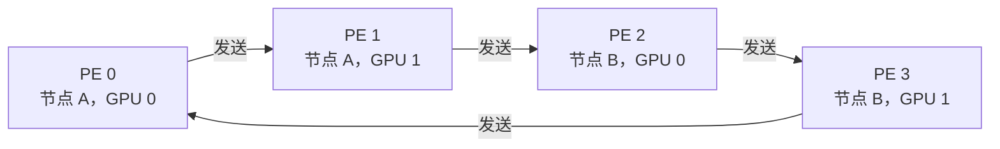
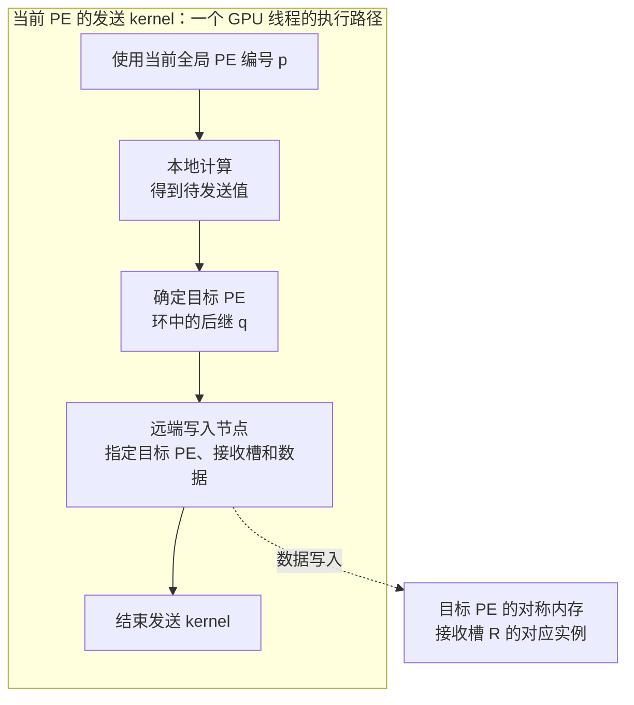
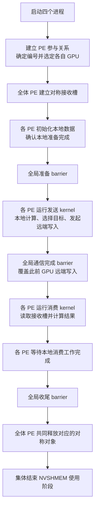
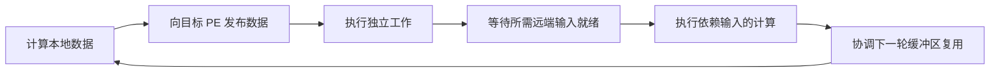

# NVSHMEM（一）：解决什么问题，以及如何组织一个程序

写单 GPU CUDA kernel 时，主要关注：**哪些线程处理哪些数据，以及线程之间怎样协作**。扩展到多 GPU 后，还要确定数据归属、通信目标、传输时机，以及接收方使用数据的条件。

NVSHMEM 让 GPU 线程能够在 kernel 执行过程中访问其他 PE 的对称内存，并参与跨 GPU 同步。通信因此可以成为 GPU 算法执行流程中的一个步骤。

这篇笔记先建立概念模型，再用一个贯穿全文的例子说明程序怎样运行：**两台节点上运行四个 PE，每个 PE 使用一张 GPU，计算一个值并传给下一个 PE。**

主要依据是官方 [Introduction](https://docs.nvidia.com/nvshmem/api/latest/introduction.html)、[Execution Model](https://docs.nvidia.com/nvshmem/api/latest/gen/exec-model.html)，以及本地 NVSHMEM 仓库的 README 和环形传值示例。

## NVSHMEM 要解决的程序组织问题

假设一个网格计算被分到多张 GPU 上，每张 GPU 更新自己的网格区域，再把边界数据交给相邻 GPU。下一轮计算需要使用邻居发来的边界。

如果由 CPU 安排这些阶段，流程可以是：启动计算、等待所需数据就绪、提交通信、建立后续计算依赖。CUDA stream 和 event 可以表达这些依赖，并支持异步提交与重叠执行。

当交换很频繁、数据粒度很小，或者通信目标由 GPU 上刚计算出的结果决定时，就需要更紧密地组织计算和通信。NVSHMEM 允许 GPU 线程沿着下面的流程执行：

1. 计算一部分结果。
2. 确定这部分结果属于哪个远端 PE。
3. 发起远端写入。
4. 继续处理独立工作。
5. 在需要远端输入的位置等待就绪，再继续计算。

**GPU 发起通信，指的是 GPU 线程能够决定并执行流程中的通信节点。** 在合适的算法中，这些节点还可以放进一个长时间运行的 kernel，构成持续的计算、通信和等待循环。减少 CPU–GPU 协调开销、支持细粒度通信与计算通信重叠，是 NVSHMEM 的主要动机，见 [Introduction](https://docs.nvidia.com/nvshmem/api/latest/introduction.html)。

## OpenSHMEM、PGAS 与 NVSHMEM

三个名字分别描述编程模型、接口标准和具体软件库：

| 名称 | 所在层次 | 核心含义 |
| --- | --- | --- |
| PGAS | 并行编程模型 | Partitioned Global Address Space，分区全局地址空间。各参与者保存自己的数据分区，同时允许远端访问。 |
| OpenSHMEM | 接口标准 | 围绕 PGAS 定义远端读写、原子操作、同步和集合通信等能力。 |
| NVSHMEM | 面向 NVIDIA GPU 的软件库 | 将这套模型用于 GPU 对称内存和 kernel 内的通信，并与 CUDA 执行流程结合。 |

PGAS 说明数据如何组织，OpenSHMEM 规定操作语义，NVSHMEM 提供面向 GPU 的实现和扩展。具体语义以 NVSHMEM 文档为准，见 [Introduction](https://docs.nvidia.com/nvshmem/api/latest/introduction.html)。

NVLink、PCIe、InfiniBand / RoCE 则属于数据实际经过的互连或网络。一次远端访问的代价取决于数据位置和传输路径；相关硬件概念可以回看 [[communication-basic|GPU 通信基础：从单机互连到 AI 集群]]。

## 执行层次：PE、GPU 与 CUDA thread

### 一个 PE 包含怎样的执行活动

**PE（Processing Element，处理单元）是 NVSHMEM 的进程级通信参与者，由操作系统进程实现。** 每个 PE 有自己的编号、本地数据和执行进度。

本文采用每个 PE 在作业期间固定使用一张独占 GPU 的映射方式，见 [Using NVSHMEM](https://docs.nvidia.com/nvshmem/api/latest/using.html#communication-model)。在这个结构中，一个 PE 的活动包含两部分：

- **CPU 侧组织工作**：加入作业、选定 GPU、建立数据对象、安排 GPU 任务，以及最终释放资源。
- **GPU 侧执行工作**：运行 kernel，由线程完成计算、发起远端访问，并在需要的位置参与同步。

| 对象 | 负责的事情 | 典型作用范围 |
| --- | --- | --- |
| PE | 作为通信参与者拥有本地数据，与其他 PE 协作。 | 整个 NVSHMEM 作业中的一个进程。 |
| GPU | 保存设备数据并执行 kernel。 | 分配给该 PE 的执行设备。 |
| kernel | 描述一次 GPU 工作中的计算、通信和同步步骤。 | 该 PE 提交到 GPU 的一次任务。 |
| CUDA thread | 执行 kernel 中的一条线程路径。 | 某个 block 中的一个线程。 |
| warp / block | 组织 GPU 内的线程协作。 | 一组共同处理数据的 GPU 线程。 |

例如，PE 2 的 GPU 上可以运行成千上万个 CUDA threads。这些线程各有自己的 block 和线程位置，**它们发起 NVSHMEM 操作时，都属于 PE 2**。

### SPMD：各 PE 执行同一份程序

NVSHMEM 程序通常采用 **SPMD（Single Program, Multiple Data，单程序多数据）**：多个 PE 运行同一份程序，根据自己的 PE 编号处理各自的数据。

可以把这份程序理解成一个共同的执行模板：建立本地数据、计算本地结果、访问指定 PE、等待依赖满足、继续计算。每个 PE 代入自己的编号和数据，沿着这份模板独立推进。

各 PE 可以走不同分支，也可以在不同时间到达同一个步骤。需要全体 PE 参与的集合步骤，则安排在各 PE 都会执行到的位置。[Execution Model](https://docs.nvidia.com/nvshmem/api/latest/gen/exec-model.html) 将 SPMD 作为典型用法，并说明了 PE 的独立执行与协作关系。

外层的 SPMD 描述多个进程如何执行程序；GPU 内的 **SIMT（Single Instruction, Multiple Threads，单指令多线程）** 描述线程如何执行 kernel。这两层共同组成一个多 GPU 程序。

## 四个 PE 的编号与设备映射

### 先确定各个编号的作用范围

本例有两台计算节点 A、B，每台两张 GPU，共四个 PE。约定按下表放置进程，并让每个进程看到本节点的两张 GPU：

| 所在节点 | 全局 PE 编号 | 节点内 PE 编号 | 选中的 GPU | 当前进程中的 GPU 编号 |
| --- | --- | --- | --- | --- |
| 节点 A | 0 | 0 | A 上的第 0 张 GPU | 0 |
| 节点 A | 1 | 1 | A 上的第 1 张 GPU | 1 |
| 节点 B | 2 | 0 | B 上的第 0 张 GPU | 0 |
| 节点 B | 3 | 1 | B 上的第 1 张 GPU | 1 |

这是本文选定的一种放置方案。实际作业中的对应关系由启动配置和应用的设备选择逻辑确定。

- **全局 PE 编号**标识作业中的通信参与者。四个 PE 的全局编号是 0、1、2、3，远端访问通过这个编号选择目标。
- **节点内 PE 编号**描述 PE 在本节点参与者中的位置。本例中，每台节点分别使用 0、1，可据此分配本机 GPU。
- **进程中的 GPU 编号**描述该进程可见的设备。上表假设每个进程看到本节点全部 GPU，并具有一致的设备顺序。
- **PE 总数**是作业规模，本例为 4。它用于任务划分和通信目标计算。

如果启动配置让每个进程只看到分配给它的一张 GPU，那么四个进程中的 GPU 编号都可以是 0。此时全局 PE 编号仍为 0、1、2、3，远端通信继续使用这组全局编号定位参与者。

全局 PE 编号在作业的 NVSHMEM 使用阶段固定，取值范围从 0 到 PE 总数减 1，见 [Execution Model](https://docs.nvidia.com/nvshmem/api/latest/gen/exec-model.html)。CUDA 的 block 和线程编号则用于定位某次 kernel 内部的执行位置。

### 用全局编号建立环形关系

设当前 PE 的全局编号为 $p$，PE 总数为 $P=4$。本例让每个 PE 向下一个 PE 发送，从上一个 PE 接收：

$$
\text{发送目标} = (p + 1) \bmod P, \qquad
\text{接收来源} = (p + P - 1) \bmod P
$$

| 当前 PE | 发送目标 | 接收来源 |
| --- | --- | --- |
| PE 0 | PE 1 | PE 3 |
| PE 1 | PE 2 | PE 0 |
| PE 2 | PE 3 | PE 1 |
| PE 3 | PE 0 | PE 2 |

图中的箭头表示数据流向。PE 0 到 PE 1、PE 2 到 PE 3 是节点内通信；另外两条边跨节点。程序用同一套 PE 编号关系描述整个环，底层根据目标位置选择实际传输路径。

## 数据如何建立：本地数据与对称对象

### 对称分配建立各 PE 上的对应对象

本例需要每个 PE 都拥有一个接收槽，用来存放前驱发来的整数。将这个对象称为 $R$，它在 PE 0、1、2、3 上的实例分别记为 $R_0$、$R_1$、$R_2$、$R_3$。

建立它们的概念流程是：

1. 全体 PE 共同执行一次对称分配步骤，约定同样的存储大小。
2. 每个 PE 在自己的 GPU 对称堆中获得一个接收槽。
3. 运行时建立这些对象之间的对应关系，使远端访问能够找到目标 PE 上的对应实例。

**对称性描述的是对象的对应关系与分配约定。每个 PE 上的对象都有自己的存储和内容。** 多个对称对象按一致的顺序建立，之后也按对应关系共同释放，见 [Memory Management](https://docs.nvidia.com/nvshmem/api/latest/gen/api/memory.html)。

每个 PE 还会计算一个待发送值，并保存最终结果。本例中的数据分为：

| 数据 | 如何产生 | 存放位置与作用 |
| --- | --- | --- |
| 当前 PE 编号 $p$ | 作业建立参与者关系时确定。 | 用于计算本地值和通信目标。 |
| 待发送值 $v_p$ | GPU 线程在 kernel 中计算。 | 由该线程临时持有，用于本轮发送。 |
| 接收槽 $R_p$ | 全体 PE 共同建立对应的对称对象。 | 位于本 PE 的 GPU 对称堆，由前驱写入、本 PE 消费。 |
| 本地结果 $y_p$ | 接收数据就绪后，由后续计算产生。 | 由本 PE 保存，供后续处理或结果检查使用。 |

### 建立存储之后，再完成内容初始化

为了便于观察，本例在分配后把每个接收槽初始化为 −1，再安排一个**全局准备 barrier（屏障）**。

每个 PE 完成本地初始化后到达这个屏障。全体 PE 都满足准备条件后，程序进入发送阶段。此时四个接收槽已经建立并完成初始化，接下来的更新来自各自的前驱。

这里有两个先后相接的节点：**对称分配建立存储及对应关系，本地初始化准备存储中的内容。** 本例用准备屏障把四个 PE 的准备阶段衔接到后续通信阶段。

### PGAS 中的远端位置怎样表达

PGAS 将各 PE 的对称内存组织为可以远端访问的分区：

| 分区 | 本例中的对称对象 | 本轮写入者 |
| --- | --- | --- |
| PE 0 的分区 | 接收槽 $R_0$ | PE 3。 |
| PE 1 的分区 | 接收槽 $R_1$ | PE 0。 |
| PE 2 的分区 | 接收槽 $R_2$ | PE 1。 |
| PE 3 的分区 | 接收槽 $R_3$ | PE 2。 |

**“全局”表示这些分区可通过统一的通信模型访问，“分区”表示每份数据有明确的归属 PE。**

因此，一次远端访问在概念上需要确定：

$$
\text{远端位置} = (\text{目标 PE},\ \text{对称对象},\ \text{对象内的位置})
$$

例如，PE 2 向 PE 3 发送数据时，目标是“PE 3 上的接收槽 $R$”。如果 $R$ 是数组，还需要给出元素下标或偏移。

每个 PE 持有自己本地对象的对称地址。这个地址描述对应分配中的位置，目标 PE 编号选择要访问的数据分区，运行时据此定位远端对象，见 [Memory Model](https://docs.nvidia.com/nvshmem/api/latest/gen/mem-model.html)。

## 单边通信如何嵌入 kernel

### 在计算路径中安排一个远端写入节点

数据准备完成后，每个 PE 启动一个发送 kernel。为便于观察，本例只让一个 GPU 线程负责计算和发送一个整数。

这条线程路径依次执行：

1. 使用当前 PE 的全局编号 $p$。
2. 计算本地值 $v_p = 100 + p$。
3. 计算目标 PE $q = (p + 1) \bmod 4$。
4. 向目标 PE 的接收槽 $R_q$ 发起一次远端写入，写入值为 $v_p$。
5. 结束这次发送 kernel。

实线表示当前线程的执行顺序，虚线表示数据流向。**远端写入节点由当前 GPU 线程执行，写入的数据落在目标 PE 的对称对象中。** 目标 PE 的消费计算由它自己的执行流程安排。

### 单边通信省去逐次接收匹配

发送方在写入节点已经确定了目标 PE、目标对象、对象内位置和数据。运行时因此可以推进这次传输，省去接收方为每次写入安排一个配对 receive 的步骤。

目标 PE 事先参与对称对象的建立，并在后续同步条件满足时读取本地接收槽。按照 [Execution Model](https://docs.nvidia.com/nvshmem/api/latest/gen/exec-model.html#progress-of-nvshmem-operations)，目标 PE 执行本地计算期间，其他 PE 发起的单边通信也应持续推进。

同一模型还支持另外两类操作：

| 概念操作 | 发起方在 kernel 中表达的意图 |
| --- | --- |
| 远端读取 | 指定目标 PE 和对称对象，将所需数据读到本地，用于后续计算。 |
| 远端原子更新 | 指定目标 PE 上的共享状态，以原子方式更新，例如分配任务槽位或累计计数。 |

单边操作描述如何移动或更新数据；同步节点负责组织数据的完成、可见性和消费时机，见 [Remote Memory Access](https://docs.nvidia.com/nvshmem/api/latest/gen/api/rma.html)。

## 从发送到消费：同步节点分别负责什么

一次数据交换要沿着几个事件推进：发送线程发起传输，数据到达目标位置，接收方获得就绪条件，然后执行消费计算。

| 执行节点 | 建立的条件 | 后续可以安排的工作 |
| --- | --- | --- |
| 本地线程协作 | 参与的 GPU 线程完成所需计算，并按约定交接数据。 | 由负责通信的线程或线程组发起传输。 |
| 交付顺序约束 | 相关更新按协议要求的先后关系交付。 | 例如在数据发布之后发布对应的就绪通知。 |
| 通信完成 | 相关远端操作达到规定的完成条件。 | 进入依赖这些操作完成的步骤。 |
| 点对点就绪通知与等待 | 某个接收方确认自己所需的数据就绪。 | 该接收方开始消费数据。 |
| 参与者 barrier | 指定范围内的 PE 共同到达一个阶段边界。 | 各 PE 进入屏障之后的阶段。 |
| CPU 等待本地 GPU 工作 | 当前 PE 提交的相关 GPU 任务完成。 | CPU 检查结果或安排后续资源回收。 |

顺序约束、通信完成和参与者协调各有自己的职责，相关语义见 [Memory Ordering](https://docs.nvidia.com/nvshmem/api/latest/gen/api/ordering.html)。

本例选择一个**带有 GPU 通信完成语义的全局 barrier**连接发送与消费。它同时建立两个条件：

- 四个 PE 都已经到达本轮交换的阶段边界。
- 屏障所覆盖的此前 GPU 远端更新已经完成，接收方可以在后续步骤中使用对应数据。

这里的“全局”描述参与范围为四个 PE。每个 PE 在自己的 GPU 工作队列中，把这个同步节点安排在发送 kernel 之后、消费 kernel 之前。CPU 负责提交这些任务，GPU 按依赖顺序推进，见 [Collective Communication](https://docs.nvidia.com/nvshmem/api/latest/gen/api/collectives.html#nvshmem-barrier-all)。

对于细粒度算法，可以用点对点就绪通知协调具体的生产者和消费者。本篇的环形例子先采用全局屏障，使各阶段的先后关系清晰可见。

## 把四个 PE 的完整执行流程串起来

### 从进程启动到资源释放

下面是本例共同遵循的执行模板。每个 PE 都运行这份流程，并将自己的全局编号代入计算和目标选择。

这张图把本例组织成三个工作阶段：**准备数据、交换数据、消费数据**。三个屏障分别确认各阶段完成，再进入下一阶段或资源回收。

其中，编号建立、设备选择和对称对象建立属于作业准备工作。发送与消费在 GPU 上执行；CPU 通过本地 GPU 工作的完成条件安排收尾。

### 四个 PE 在同一阶段分别做什么

消费阶段用一个简单计算表示后续工作：读取本地接收槽，将收到的值加上当前 PE 编号，得到本地结果 $y_p = R_p + p$。

| 阶段 | PE 0 | PE 1 | PE 2 | PE 3 |
| --- | --- | --- | --- | --- |
| 建立并初始化接收槽 | $R_0=-1$。 | $R_1=-1$。 | $R_2=-1$。 | $R_3=-1$。 |
| 准备 barrier | 本地准备完成后到达。 | 本地准备完成后到达。 | 本地准备完成后到达。 | 本地准备完成后到达。 |
| kernel 内计算 | 得到 $v_0=100$。 | 得到 $v_1=101$。 | 得到 $v_2=102$。 | 得到 $v_3=103$。 |
| kernel 内远端写入 | 向 PE 1 的 $R_1$ 写入 100。 | 向 PE 2 的 $R_2$ 写入 101。 | 向 PE 3 的 $R_3$ 写入 102。 | 向 PE 0 的 $R_0$ 写入 103。 |
| 通信完成 barrier | 与其他 PE 会合并完成本轮更新。 | 与其他 PE 会合并完成本轮更新。 | 与其他 PE 会合并完成本轮更新。 | 与其他 PE 会合并完成本轮更新。 |
| 后续消费 | 从 $R_0$ 读到 103，得到结果 103。 | 从 $R_1$ 读到 100，得到结果 101。 | 从 $R_2$ 读到 101，得到结果 103。 | 从 $R_3$ 读到 102，得到结果 105。 |
| 收尾 | 本地消费完成后参与收尾屏障，再共同释放和退出。 | 同左。 | 同左。 | 同左。 |

这些行表示各 PE 的阶段依赖。PE 的推进速度可以各自变化，例如 PE 0 已经提交写入时，PE 2 可能还在计算自己的发送值。到达屏障较早的参与者等待其余参与者满足条件。

### 沿着 PE 2 的执行路径看一遍

PE 2 位于节点 B，节点内编号为 0，并使用当前进程中的 GPU 0。

1. **建立数据**：它参与对称分配，在本地 GPU 获得接收槽 $R_2$，初始化后到达准备屏障。
2. **本地计算**：发送 kernel 的线程使用全局编号 2，计算出待发送值 102。
3. **选择目标**：根据环形关系，目标为全局 PE 3。运行时将这个参与者对应到节点 B 的另一张 GPU。
4. **发起写入**：线程在 kernel 的通信节点向 $R_3$ 写入 102。与此同时，PE 1 的发送线程负责向 $R_2$ 写入 101。
5. **完成交换**：PE 2 的 GPU 工作队列推进到全局通信完成屏障，等待本轮交换满足完成与会合条件。
6. **消费数据**：后续 kernel 从本地 $R_2$ 读取 101，再加上当前 PE 编号 2，得到本地结果 103。
7. **收尾退出**：CPU 确认本地消费工作完成后，PE 2 参与收尾屏障，再与其他 PE 一起释放对应对象、结束 NVSHMEM 使用阶段。

这个过程把三组信息连接起来：**全局编号决定通信对象，设备映射决定工作在哪张 GPU 上执行，对称对象关系决定数据落在哪个位置。**

### 每个 barrier 究竟在等什么

| 屏障节点 | 参与者 | 到达前应完成的工作 | 越过屏障后可以做什么 |
| --- | --- | --- | --- |
| 准备 barrier | 全部四个 PE。 | 各自完成接收槽与本地数据的初始化。 | 发起本轮远端写入。 |
| 通信完成 barrier | 全部四个 PE。 | 发送 kernel 已发起本轮写入；屏障负责完成所覆盖的 GPU 更新并协调会合。 | 启动读取本地接收槽的消费计算。 |
| 收尾 barrier | 全部四个 PE。 | 各自完成本轮消费，结束对这些对象的使用。 | 共同释放对应的对称对象。 |

**到达屏障表示本 PE 已经推进到该边界，越过屏障表示参与者共同满足了该节点的继续执行条件。** 各 PE 随后继续按自己的执行路径推进。

这些屏障是本例选择的阶段划分方式。实际程序可以根据数据依赖合并阶段，或用点对点协调缩小等待范围。

### 释放与退出节点

对称对象的生命周期覆盖整个数据交换和消费过程。发送完成后，接收槽继续保存输入，供消费 kernel 使用；本地消费完成后，PE 才进入收尾阶段。

收尾屏障为这个例子建立一个清晰边界：所有 PE 已经完成本轮工作，可以共同释放对应对象。对称释放本身也具有集合语义；图中把“确认使用结束”和“释放对象”单独画出，是为了说明两者在生命周期中的职责，见 [Memory Management](https://docs.nvidia.com/nvshmem/api/latest/gen/api/memory.html)。

最后，全体 PE 共同结束 NVSHMEM 使用阶段，完成库资源清理。整个生命周期从建立参与关系开始，到集体结束为止，见 [Execution Model](https://docs.nvidia.com/nvshmem/api/latest/gen/exec-model.html)。

## 把通信放进更长的计算流程

本例把发送 kernel、通信完成屏障、消费 kernel 分成三个节点，方便逐步观察。在更紧密的计算流程中，可以把本地计算、远端写入、就绪通知、等待输入和后续计算放进同一个 kernel。

这个循环适合表达迭代算法或持久化 kernel。每个等待节点都对应一个生产者，缓冲区复用节点则协调前一轮消费与下一轮写入。把这类依赖放进 kernel 后，还需要结合 GPU 调度与执行资源安排任务，相关约束见 [NVSHMEM and the CUDA Model](https://docs.nvidia.com/nvshmem/api/latest/cuda-interactions.html)。

GPU 发起通信描述发起位置，实际传输的推进方式由底层 transport 决定：某些路径使用 CPU 代理线程，另一些路径由 GPU 执行更多网络控制工作。这个实现层次与上面的算法节点分工可以分别理解，参见 [Using NVSHMEM](https://docs.nvidia.com/nvshmem/api/latest/using.html#using-gpudirect-async-kernel-initiated-communication)。

如果算法需要在计算过程中持续决定远端目标、发布小块数据或协调邻居，NVSHMEM 的模型较容易贴合这些依赖。若通信天然是某个阶段对整块张量做归约、收集或分发，标准集合通信通常能直接表达需求。选择时主要看**通信发生在什么粒度、由谁决定，以及后续计算依赖哪些数据**。
