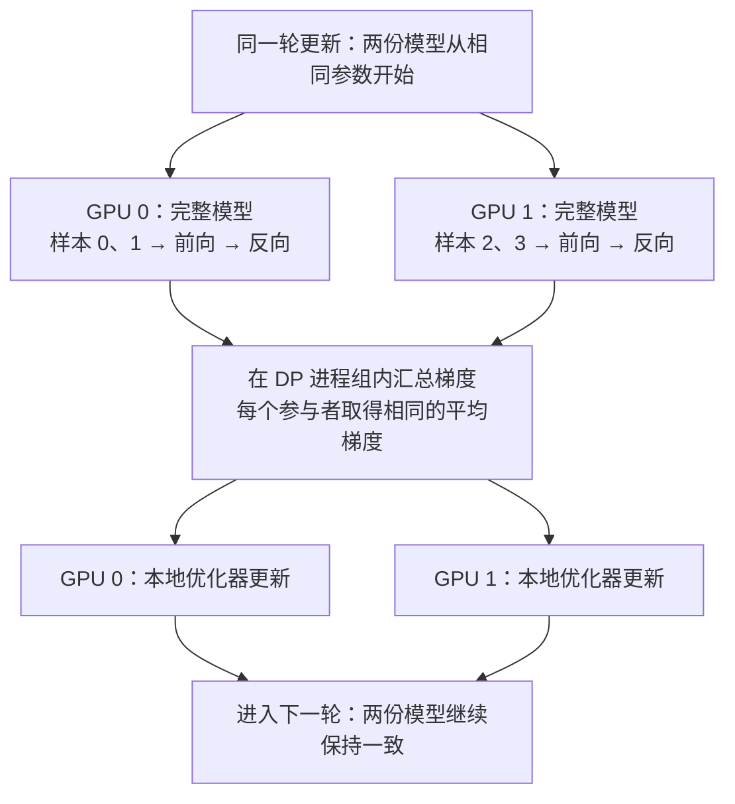
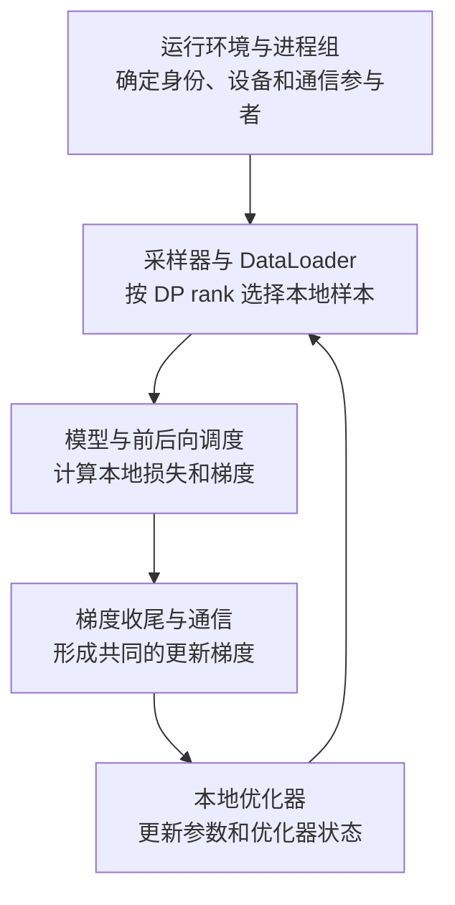

# Megatron 基础数据并行：完整副本如何协同训练

**数据并行（Data Parallelism，DP）的核心是：每个参与者保留一份完整模型，处理不同的数据，再用汇总后的梯度更新各自的模型。**

例如，单卡原本要处理 8 条训练样本，现在可以让两张 GPU 各处理 4 条。两张卡使用相同的模型结构和参数，分别对分配给自己的数据执行前向与反向计算。梯度汇总之后，两张卡各自执行一次相同的优化器更新，继续保留相同的模型参数。

本文依据当前工作区源码，说明这个基础过程及其在 Megatron 中的职责划分。讨论范围是普通稠密模型、完整模型状态副本，以及计算和梯度通信依次进行的同步训练；其他并行维度均设为 1。下文以双卡场景说明原理。

## DP 分配的究竟是什么

DP 分配的是**同一次参数更新所需的训练数据和对应计算工作**。

| 对象 | 每个 DP 参与者持有什么 | 数据流与同步方式 |
| --- | --- | --- |
| 模型参数 | 完整的一份参数副本，更新前应当一致 | 各副本用共同的梯度执行本地更新，保持参数一致 |
| 优化器状态 | 完整的一份状态，例如 Adam 的一阶、二阶矩 | 起始状态和更新规则一致时，可以各自维护 |
| 当前输入样本 | 本次分配给自己的样本 | 各进程分别读取和处理自己的样本 |
| 中间激活 | 自己这批输入产生的激活 | 保留在本地，供本地前向与反向计算使用 |
| 本地梯度 | 自己的数据对所有可训练参数的梯度 | **必须在参数更新之前形成共同的更新梯度** |

这里的“完整副本”包含 Embedding、所有 Decoder 层以及输出层。假设原模型有 4 层 Decoder，两张卡各自都运行完整的 4 层。

## 先看一次双卡更新

先看每张卡执行一次前向和反向就更新参数的情况，假设每张卡本次处理 2 条样本。

图中汇合的是梯度。样本、预测结果和中间激活保留在各自进程中。汇总完成之后，**每个进程都通过本地优化器更新参数**。

一次更新可以分成五步：

1. 每个进程清空上一轮梯度，取出分配给自己的样本。
2. 每张 GPU 使用本地完整模型执行前向，计算本地损失。
3. 每张 GPU 执行反向，得到本地数据对应的参数梯度。
4. 在 DP 进程组内聚合这些梯度，得到共同的更新梯度。
5. 每个进程用相同的优化器规则更新本地参数，再读取下一批样本。

**梯度汇总让各进程共同参与同一次模型更新，是副本协同训练的关键。**

## 为什么平均梯度可以对应更大的 batch

设 DP 参与者数量为 $D$，每个参与者处理 $b$ 条样本。所有参与者从同一份参数 $\theta$ 出发，各自计算本地平均损失：

$$
L_r(\theta)
= \frac{1}{b}\sum_{j=1}^{b}\ell(\theta; x_{r,j})
$$

其中，$r$ 是 DP rank，$x_{r,j}$ 是分配给该 rank 的第 $j$ 条样本，$\ell$ 是单样本损失。

将所有样本看成一个大小为 $Db$ 的全局 batch，对应的平均损失为：

$$
L(\theta)
= \frac{1}{D}\sum_{r=0}^{D-1}L_r(\theta)
$$

由于求导对求和具有线性关系：

$$
g = \nabla_\theta L(\theta)
= \frac{1}{D}\sum_{r=0}^{D-1}\nabla_\theta L_r(\theta)
= \frac{1}{D}\sum_{r=0}^{D-1}g_r
$$

因此，**本地计算平均损失对应的梯度，再对各卡梯度求平均，就能得到这个全局 batch 的梯度**。

这个推导需要明确几个前提：

- 各副本在求梯度时使用同一组参数，参数更新发生在梯度汇总之后。
- 每个 rank 的样本数和损失权重相同；本地平均损失采用相同的定义。
- 损失可以分解为各样本独立计算的损失之和。
- 该关系描述数学上的梯度等价性；具体执行的数值还受随机操作和浮点加法顺序影响。

语言模型还需要关心**有效 token 数**。当各 rank 的有效 token 数存在差异时，全局 token 平均损失需要按各 rank 的有效 token 数加权。具体做法是汇总损失贡献，再按全局有效 token 总数归一化。

Megatron 的 [`pretrain_gpt.py`](../../pretrain_gpt.py) 中，`loss_func()` 返回损失和、有效 token 数以及日志指标；调度器与梯度收尾函数负责后续缩放。启用 `calculate_per_token_loss` 时，可以在 [`finalize_model_grads()`](../../megatron/core/distributed/finalize_model_grads.py) 末尾看到对全局有效 token 数的归约和梯度归一化。阅读源码时，应先确认采用哪一种损失归一化约定。

## Megatron 把 DP 分成哪些职责

Megatron 将 DP 划分为运行环境、数据加载、模型计算、梯度通信和参数更新几层职责，通过它们的协作完成训练。

这个分层的好处是：模型层可以继续表达“输入张量如何变成输出张量”，采样器决定“本进程读哪些样本”，通信层决定“同一参数的梯度与谁汇总”，训练循环则协调它们的执行顺序。

| 职责 | 主要源码入口 | 阅读时关注什么 |
| --- | --- | --- |
| 建立分布式运行环境 | [`initialize.py`](../../megatron/training/initialize.py) 的 `_initialize_distributed()` | 绑定本地 GPU，初始化 `torch.distributed`，再初始化 Megatron 进程组 |
| 确定 DP 成员 | [`parallel_state.py`](../../megatron/core/parallel_state.py) 的 `initialize_model_parallel()`、`RankGenerator.get_ranks()` | 根据并行配置生成 rank 列表，再建立对应通信组 |
| 向组件传递进程组 | [`process_groups_config.py`](../../megatron/core/process_groups_config.py) 的 `ProcessGroupCollection` | 向组件传递参与通信的进程组，明确通信成员 |
| 分配输入样本 | [`data_samplers.py`](../../megatron/training/datasets/data_samplers.py) 的 `MegatronPretrainingSampler` | 用 DP rank 和 micro batch 大小计算本地索引切片 |
| 计算梯度累积次数 | [`num_microbatches_calculator.py`](../../megatron/core/num_microbatches_calculator.py) 的 `ConstantNumMicroBatchesCalculator` | 由全局 batch、每卡 micro batch 和 DP 大小推导次数 |
| 执行本地前向和反向 | [`schedules.py`](../../megatron/core/pipeline_parallel/schedules.py) 的 `forward_backward_no_pipelining()` | 每个进程运行完整模型，依次处理本地 micro batch |
| 完成梯度同步 | [`finalize_model_grads.py`](../../megatron/core/distributed/finalize_model_grads.py) 的 `finalize_model_grads()` | 在优化器读取梯度之前，完成各模型部分的梯度同步 |
| 执行集体通信 | [`param_and_grad_buffer.py`](../../megatron/core/distributed/param_and_grad_buffer.py) 的 `start_grad_sync()` | 本文只关注完整梯度的 `torch.distributed.all_reduce()` 路径 |
| 驱动一次更新 | [`training.py`](../../megatron/training/training.py) 的 `train_step()` | 清梯度、调用前后向调度、执行 `optimizer.step()` |

阅读基础 DP 时，沿着上述入口追踪数据和梯度，就能串起一次训练更新。

### 进程身份与设备编号

Megatron 的常规 GPU 训练采用一进程管理一张 GPU 的方式。以下四个概念分别描述任务规模、全局进程身份、本地设备选择和 DP 组内身份。

| 名称 | 含义 | 纯双卡 DP 的示例 |
| --- | --- | --- |
| `world_size` | 整个训练任务的进程数 | 2 |
| `rank` | 进程在整个训练任务中的编号 | 0、1 |
| `local_rank` | 进程在当前节点内的编号，用来选择本地可见设备 | 单节点上通常为 0、1 |
| `data_parallel_rank` | 进程在自己所属 DP 组内的编号 | 0、1 |

在本文的纯 DP 设置下，所有其他并行维度均为 1，所以 $D = \text{world\_size}$，DP rank 也与全局 rank 对应。组合其他并行策略时，DP 大小和 DP rank 由各自所属的进程组确定。

`initialize_model_parallel()` 会计算 DP 大小，通过 rank 生成器取得组成员，并创建 `DATA_PARALLEL_GROUP`。随后，`get_data_parallel_world_size()` 和 `get_data_parallel_rank()` 提供组内大小和编号。

`ProcessGroupCollection` 将相关组交给模型与训练组件。源码里还有带其他轴名称的 DP 组字段；在本文其他并行维度都为 1 的前提下，相关组可以具有相同的成员集合，暂时只需要识别它们的参与者。

**进程组约定“和谁通信”，采样器负责样本分配，梯度通信组件负责汇总梯度。**

### 参数副本：对齐结构、参数和优化器状态

每个进程都按相同配置构建模型，并在第一次协同更新前对齐参数初值。

Megatron 在 [`_set_random_seed()`](../../megatron/training/initialize.py) 中设置 Python、NumPy、PyTorch 和模型并行随机状态。默认设置 `data_parallel_random_init=False` 时，相同模型位置的 DP 副本采用一致的初始化种子。

如果启用不同 DP rank 的随机初始化，模型构建路径还会调用 `broadcast_params()`，在训练前把参数对齐。这里要理解的基础要求是：**进入第一次协同更新之前，各副本应当具有一致的参数；恢复训练时，优化器状态和更新进度也需要对齐。**

训练中的随机掩码可以使本地梯度产生差异。各副本最终使用共同的更新梯度，并执行相同的状态更新，参数就能继续保持一致。

### 数据分配：每个进程自己选择样本索引

[`build_pretraining_data_loader()`](../../megatron/training/datasets/data_samplers.py) 将 DP rank、DP 大小、micro batch 大小和已消费样本数传入采样器。

先看顺序采样路径 `MegatronPretrainingSampler`。它一次收集 $D \times b$ 个样本索引，再由每个 rank 选择自己的连续片段：

$$
\text{start}_r = r \times b, \qquad
\text{end}_r = \text{start}_r + b
$$

对应源码是 `get_start_end_idx()` 和 `__iter__()` 中的 `batch[start_idx:end_idx]`。这里的 `batch` 是**样本索引列表**，DataLoader 根据选中的索引读取实际样本。

当 $D=2$、$b=2$ 时：

| 所有 rank 按相同顺序考虑的索引段 | DP rank 0 选择 | DP rank 1 选择 |
| --- | --- | --- |
| 0、1、2、3 | 0、1 | 2、3 |
| 4、5、6、7 | 4、5 | 6、7 |
| 8、9、10、11 | 8、9 | 10、11 |

各进程拥有相同的逻辑数据集视图，通过自己的索引取出分配给自己的样本。**每个进程的 DataLoader 根据本地索引独立读取数据。**

采样过程的适用条件与进度管理如下：

- 这里讲的是 `dataloader_type='single'` 的普通顺序采样路径；循环随机采样有另外的采样器。
- 采样器分配逻辑数据集中的索引位置，样本内容由这些位置对应的数据决定。
- `consumed_samples` 表示所有 DP rank 合计已消费的全局样本数，用于确定恢复采样的起点。
- 普通采样器默认每次产出完整的 $D \times b$ 索引段，并丢弃尾部剩余索引，使各 rank 取得相同大小的 micro batch，保持计算和通信步数一致。
- 外部 DataLoader 路径会直接接收用户提供的加载器，样本如何分配需要由调用者保证。

### 梯度累积：把同一次更新拆成多个 micro batch

Megatron 区分单次前向计算的 batch 和一次参数更新的全局 batch。

| 符号 | Megatron 中的对应概念 | 含义 |
| --- | --- | --- |
| $b$ | `micro_batch_size` | 每个 DP rank 每次前向处理的样本数 |
| $M$ | `num_microbatches` | 每个 rank 在一次参数更新中处理的 micro batch 数 |
| $D$ | `data_parallel_size` | 共同处理不同数据并汇总梯度的参与者数 |
| $B$ | `global_batch_size` | 一次参数更新在所有 DP rank 上合计使用的样本数 |

在这些 batch 大小固定且均匀的设置下：

$$
B = b \times M \times D, \qquad
M = \frac{B}{bD}
$$

例如，设 $B=8$、$b=2$、$D=2$，那么 $M=2$：

| 同一次更新中的计算阶段 | GPU 0 的样本索引 | GPU 1 的样本索引 | 执行操作 |
| --- | --- | --- | --- |
| 第 1 个 micro batch | 0、1 | 2、3 | 计算并累积梯度 |
| 第 2 个 micro batch | 4、5 | 6、7 | 完成梯度汇总后，各自更新一次 |

因此，GPU 0 这一轮共处理 4 条样本，GPU 1 也处理 4 条，全局合计 8 条。**一个优化器 step 包含本轮全部 micro batch 的前向、反向、梯度汇总和一次参数更新。**

对等权平均损失而言，每个本地 micro batch 的梯度记为 $g_{r,k}$，目标更新梯度为：

$$
g = \frac{1}{DM}\sum_{r=0}^{D-1}\sum_{k=0}^{M-1}g_{r,k}
$$

[`ConstantNumMicroBatchesCalculator`](../../megatron/core/num_microbatches_calculator.py) 按 $B/(bD)$ 计算累积次数。常规设置要求 $B$ 能被 $bD$ 整除，且至少包含一个 micro batch。启用自动调整选项时，计算器先将运行 batch 大小调整为 $bD$ 的整数倍，再计算累积次数。

[`forward_backward_no_pipelining()`](../../megatron/core/pipeline_parallel/schedules.py) 位于 `pipeline_parallel` 目录，负责每个进程运行完整模型时的普通前后向执行。它遍历本地 micro batch，完成反向累积，并在返回优化器阶段之前调用梯度收尾函数。

梯度累积通过多次处理较小的 micro batch，控制同时保留的激活规模。DP 则通过多个副本并行处理数据，两者可以组合使用。

### 梯度汇总：All-Reduce 让每个进程得到共同结果

基础 DP 需要按同一参数的位置，对所有 rank 的梯度逐元素汇总。

**All-Reduce（全归约）** 可以理解为：每个参与者提交一个同形状张量，执行求和等指定运算，所有参与者都取得归约后的结果。

底层通信后端负责完成集体通信，使每个参与者都得到相同的归约结果。

假设只有两个参数，用一轮简单的 SGD 更新说明：

| 阶段 | GPU 0 | GPU 1 |
| --- | --- | --- |
| 更新前的参数 | $(10, 20)$ | $(10, 20)$ |
| 本地数据产生的梯度 | $(2, 4)$ | $(6, 8)$ |
| 梯度求和结果 | $(8, 12)$ | $(8, 12)$ |
| 对两个参与者取平均后 | $(4, 6)$ | $(4, 6)$ |
| 学习率为 0.1 的本地更新后 | $(9.6, 19.4)$ | $(9.6, 19.4)$ |

两张卡使用相同的平均梯度执行本地更新，更新后的参数均为 $(9.6, 19.4)$。

**求和与求平均必须分清。** 在当前源码的普通平均损失路径中，梯度平均可以通过以下两种方式表达：

- 通信前将梯度乘以 $1/D$，再执行求和归约。
- 保留原始梯度尺度，直接使用平均归约。

[`param_and_grad_buffer.py`](../../megatron/core/distributed/param_and_grad_buffer.py) 的 `start_grad_sync()` 可以看到梯度缩放、归约运算选择，以及 `torch.distributed.all_reduce(..., group=communication_group)`。这里将梯度汇总落实为进程组内的集体通信。

前后向调度器对 micro batch 的平均、DP 通信对副本的平均，以及有效 token 归一化，分别作用于训练计算链的相应位置。**最终的梯度尺度由归约运算和相关缩放共同决定。** 阅读源码时，需要沿着整条计算链确认每个归一化因子的位置与次数。

### 更新参数：每个 rank 独立执行相同的优化器操作

梯度汇总完成后，每个进程执行本地 `optimizer.step()`。

可以把一次更新抽象为：

$$
(\theta_{t+1}, s_{t+1})
= F(\theta_t, s_t, g_t, h_t)
$$

其中，$s_t$ 是优化器状态，$g_t$ 是共同的更新梯度，$h_t$ 表示学习率等超参数。只要这些输入在各 rank 上一致，并采用一致的更新规则，就能得到一致的下一轮参数和状态。

因此，基础 DP 中的**每个 rank 都维护优化器状态，并通过本地更新保持参数一致**。

如果启用梯度裁剪，执行顺序是：先汇总梯度，再裁剪共同的更新梯度，最后执行优化器更新。

## 沿源码串起一次训练更新

从 [`training.py`](../../megatron/training/training.py) 的 `train_step()` 出发，可以按下面的顺序阅读基础执行路径：

1. 调用模型的梯度清理接口和 `optimizer.zero_grad()`，开始新一轮累积。
2. 调用 `forward_backward_func(...)`，将 `num_microbatches` 和数据迭代器交给调度器。
3. 进入 `forward_backward_no_pipelining()`，逐个执行本地完整模型的 micro batch 前向与反向。
4. 调度器通过 `config.finalize_model_grads_func(...)` 进入 `finalize_model_grads()`。
5. 梯度收尾函数调用模型的 `finish_grad_sync()`，保证用于本次更新的梯度通信完成；基础同步路径最终落到 DP 组内的 All-Reduce。
6. 前后向调度返回后，`train_step()` 调用 `optimizer.step()`，更新本地参数，并在更新成功后推进学习率调度。

**这条调用链保证：本轮所需的梯度汇总完成后，优化器再更新参数。**

训练循环还会汇总 loss 指标，用于输出全局日志。**loss 指标汇总服务于训练观测，参数梯度汇总服务于模型更新**；日志指标通常已经从计算图分离。

## DP 的收益与边界

### 适合扩大数据处理吞吐

当一份模型及其训练状态已经能放进单张 GPU 时，可以用更多副本分担样本计算。

- 固定每卡 micro batch 和累积次数，增加 $D$，全局 batch 会随之增加。
- 固定全局 batch，增加 $D$，可以结合整数和显存约束，减少每卡样本数或累积次数。
- 增大全局 batch 会改变每次更新使用的数据量，需要结合学习率、训练进度和收敛行为一起调整。

### 每张 GPU 保留完整模型状态

基础 DP 的每个参与者都保留完整参数、梯度和优化器状态。例如，两张 8GB GPU 运行纯 DP 时，每张 GPU 都需要容纳同样一份完整模型状态，并为激活和运行时资源预留空间。

固定全局 batch 时，可以通过减小每卡 micro batch 来降低激活开销。**完整模型状态分别保留在每张卡上**，DP 的主要收益来自同一模型对更多数据的并行计算。

### 通信与慢进程会限制加速

在本文计算和梯度通信依次进行的路径下，一轮耗时可以粗略理解为：

$$
T_{\text{step}}
\approx \max_r T_{\text{本地前后向},r}
+ T_{\text{梯度通信}}
+ T_{\text{优化器更新}}
$$

这个表达式用于理解 step 的主要耗时构成，实际运行还包含数据加载等开销。整体速度由本地计算、梯度通信和参数更新共同决定。参与通信的进程需要配合执行，较慢 rank 的数据加载或计算会影响整轮训练进度。

