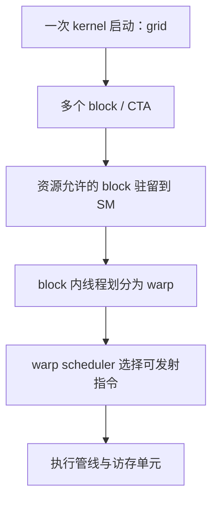

# Infra 八股

## CUDA 基础

本章围绕 CUDA C++ 的 SIMT 执行与性能分析展开。每题的“面试回答”采用被面试者的表述方式，随后给出地址推导、资源计算和追问分析。

**架构范围**：以现代 NVIDIA GPU 为背景；共享内存示例采用 32 个 bank、连续 32-bit 字映射到连续 bank 的组织方式。涉及具体资源数量时明确以 H100（计算能力 9.0）为例，其他型号需核对设备属性。

**参考资料查阅日期：2026-10-20。**

### Kernel 的执行模型与线程组织

> **问题：CUDA 中 kernel 的执行模型是怎样的？block、grid、thread 如何组织？**

#### 面试回答

> CUDA kernel 是由大量逻辑线程执行的设备函数。一次启动产生一个 grid，grid 包含多个 block，每个 block 包含多个 thread。grid 和 block 都可以是一维、二维或三维，用于将线程映射到向量、矩阵或更高维的数据。
>
> 在硬件上，普通 block 作为整体分配给一个 SM，block 内的线程按线性线程编号划分为 32 个线程一组的 warp。SM 以 warp 为主要指令发射单位执行 SIMT 程序。
>
> block 内可以通过 shared memory 交换数据并进行 block 级同步。普通 grid 中，各 block 独立执行，执行顺序和同时驻留的数量由硬件资源与运行时调度决定。这样的组织方式允许同一个 grid 在不同规模的 GPU 上执行。

这一回答需要把**编程层级、硬件映射和同步边界**联系起来。[NVIDIA CUDA 编程模型](https://docs.nvidia.com/cuda/cuda-programming-guide/01-introduction/programming-model.html#thread-blocks-and-grids)

#### 线程编号与数据映射

设 block 的维度为 $(B_x,B_y,B_z)$，block 内线程坐标为 $(t_x,t_y,t_z)$，则线性编号为：

$$
t_{\mathrm{linear}}=t_x+B_x(t_y+B_y t_z)
$$

$$
\mathrm{warp\_id}=\left\lfloor\frac{t_{\mathrm{linear}}}{32}\right\rfloor,
\qquad
\mathrm{lane\_id}=t_{\mathrm{linear}}\bmod32
$$

**`threadIdx.x` 是变化最快的维度，warp 按线性编号形成。** 例如：

- `blockDim=(32,8)`：一个 warp 对应一整行 32 个线程。
- `blockDim=(16,16)`：一个 warp 覆盖相邻两行，每行 16 个线程。
- 一个 block 有 33 个线程时，需要两个 warp，第二个 warp 只有一个有效线程；warp 的划分以 block 为边界。

对二维行主序矩阵，常见映射是：

$$
x=\mathrm{blockIdx.x}\,B_x+t_x,\qquad
y=\mathrm{blockIdx.y}\,B_y+t_y
$$

元素地址由 `y * leading_dimension + x` 决定。分析合并访存时，应结合元素布局，计算同一 warp 各线程实际访问的地址。

#### 执行与同步边界



图中表示层级关系：CTA 是资源分配与驻留的重要单位，warp 是指令调度的重要单位。grid 可以远大于 GPU 同时容纳的 block 数，剩余 block 等待资源释放。

- **线程级状态**：每个线程具有自己的逻辑寄存器、索引和控制流状态。
- **block 级协作**：`__syncthreads()` 用于 block 内的线程同步与相应共享访问的可见性；参与线程必须按其语义一致到达。
- **grid 级依赖**：一般通过后续 kernel 和 stream/event 依赖组织。Cooperative Groups 的 grid 同步需要协作启动等额外条件。
- **异步启动**：常规 kernel 启动通常相对 host 异步；host 提交后可以继续执行，GPU 的完成状态通过相应的同步或查询机制确认。

block 的线程总数是三个维度的乘积，同时受到单 block 总线程数和各维度上限约束。H100 的单 block 线程上限为 1024，通用代码应查询 `maxThreadsPerBlock`、`maxThreadsDim` 和 `maxGridSize`。线程与数据的映射可以灵活组织，例如让一个线程通过 grid-stride loop 处理多个元素。

Hopper 的 thread block cluster 在 block 之上提供额外协作层级。一个 cluster 由多个 CTA 组成，各 CTA 分别驻留于 SM，并通过 cluster 级机制协作。

**考察重点**：能够说明 block 到 SM 的映射、同一 SM 上多个 block 的资源共享，以及大量逻辑线程通过 warp 调度使用物理执行单元的过程。

### Warp、分支发散与延迟隐藏

> **问题：warp 是什么？warp divergence 和 SM 的 warp 调度机制如何影响性能？**

#### 面试回答

> warp 是现代 NVIDIA GPU 中由 32 个逻辑线程组成的 SIMT 执行组。一次指令发射针对某个 warp，并用活跃掩码标识参与执行的线程。
>
> 同一个 warp 内的线程走不同分支时，相关路径通常需要在不同活跃掩码下执行，每条路径只有对应的 lane 参与有效计算，因此分支发散会降低执行效率。发散以 warp 为分析单位，各 warp 分别管理自己的分支执行状态。
>
> 当某个 warp 等待访存或前序指令结果时，调度器可以发射其他就绪 warp 的指令，用并行工作隐藏延迟。驻留 warp 提供待调度的工作，其下一条指令满足依赖和发射条件后，才进入 eligible 状态。性能取决于就绪工作的数量以及执行管线的持续供给。

#### 分支发散的实际代价

假设一个 warp 的偶数 lane 执行路径 A，奇数 lane 执行路径 B，而且确实生成了需要分别执行的分支：

- 执行 A 时，参与的是约 16 个 lane；执行 B 时，参与的是另外约 16 个 lane。
- 如果两个分支工作量相近，执行时间可能接近两条路径代价之和，还要考虑分支与重汇合开销。
- 这些路径由同一个 warp 在相应活跃掩码下执行，性能损失取决于各路径的工作量、活跃 lane 比例与重汇合开销。

按 `warp_id` 划分工作，使整个 warp 统一选择路径，有利于保持较高的活跃 lane 比例。边界判断通常只影响尾部 warp 的部分 lane，其代价取决于尾部工作占整体执行的比例。

短分支可能被编译成**谓词执行（predication）**：指令仍有发射成本，只有谓词满足的线程执行对应操作。比较 `if` 与三目表达式的性能时，应检查生成的分支或谓词指令，并结合实际耗时评估开销。

#### 调度器如何隐藏等待

| 状态 | 含义 | 性能分析中的作用 |
| --- | --- | --- |
| Resident / Active | warp 已驻留，具有执行状态和资源 | 表示可供调度的总体规模 |
| Eligible | 下一条指令的依赖和发射条件已满足 | 表示当前真正能够发射的工作 |
| Issued | 调度器本轮选中了该 warp 的指令 | 表示发射槽实际得到使用 |

例如，某个 warp 发出 load 后，如果接下来的计算依赖尚未返回的数据，scoreboard 会阻止相关指令过早发射。其他具有独立指令的 warp 可以使用这些周期；同一 warp 内的独立指令也可能提供指令级并行性（ILP）。

常见架构将 SM 划分为多个子分区，每个调度器管理分配给它的一组 warp。调度器数量、指令吞吐和分配细节与架构有关。发射速率描述单位时间提交的指令数量，指令延迟描述结果就绪所需的时间，两者共同影响流水线利用率。[NVIDIA Volta 指令调度说明](https://docs.nvidia.com/cuda/volta-tuning-guide/#instruction-scheduling)

#### 独立线程调度与正确性

Volta 引入独立线程调度，硬件按线程维护程序计数器等执行状态，再将同一 warp 中可共同执行的线程组织为 SIMT 执行组。**它提供了更细粒度的执行与会合控制；分支路径的活跃 lane 比例仍是影响执行效率的重要因素。**

通过 shared memory 在 warp 内交换数据时，应按需要使用 `__syncwarp(mask)` 显式建立同步与内存顺序；使用 shuffle、投票等原语时，参与 mask 应与实际参与线程及接口约束一致。[NVIDIA Warp 级编程原语](https://developer.nvidia.com/blog/using-cuda-warp-level-primitives/)

**考察重点**：能够将发散造成的 lane 利用率下降，与依赖等待造成的发射不足区分开，并据此判断应调整任务划分、增加独立工作，还是优化访存与同步。

### Shared Memory 的 Bank Conflict 与布局优化

> **问题：Bank Conflict 是什么？共享内存如何分 bank，一个 bank 的宽度是多少？哪些访问会冲突，padding 和 swizzle 如何解决？**

#### 面试回答

> 我会先说明 bank 的宽度和容量。这里采用的现代共享内存模型有 32 个 bank，连续的 32-bit 字映射到连续 bank，一个字是 4 字节。4 字节描述映射和服务粒度；一个 bank 包含多个存储位置，保存许多相隔一定步长的字，其总容量取决于共享内存的配置。
>
> 对一个 warp 的同一条标量共享内存访问，如果多个线程访问同一 bank 中的不同 32-bit 字，这些访问需要拆分服务，产生 bank conflict。多个线程读取同一个字时，可以通过广播服务这些读取请求。
>
> 解决问题的关键是改变同时访问的物理地址分布。Padding 改变行跨度，swizzle 改变逻辑索引到物理位置的映射；两者都需要同时满足生产者写入和消费者读取的访问模式。

32 个 bank、连续 32-bit 字映射和单 bank 的 32-bit/cycle 带宽描述，见 [NVIDIA Shared Memory 访问模式](https://docs.nvidia.com/cuda/cuda-programming-guide/02-basics/writing-cuda-kernels.html#shared-memory-access-patterns)。

#### 从字节地址计算 bank

设共享内存字节地址为 $a$，以 4 字节字为单位：

$$
\mathrm{word}(a)=\left\lfloor\frac{a}{4}\right\rfloor,
\qquad
\mathrm{bank}(a)=\mathrm{word}(a)\bmod32
$$

因此，字节地址 `0, 128, 256, ...` 对应不同的 32-bit 字，但都映射到 bank 0；地址 `0, 4, 8, ...` 则依次映射到 bank 0、1、2 等。

**Bank 容量描述存储位置的总量，4 字节描述这里的字映射粒度。** 例如，假设共有 128 KiB 可寻址共享空间，均匀划分到 32 个 bank，则每个 bank 对应约 4 KiB 的位置。

下面的推导限定为：32 个活跃 lane，每个 lane 访问一个 `float`，各 lane 请求不同的 32-bit 字。设 lane $\ell$ 的字索引为 $w_0+s\ell$：

$$
\mathrm{bank}(\ell)=(w_0+s\ell)\bmod32
$$

| 字步长 $s$ | lane 0、1、2、3 的 bank，假设 $w_0=0$ | 全 warp 使用的 bank 数 | 冲突程度 |
| --- | --- | --- | --- |
| 1 | 0、1、2、3 | 32 | 无冲突 |
| 2 | 0、2、4、6 | 16 | 2 路冲突 |
| 4 | 0、4、8、12 | 8 | 4 路冲突 |
| 32 | 0、0、0、0 | 1 | 32 路冲突 |
| 33 | 0、1、2、3 | 32 | 无冲突 |

在上述各 lane 访问不同字的条件下，冲突程度可由 $\gcd(s,32)$ 判断。步长为零、所有线程读取同一个字时，则按广播情形处理。

#### 为什么矩阵按列访问容易冲突

对行主序的 `float tile[32][32]`，忽略基址带来的统一 bank 偏移：

$$
\mathrm{word}(r,c)=32r+c,\qquad
\mathrm{bank}(r,c)=c\bmod32
$$

- 固定 $r$，令 `c = lane_id`：32 个 lane 分布到 32 个 bank，无冲突。
- 固定 $c$，令 `r = lane_id`：32 个 lane 访问同一 bank 的不同字，产生 32 路冲突。

**冲突取决于同一次 warp 访问的地址集合。** 分析时，先确定实际指令与参与 lane，再把各 lane 的地址转换为字索引和 bank 编号，统计同一 bank 中请求的不同字。

#### Padding：改变物理行跨度

将布局改为 `float tile[32][33]` 后：

$$
\mathrm{word}(r,c)=33r+c,\qquad
\mathrm{bank}(r,c)=(r+c)\bmod32
$$

此时固定列 $c$、让 $r$ 随 lane 变化，就会遍历全部 32 个 bank。因此，转置中的列读取可以消除上述 32 路冲突。

额外空间为 $32\times1\times4=128$ 字节，相对原来的 4096 字节增加 3.125%。这一代价通常较小，但仍需检查资源临界点：如果 padding 使共享内存分配越过驻留阈值，可能减少 resident CTA。写入和读取也必须统一使用实际的 33 列跨度。

#### Swizzle：改变逻辑到物理的映射

对这个 32×32、标量 `float` 的教学例子，可以使用：

$$
p(r,c)=32r+(c\mathbin{\oplus}r)
$$

其中 $\oplus$ 是按位 XOR。行内 $c,r$ 均在 $[0,32)$：

- 固定行 $r$，`c ^ r` 是列编号的一个置换，行访问仍遍历全部 bank。
- 固定列 $c$，`c ^ r` 随 $r$ 遍历全部 bank，因此列访问也无冲突。
- 映射使用原有的 32×32 存储空间，且 XOR 可逆；写入和读取需要使用同一套映射。

```cpp
/**
 * @brief 计算 32×32 float tile 的标量 XOR swizzle 下标。
 * @param row 逻辑行索引，范围为 [0, 32)。
 * @param col 逻辑列索引，范围为 [0, 32)。
 * @return 共享内存中按 float 元素计的物理下标。
 */
__device__ __forceinline__ int swizzled_index(int row, int col) {
    return row * 32 + (col ^ row);
}
```

这是一种针对指定标量访问模式推导的布局。若按 16 字节向量或 Tensor Core 操作数访问，需要保留所需的连续片段和对齐，再重新分析服务阶段内的 bank 分布。

Hopper TMA 的 swizzle 以 **16 字节块**组织重排，提供 32B、64B、128B 等模式。应用时需按所选模式推导物理布局，并匹配 tensor map、共享内存基址和消费者索引。[NVIDIA TMA Swizzle 说明](https://docs.nvidia.com/cuda/cuda-programming-guide/04-special-topics/async-copies.html#shared-memory-bank-swizzling)

#### 追问与考察重点

- **相同 bank 的访问如何判断？** 先区分同一个字的读取广播与不同字的分批服务；多个线程对同一地址进行非原子写入，还涉及写入竞争。
- **`double`、`half`、`float4` 如何分析？** 先计算每条实际指令覆盖的 32-bit 字，再分析硬件拆分出的事务或 wavefront。以数据量所需的理想服务次数为基准，判断 bank 分布是否引入额外服务。
- **如何验证优化？** 对比相同工作负载的耗时、shared load/store 的实际与理想 wavefront、bank conflict 指标及 occupancy；结合 SASS 确认访问宽度。

**考察重点**：能够从实际地址算出冲突，并说明 padding、swizzle 和向量化布局之间的适配关系。

### SM 的 CTA 调度、Warp 调度与 Occupancy

> **问题：SM 如何调度 CTA 和 warp？共享内存、寄存器和线程等资源如何限制 occupancy？**

#### 面试回答

> 我会把调度分为两层。第一层是 block/CTA 的分配与驻留：资源足够时，一个 SM 可以同时驻留多个 CTA；每个 CTA 都要占用线程与 warp 槽位、寄存器、共享内存等资源。
>
> 第二层是驻留 warp 的指令调度。调度器从自己管理的 eligible warp 中选择指令发射；等待访存或前序结果的 warp 保留驻留状态，在依赖满足后重新进入可发射状态。各驻留 warp 的寄存器状态已经保存在 SM 中，调度器可以直接选择其他就绪 warp，利用这些周期执行独立工作。
>
> Occupancy 是驻留活跃 warp 数占硬件最大可驻留 warp 数的比例，描述的是延迟隐藏的资源条件。lane 利用率反映参与有效执行的线程比例，计算管线利用率反映执行单元的忙碌程度。评估性能时，我会把这些指标与依赖、冲突、同步和最终耗时结合起来。

#### CTA 驻留的资源上界

设一个 block 有 $T_b$ 个线程：

$$
W_b=\left\lceil\frac{T_b}{32}\right\rceil
$$

用 $R_b,S_b$ 分别表示一个 block 实际分配的寄存器与共享内存，则每 SM 的驻留 block 数受以下上界共同限制：

$$
B_{\mathrm{resident}}\le\min\left(
B_{\mathrm{hw}},
\left\lfloor\frac{T_{\mathrm{SM}}}{T_b}\right\rfloor,
\left\lfloor\frac{W_{\mathrm{SM}}}{W_b}\right\rfloor,
\left\lfloor\frac{R_{\mathrm{SM}}}{R_b}\right\rfloor,
\left\lfloor\frac{S_{\mathrm{SM}}}{S_b}\right\rfloor
\right)
$$

求最小值时，仅计入用量大于零的资源项。该式是理解资源关系的简化上界：实际还要考虑寄存器与共享内存的分配粒度、SM 子分区约束、系统保留量，以及单 block 上限；cluster kernel 还需考虑 cluster 资源。

理论 occupancy 为：

$$
O_{\mathrm{theoretical}}=
\frac{B_{\mathrm{resident}}W_b}{W_{\mathrm{SM}}}
$$

#### H100 的计算示例

H100 每 SM 最多驻留 64 个 warp、32 个 block，寄存器文件包含 65536 个 32-bit 寄存器，共享内存上限为 228 KiB。容量上限与实际配置、保留量需要分别考虑。[NVIDIA Hopper Occupancy 约束](https://docs.nvidia.com/cuda/hopper-tuning-guide/index.html#occupancy)

假设 block 为 256 个线程，每线程使用 64 个寄存器，每 block 使用 48 KiB 共享内存，暂按简化分配计算：

- 每 block 为 $256/32=8$ 个 warp。
- 寄存器需求约为 $256\times64=16384$ 个，寄存器上限对应 4 个 block。
- 共享内存上限对应约 4 个 block；线程与 warp 槽位对应最多 8 个这样的 block。
- 最终约为 4 个驻留 block，即 32 个 warp，理论 occupancy 约 50%。

如果寄存器升至每线程 96 个，单 block 需求变为 24576 个，寄存器约束只允许 2 个 block，理论 occupancy 降至约 25%。该结果应通过 `cudaOccupancyMaxActiveBlocksPerMultiprocessor` 和 NCU 的资源限制结果核对。

#### Spill：寄存器压力如何变成额外访存

**Register spilling（寄存器溢出）是编译器为腾出寄存器，将一部分需要保留的值安排到其他存储位置，并插入相应保存与读回指令的行为。** 先按常规的 local memory spill 路径理解：值被保存到线程私有的 local memory，后续使用时再读回寄存器参与计算。[NVIDIA 寄存器与 Spill 说明](https://docs.nvidia.com/cuda/cuda-programming-guide/02-basics/writing-cuda-kernels.html#registers)

理解触发原因，需要关注**同时活跃的值**：一个中间结果从计算出来，到最后一次使用之间，都需要保留。多个中间结果、地址和循环状态的存活区间重叠时，会共同占用寄存器，形成寄存器压力。编译器需要在可用的寄存器预算内安排这些值。

沿用上面的数字，假设原版本每线程使用 96 个 32-bit 寄存器，加入 `-maxrregcount=64` 后，编译器需要在更小的预算内重新分配。它可以调整指令顺序、缩短值的存活区间或重新计算部分结果；仍需跨阶段保存的值，则可能通过 spill 腾出寄存器。实际 spill 量由重新分配后的代码决定。

以一个后面还要使用的中间结果 `v` 为例，发生 spill 时可能经历：

1. 计算出 `v`，将它保存到当前线程的 local memory 槽位，这一步对应 **spill store**。
2. 原先存放 `v` 的寄存器用于其他中间结果，继续执行后续计算。
3. 再次需要 `v` 时，从对应槽位读回寄存器，这一步对应 **spill load / reload**。

这样，用寄存器保留一个值的过程，增加了保存、读回及相关依赖等待。若这些访问位于高频循环中，成本还会随循环执行次数累积。

**Local memory 的“私有”指访问作用域，其后备存储通常是设备内存。** Spill 访问可以经过缓存，命中情况决定有多少请求继续到达更低层级。它会增加访存指令、缓存压力和潜在的设备内存流量，具体代价应结合实际执行测量。[NVIDIA Shared Memory Register Spilling 背景](https://developer.nvidia.com/blog/how-to-improve-cuda-kernel-performance-with-shared-memory-register-spilling/)

这里的两个阶段也要联系起来：**编译器决定寄存器分配和 spill 指令；SM 在执行时根据生成代码的资源需求安排 CTA 驻留。** 限制每线程寄存器数量，可能让更多 CTA 驻留，同时让每个线程承担更多访存工作。最终收益取决于新增并行工作隐藏的延迟，与 spill 引入的成本之间的关系。

**如何确认自己遇到的是否是 spill？** 编译时加入 `-Xptxas=-v`，查看目标 kernel 的资源报告：

| 报告字段 | 含义 | 分析用途 |
| --- | --- | --- |
| `Used N registers` | 每线程分配的寄存器数量 | 对比调整前后的寄存器占用 |
| `X bytes spill stores` | 编译器报告的溢出保存量 | 确认 local memory spill store 的生成情况 |
| `Y bytes spill loads` | 编译器报告的溢出读回量 | 确认 local memory spill load 的生成情况 |
| `Z bytes stack frame` | 每线程的栈帧大小 | 结合数组、调用与 spill 分析栈空间的来源 |

这些是编译期统计；运行时实际流量还取决于执行路径、循环次数和缓存行为。线程私有数组、调用栈等也可能产生 local memory 使用，识别寄存器溢出时应重点查看 spill 字段，再通过最终 SASS 与 NCU 的源码关联分析访问位置和频率。[NVIDIA 编译器资源报告](https://docs.nvidia.com/cuda/cuda-compiler-driver-nvcc/index.html#printing-code-generation-statistics)、[NVIDIA Local Memory 说明](https://docs.nvidia.com/cuda/cuda-c-best-practices-guide/index.html#local-memory)

优化时可从缩小每线程 tile 或累加器规模、调整循环展开、缩短中间值存活区间入手。每次调整都对比寄存器数、spill、驻留数和耗时，判断资源变化是否带来实际收益。

**版本补充**：CUDA 13.0 引入了需要显式启用的 shared memory register spilling。在满足编译与 kernel 条件时，编译器可优先用 shared memory 保存溢出值；这会增加共享内存占用，也需要重新评估 CTA 驻留数。这里的基础推导采用前述 local memory 路径。[NVIDIA Shared Memory Register Spilling](https://developer.nvidia.com/blog/how-to-improve-cuda-kernel-performance-with-shared-memory-register-spilling/)

#### 性能取舍与追问

- **降低寄存器有哪些取舍？** 降低寄存器占用有机会提高驻留数；设置较低上限时，编译器也可能将部分中间值溢出保存到 local memory，并在使用前读回。应比较驻留收益与新增访存成本。
- **增加共享内存复用有哪些取舍？** 更大的 tile 或更多流水级可能减少全局访存，同时降低 CTA 驻留数。
- **理论值高、实际值低说明什么？** 检查 grid 大小、尾波、CTA 工作量不均、资源与运行环境；停顿中的驻留 warp 仍计入 occupancy，因此还要看 eligible warp。
- **block 内 barrier 的影响是什么？** 到达较早的 warp 等待其他 warp，但 CTA 占用的资源仍需保留；不同工作量和依赖可能放大等待。

CTA 的分配顺序与 warp 的具体选择策略由微架构和运行状态决定。性能分析应围绕可观测的驻留资源、eligible warp 和实际发射率展开。

**考察重点**：能够分别解释 CTA 的资源准入、驻留 warp 的依赖就绪，以及 eligible warp 对发射槽的竞争。

### 原子操作的语义、执行路径与竞争优化

> **问题：CUDA 中有哪些原子操作，它们如何执行，性能受什么影响？**

#### 面试回答

> 原子操作保证指定作用域内，对某个受支持对象的读改写作为一个整体完成。例如 `atomicAdd` 把读取旧值、求和和更新合为一次原子操作，传统接口还返回旧值。多个线程累加同一位置时，各次更新按某种顺序生效，每次累加都基于相应的旧值完成。
>
> 硬件执行上，全局原子通常经由 SM 的访存路径进入 L2 侧原子处理阶段，现代 shared memory 原子则可由 SM 内的共享内存原子路径处理。多个请求竞争同一地址时，更新会形成串行化，热点竞争因此会限制吞吐并增加延迟。
>
> 我还会区分原子性、作用域和内存序。传统 `atomicAdd` 使用 relaxed 内存序，保证目标对象的原子更新；其他数据的发布与读取顺序需要通过相应的同步协议建立。例如用标志位发布数据时，应使用适当作用域的 release/acquire 协议，并考虑线程之间的执行进展条件。

全局原子竞争的 L2 路径见 [NVIDIA Compute Triage](https://docs.nvidia.com/nsight-compute/ComputeTriage/)，shared memory 硬件原子的历史实现背景见 [NVIDIA Shared Atomics](https://developer.nvidia.com/blog/gpu-pro-tip-fast-histograms-using-shared-atomics-maxwell)。具体类型和操作是否原生支持，取决于架构。

#### 读改写与 CAS

常见接口包括 `atomicAdd`、`atomicMin/Max`、`atomicExch`、`atomicCAS` 以及按位原子操作。

以两个线程各执行一次 `atomicAdd(counter, 1)` 为例，若初值为 0，返回旧值分别为 0 和 1，最终值为 2；各线程获得的旧值取决于其更新生效的顺序。

CAS（compare-and-swap）根据当前位置是否仍等于预期值，决定是否替换为新值。缺少原生操作时，可以基于 CAS 构造重试循环：读取旧状态、计算新状态、CAS 提交，失败后重试。其成本包括状态读取、更新计算与 CAS 尝试；竞争越强，重试次数和尾延迟可能越高。

返回值未被使用、操作及后端支持时，编译器可能选择无需返回旧值的 reduction 指令形式。是否采用相应指令，应检查 PTX/SASS。

#### 原子性、作用域与内存序

| 维度 | 需要回答的问题 | 例子 |
| --- | --- | --- |
| 原子性 | 哪个对象作为整体完成更新 | 整数原子加以指定整数对象为单位；多字段一致更新需设计相应协议 |
| 作用域 | 哪些参与者之间保证原子性 | `_block`、普通 device scope、满足平台条件的 `_system` |
| 内存序 | 其他内存访问如何与原子操作排序 | relaxed、release、acquire、acq_rel 等 |

传统 `atomicAdd` 无后缀时为 device scope，`atomicAdd_block` 为 block scope，`atomicAdd_system` 的 system scope 还需要满足平台和内存支持条件。现代 `cuda::atomic_ref` 等接口可以显式表达作用域与内存序。[NVIDIA 原子接口与作用域](https://docs.nvidia.com/cuda/cuda-programming-guide/05-appendices/cpp-language-extensions.html#legacy-atomic-functions)

发布数据时，典型关系是：生产者写 payload 后，release 写 flag；消费者通过 acquire 读到对应 flag 后读取 payload。这里，原子发布协议建立参与线程之间的同步关系；`__threadfence()` 用于约束访问顺序，线程会合则由相应的 barrier 机制完成。[CUDA C++ 内存模型](https://docs.nvidia.com/cuda/cuda-programming-guide/05-appendices/cuda-cpp-memory-model.html)

跨 CTA 同步还需要满足执行进展条件。普通 grid 中，大量 CTA 自旋等待可能占满驻留资源，使负责推进的 CTA 一直等待调度，进而导致死锁。设计 grid 级依赖时，可通过分阶段 kernel，或满足协作启动条件的 grid 同步来组织执行。

#### 竞争优化与数值边界

- **层级归约**：先进行线程内累加、warp/block 归约，再让每个 block 提交一次全局原子，减少热点地址的更新次数。
- **私有化与分片**：直方图等场景可使用 warp/block 私有计数或多个计数分片，最后统一合并；需要核算额外存储与归并成本。
- **保留结果契约**：如果每个线程都需要独立的旧计数作为 ticket，优化方案也要保留各线程的返回值语义；仅求最终总和的归约适用于只关心总量的场景。
- **浮点结果**：原子性保证更新完整；浮点加法受舍入影响，不同更新顺序可能产生不同的数值结果。
- **向量与宽度**：支持的 `float2/float4` 等向量原子以各分量为原子性单位；需要整体更新的宽对象，应核对具体接口支持的原子宽度、架构和对齐要求。

**考察重点**：能够解释原子更新的完整性、热点竞争的串行化成本，以及内存发布和数值确定性各自需要满足的条件。

### 合并访存与向量化拷贝

> **问题：如何理解 128 字节合并访存？`LDGSTS.128` 每个线程搬运多少数据，一个 warp 的 512 字节访问如何组织？**

#### 面试回答

> 我会先明确三个粒度：单线程的指令访问宽度、整个 warp 的地址覆盖范围，以及硬件服务这些地址时使用的扇区和事务。合并访存关注同一个 warp 执行同一条访存指令时，如何用尽量少的内存访问服务各 lane 的地址。
>
> 例如，32 个线程各读取一个连续的 `float`，整个 warp 请求 128 字节。基址按 128 字节对齐时，这些地址位于同一个 128 字节缓存行范围，覆盖其中的 4 个 32 字节扇区。这就是常见的 128 字节合并访问示例。
>
> `LDGSTS.128` 的 `.128` 表示每线程搬运 128 bit，也就是 16 字节。32 个 lane 全部参与、各自搬运连续且互不重叠的 16 字节片段时，整个 warp 覆盖 512 字节。对齐合适时，它们覆盖 4 个连续的 128 字节区间，共 16 个 32 字节扇区，由访存管线分段服务。
>
> `LDGSTS` 用于 global → shared 的异步搬运，可以直接把数据送到 shared memory，减少通用寄存器中转。分析性能时，我会分别检查 global 端的地址合并、shared 端的 bank 分布，以及异步操作的完成与线程间同步。

#### 32 字节扇区与 128 字节合并访问

先看最常见的标量读取。设基址 $B$ 按 128 字节对齐，warp 的 32 个 lane 全部活跃，lane $\ell$ 访问一个 `float`：

$$
a_\ell=B+4\ell,\qquad \ell\in[0,32)
$$

| 参与线程 | 相对基址的字节范围 | 覆盖的 32B 扇区 |
| --- | --- | --- |
| lane 0～7 | 0～31 | 扇区 0 |
| lane 8～15 | 32～63 | 扇区 1 |
| lane 16～23 | 64～95 | 扇区 2 |
| lane 24～31 | 96～127 | 扇区 3 |

这条 warp 级指令请求的有效数据为 $32\times4=128$ 字节，恰好填满 4 个扇区。对现代 GPU 的常规 global 访问，**32B 扇区用于计算地址覆盖与传输利用率，128B 则是这里完整缓存行的范围**。[NVIDIA 合并访存说明](https://docs.nvidia.com/cuda/cuda-c-best-practices-guide/index.html#coalesced-access-to-global-memory)、[NCU 扇区与缓存行定义](https://docs.nvidia.com/nsight-compute/ProfilingGuide/index.html#quantities)

普通的连续标量读取在基址按 32 字节对齐时，就可以覆盖恰好 4 个扇区；进一步按 128 字节对齐，则使这 4 个扇区处于同一缓存行范围。由此可以分别讨论扇区利用率和缓存行覆盖。

下面保持每 lane 一次 4 字节读取，比较几种地址模式，仍以 128 字节对齐的 $B$ 为基准，忽略缓存复用：

| lane $\ell$ 的字节偏移 | 请求的有效字节数 | 覆盖的 32B 扇区数 | 地址层面的有效比例 |
| --- | --- | --- | --- |
| $4\ell$ | 128 B | 4 | 100% |
| $4(\ell+1)$ | 128 B | 5 | 80% |
| $128\ell$ | 128 B | 32 | 12.5% |

这些比例描述单次 warp 请求的扇区利用率。评估实际 HBM 带宽时，还需结合缓存命中、相邻 warp 复用与写入路径，使用实际 DRAM 流量和耗时计算。

合并效率取决于地址集合的扇区覆盖：在相同覆盖范围内置换 lane 与地址的对应关系，仍可能具有相同的合并效率。

#### 每线程 128 bit，如何形成每 warp 512 字节

将每个线程的访问宽度提高到 16 字节，例如每线程读取一个 `float4`，并让相邻 lane 负责相邻片段：

$$
a_\ell=B+16\ell,\qquad
\text{lane }\ell\text{ 访问 }[a_\ell,a_\ell+15]
$$

$$
D_{\mathrm{warp}}=32\times\frac{128}{8}=512\ \mathrm{B}
$$

基址按 128 字节对齐时，地址覆盖如下：

| 参与线程 | 相对基址的字节范围 | 覆盖的 128B 区间 | 覆盖的 32B 扇区 |
| --- | --- | --- | --- |
| lane 0～7 | 0～127 | 第 0 个区间 | 0～3 |
| lane 8～15 | 128～255 | 第 1 个区间 | 4～7 |
| lane 16～23 | 256～383 | 第 2 个区间 | 8～11 |
| lane 24～31 | 384～511 | 第 3 个区间 | 12～15 |

**“每 warp 512B”描述一条指令在整个 warp 上的有效数据量；底层按扇区、缓存行及各管线的服务粒度处理。** 对这一连续布局，可以按 4 个 128B 区间、16 个 32B 扇区理解全局地址的合并结果。具体 request 和 wavefront 的数量，要结合指令路径及对应层级的计数口径分析。

合并访存的分析单位是**同一个 warp 的同一条指令**。若有多个 warp 分别执行这样的搬运，每个完整 warp 各自覆盖 512 字节；它们之间的数据复用再由缓存等机制体现。

对 32 个活跃 lane、地址连续且互不重叠的常规 global load，NCU 的理想扇区数随指令宽度变化：

| 每线程访问宽度 | 每 warp 有效数据 | 理想 32B 扇区数 |
| --- | --- | --- |
| 32 bit，即 4B | 128B | 4 |
| 64 bit，即 8B | 256B | 8 |
| 128 bit，即 16B | 512B | 16 |

这些参考值以各自的访问宽度为前提，能用于判断宽指令是否有效利用了所覆盖的扇区。[NCU Global Memory 扇区指标](https://docs.nvidia.com/nsight-compute/ProfilingGuide/index.html#l1-texture-cache)

#### 向量化与 LDGSTS 的执行路径

向量化提高的是单线程单条指令的访问宽度。对相同的 512 字节数据，可以让一个 warp 分 4 轮、每线程每轮访问 4 字节，也可以让每线程一次访问连续的 16 字节。生成宽指令后，有机会减少指令发射、地址计算与请求组织开销。收益还取决于线程到数据的映射、寄存器需求和缓存复用。[NVIDIA 向量化访存说明](https://developer.nvidia.com/blog/cuda-pro-tip-increase-performance-with-vectorized-memory-access/)

常见的 128-bit 指令可以按数据路径理解：

| 指令示例 | 数据路径 | 每个参与线程的数据宽度 |
| --- | --- | --- |
| `LDG.128`，具体 SASS 可带 `.E` 等修饰 | global → 通用寄存器 | 16B |
| `STG.128` | 通用寄存器 → global | 16B |
| `STS.128` | 通用寄存器 → shared | 16B |
| `LDGSTS.128` | global → shared 的异步搬运 | 16B |

传统的 global → shared 拷贝通常通过 `LDG` 加 `STS` 完成，中间值由通用寄存器保存。Ampere（计算能力 8.0）起提供的 `cp.async` 路径可以生成 `LDGSTS`，直接将数据搬入 shared memory；地址计算仍使用寄存器，省下的是搬运数据的通用寄存器中转与相应指令开销。

在 PTX 中，`cp.async` 的拷贝大小使用**字节**表示。例如 `cp.async.cg.shared.global` 的 16 字节拷贝，在目标机器代码中可对应 `LDGSTS.E.BYPASS.128`。这里 PTX 的 `16` 与 SASS 的 `.128` 描述相同的每线程数据宽度。

`cp.async.ca` 可使用包含 L1 的缓存路径，`cp.async.cg` 使用面向 L2 的缓存策略，常见 SASS 对应 ACCESS/BYPASS 形式。**128B 基址对齐是这类连续 LDGSTS 搬运获得良好性能的重要条件**；源和目的地址还需要满足每线程拷贝宽度的自然对齐要求。[NVIDIA LDGSTS 使用说明](https://docs.nvidia.com/cuda/cuda-programming-guide/04-special-topics/async-copies.html#using-ldgsts)、[PTX cp.async 定义](https://docs.nvidia.com/cuda/parallel-thread-execution/index.html#data-movement-and-conversion-instructions-cp-async)

#### LDGSTS 的 shared 写入端如何服务 512 字节

对 shared 端也采用连续布局，设共享内存基址为按 128 字节对齐的 $S$，lane $\ell$ 写入 $[S+16\ell,S+16\ell+15]$。

在常见的 32 个 bank、每个 bank 每轮服务一个 4 字节字的分析模型下，一轮可服务 $32\times4=128$ 字节。因此，512 字节的写入本身需要 4 轮理想服务，可以按每组 8 个 lane 理解。

令 $\ell=8q+r$，其中 $q\in[0,4)$、$r\in[0,8)$；每个线程的 16 字节包含 4 个字，字内编号为 $j\in[0,4)$，则：

$$
\mathrm{bank}(\ell,j)=(4\ell+j)\bmod32=(4r+j)\bmod32
$$

每组 8 个 lane 的 32 个字恰好覆盖全部 32 个 bank：lane 0 使用 bank 0～3，lane 1 使用 bank 4～7，依次到 lane 7 使用 bank 28～31。随后各组按同样方式服务下一段 128 字节。

**这里的 4 轮服务来自 512 字节的数据量；额外 bank conflict 则表现为超出相应理想服务需求的开销。** 分析布局时，应分别核对 global 源地址的扇区覆盖与 shared 目的地址在各服务阶段的 bank 分布，再用目标 GPU 的实际与理想 wavefront 指标验证。[NVIDIA Shared Memory 硬件模型](https://docs.nvidia.com/nsight-compute/ProfilingGuide/index.html#memory)、[NCU Shared Memory 分析](https://docs.nvidia.com/nsight-compute/NsightCompute/index.html#profiler-report-source-page)

#### 普通 float4 拷贝示例

下面展示 global → global 的向量化拷贝，主体可生成 `LDG.128` / `STG.128` 指令，具体形式通过最终 SASS 核对。输入、输出基址均按 16 字节对齐且互不重叠，尾部按标量处理：

```cpp
/**
 * @brief 按连续 16 字节片段复制 device 数组，并处理不足四个 float 的尾部。
 *
 * 一个线程负责四个连续元素；grid 覆盖 ceil(count / 4) 个逻辑任务。
 *
 * @param input 输入 device 指针，16 字节对齐，包含 count 个 float。
 * @param output 输出 device 指针，16 字节对齐，容量不少于 count，且与输入不重叠。
 * @param count 要复制的 float 元素数量；为零时调用方跳过启动。
 */
__global__ void copyVectorKernel(const float* __restrict__ input,
                                 float* __restrict__ output,
                                 std::size_t count) {
    const std::size_t vector_idx =
        static_cast<std::size_t>(blockIdx.x) * blockDim.x + threadIdx.x;
    const std::size_t vector_count = count / 4;

    if (vector_idx < vector_count) {
        const auto* input_vec = reinterpret_cast<const float4*>(input);
        auto* output_vec = reinterpret_cast<float4*>(output);
        output_vec[vector_idx] = input_vec[vector_idx];
    } else if (vector_idx == vector_count) {
        // 只有一个线程处理尾部，避免越界的 16 字节访问。
        const std::size_t tail_start = vector_count * 4;
        for (std::size_t offset = 0; offset < count % 4; ++offset) {
            output[tail_start + offset] = input[tail_start + offset];
        }
    }
}
```

该片段需包含 `<cuda_runtime.h>` 与 `<cstddef>`。例如使用 256 个线程的 block，grid 按 `ceil(ceil(count / 4) / 256)` 计算；启动后检查 `cudaGetLastError()`，并在验证或计时边界等待执行完成。

#### 一个 warp 通过 LDGSTS 搬运 512 字节

下面的设备函数用于 global → shared。每个 warp 的调用者先选好对应的源、目的片段，再由 32 个 lane 一致调用；两个基址均按 128 字节对齐，每个片段包含 32 个 `float4`。代码需包含 `<cuda_runtime.h>` 与 `<cuda_pipeline.h>`，以 `sm_80` 或更新架构编译。

```cpp
/**
 * @brief 一个完整 warp 将连续 512 字节从 global memory 搬入 shared memory。
 *
 * 32 个 lane 一致调用，每个 lane 复制一个 float4。
 * 返回时，拷贝结果对当前 warp 的参与线程可见。
 *
 * @param shared_dst 输出 shared 指针，指向 32 个 float4，基址按 128 字节对齐。
 * @param global_src 输入 global 指针，指向 32 个有效 float4，基址按 128 字节对齐。
 * @param lane_id 当前线程在线性 warp 中的 lane 编号，范围为 [0, 32)。
 */
__device__ __forceinline__ void stage_warp_tile_16b(
    float4* __restrict__ shared_dst,
    const float4* __restrict__ global_src,
    unsigned lane_id) {
    __pipeline_memcpy_async(shared_dst + lane_id,
                            global_src + lane_id,
                            sizeof(float4));
    __pipeline_commit();
    __pipeline_wait_prior(0);
    // 每个线程确认自身拷贝完成后，再建立 warp 内的共享数据可见性。
    __syncwarp(0xffffffffu);
}
```

这段代码按“提交搬运 → 等待自身拷贝完成 → warp 内同步”组织消费依赖。若数据供其他 warp 使用，还需所有相关线程按约定参与 CTA 级同步。需要重叠计算与搬运时，可在提交后安排独立计算，再在真正消费数据前等待完成；增加流水级时同步评估共享内存占用与驻留数。[PTX 异步拷贝完成语义](https://docs.nvidia.com/cuda/parallel-thread-execution/index.html#data-movement-and-conversion-instructions-cp-async-wait-group-cp-async-wait-all)

#### 追问与考察重点

- **`cudaMalloc` 对齐是否足够？** 原始分配满足较高对齐，但偏移后的指针可能破坏 16 字节对齐，例如向前偏移一个 `float`。
- **16B 自然对齐与 128B 基址对齐如何配合？** 前者满足每线程宽访问的要求，后者让整个 warp 的连续 LDGSTS 搬运与 128B 区间整齐对应；偏移与 tile 步长也应保留所需对齐。
- **如何确认生成了宽指令？** 对比 PTX 与最终 SASS，检查普通向量访问的 `LDG/STG.128`，或 global → shared 路径的 `LDGSTS.128`，再核对参与 lane 与地址分布。
- **LDGSTS 在 NCU 中如何观察？** 使用对应的 LDGSTS 路径指标，例如 `sm__sass_inst_executed_op_ldgsts_cache_bypass.sum`、`sm__sass_l1tex_t_sectors_pipe_lsu_mem_global_op_ldgsts_cache_bypass.sum` 与 `l1tex__data_bank_conflicts_pipe_lsu_mem_shared_op_ldgsts.sum`。结合源代码关联的理想服务量、实际字节数及耗时判断；指标名以本机 NCU 和目标芯片的查询结果为准。
- **宽访问的收益受哪些因素影响？** 应结合寄存器需求、并行任务数、尾部处理、异步等待与同步成本，以及原有带宽利用率评估。

**考察重点**：能够从每线程 128 bit 推导出每 warp 512 字节，解释 32B 扇区与 128B 区间的关系，并分别分析 LDGSTS 的 global 合并、shared 服务和完成同步。

### 内存层级、编译器优化与提前搬运

> **问题：现代 NVIDIA GPU 的 Registers、Shared Memory、L1、L2、Global Memory 和 Local Memory 如何组织？有哪些编译与预取优化？**

#### 面试回答

> 我会把物理存储层级与 CUDA 地址空间分开。Registers 和 Shared Memory 位于 SM 片上，L1 是靠近 SM 的硬件缓存，L2 由 GPU 中的 SM 共享；普通设备分配的 Global Memory 通常落在 HBM/GDDR 中，并可经由缓存访问。
>
> Local Memory 是线程私有的地址空间，其后备存储通常位于设备内存，并由缓存提供加速。寄存器溢出、较大的线程私有数组或动态索引，都可能产生 local memory 访问，因此要结合缓存行为与实际流量评估成本。
>
> 优化时，我先检查数据复用、合并访存和寄存器分配，再考虑提前加载或异步搬运。提前搬运的目标是让数据等待与独立计算重叠，但更深流水线会增加寄存器或共享内存占用，需要与 occupancy 一起评估。

#### 存储位置与管理方式

| 类型 | 典型物理位置与范围 | 管理方式 | 主要约束 |
| --- | --- | --- | --- |
| Registers | SM 寄存器文件，逻辑上线程私有 | 编译器分配，通常按 32-bit 槽位计数 | 容量、分配粒度、依赖与寄存器压力 |
| Shared Memory | SM 片上 SRAM，通常按 CTA 分配 | 程序显式搬运与同步 | 容量、bank 分布、同步与驻留数 |
| L1 Cache | 每 SM 附近的硬件缓存 | 硬件替换与指令缓存策略 | 容量、局部性和访问路径 |
| L2 Cache | GPU 级共享、实际按分区组织 | 硬件缓存，可使用部分访问策略提示 | 容量、复用距离与竞争 |
| Global Memory | 对普通设备分配通常为 HBM/GDDR 后备存储 | 程序分配，访问可经缓存 | 容量、带宽、延迟与访存模式 |
| Local Memory | 线程私有地址空间，后备存储通常为设备内存 | 编译器栈、数组或 spill 等 | 实际流量、缓存命中与指令开销 |

在 Ampere/Hopper 等架构上，L1 与 shared memory 共享片上资源池。Shared memory 由程序显式寻址、搬运和同步，L1 则由硬件管理缓存内容与替换。H100 的共享内存容量取决于 carveout 和相应配置，调整时需同时考虑共享内存需求与缓存局部性。[NVIDIA Hopper 内存层级](https://docs.nvidia.com/cuda/hopper-tuning-guide/index.html#unified-shared-memory-l1-texture-cache)

常规 global load 可概括为 `设备内存 → L2 → L1/对应访存路径 → 寄存器`；shared memory 通常需要显式搬运。`cp.async` 或 TMA 可以提供直接到 shared memory 的路径，减少通过通用寄存器中转的需求。实际经过的缓存层级由指令和缓存策略决定，分析时应对应到具体数据路径。

#### 编译器能够利用哪些信息

- **编译期形状与索引**：固定的小数组、可静态展开的索引更容易被标量化并放入寄存器；动态索引可能阻碍优化。
- **对齐与别名信息**：符合契约的类型、对齐信息和 `__restrict__` 有助于消除冗余访问及生成宽指令；`__restrict__` 也可能延长值的存活期并提高寄存器需求。
- **适度展开与独立计算**：展开循环、提前加载后续数据，可以增加 ILP；过度展开会增加代码体积和寄存器压力。
- **资源约束**：`__launch_bounds__`、寄存器上限等影响编译决策；调整时应综合评估寄存器占用、spill 流量、CTA 驻留数和耗时。
- **证据检查**：使用 `-Xptxas=-v` 观察寄存器、栈和 spill 信息，结合 PTX/SASS 及 NCU 检查真实访问；性能测量使用 `-O3 -lineinfo` 的优化构建，`-G` 用于设备代码调试。

Local Memory 的线程私有属性、数组与 spill 来源，可结合 [NVIDIA SM 与内存硬件模型](https://docs.nvidia.com/nsight-compute/ProfilingGuide/index.html#hardware-model)核对。

#### 提前搬运需要明确源、目的与完成机制

| 机制 | 数据移动或准备的对象 | 作用与边界 |
| --- | --- | --- |
| 提前执行普通 load | global/cache → register | 用加载与使用之间的独立计算覆盖等待，代价是增加寄存器存活期 |
| `cudaMemcpyAsync` | 显式 host/device 等复制 | 配合合适的 host 内存、stream 和事件依赖，利用拷贝引擎重叠传输与执行 |
| `cudaMemPrefetchAsync` | 支持 Unified Memory 的页面位置与可访问性 | 提前准备页面、减少按需迁移或缺页开销；页面就绪后，kernel 再通过相应指令加载到寄存器或 shared memory |
| `cuda::memcpy_async` 等异步拷贝 | 支持条件下的 global → shared | Ampere 的异步路径可直接搬运到 shared memory；具体实现随架构与 API 条件变化 |
| Hopper TMA | bulk/tensor 的 global 与 shared 搬运 | 由专用机制处理搬运和多维寻址，结合 barrier、布局与流水线组织使用 |

Unified Memory 预取与 host/device 显式复制属于不同的数据管理方式，需根据平台能力选用。[NVIDIA Unified Memory 预取](https://docs.nvidia.com/cuda/cuda-programming-guide/04-special-topics/unified-memory.html)

对双缓冲流水线，可以在计算当前 tile 时搬运下一 tile；消费当前缓冲前要等待拷贝完成，覆盖旧缓冲前要确认消费者已经结束。对传统 `cp.async`，先通过相应等待机制确认线程自身提交的拷贝完成；若数据由其他线程消费，再按协作范围通过 `__syncthreads()` 等建立线程间同步。[NVIDIA 异步拷贝与流水线](https://docs.nvidia.com/cuda/cuda-programming-guide/04-special-topics/async-copies.html)

#### TMA 相关预取的三个层次

- **提前将 tile 搬入 shared memory**：使用 TMA 提前提交后续 tile，并用对应完成机制与消费者衔接，隐藏 global → shared 延迟。
- **提前将数据放入 L2**：PTX 的 `cp.async.bulk.prefetch.L2.global` 及相应 tensor 预取形式可对后续数据发出 L2 预取提示。后续命中情况取决于预取距离、缓存容量与访问竞争。
- **提前准备 tensor map 描述符**：`prefetch.const.tensormap` 提前准备后续 TMA 使用的描述信息；tensor 元素的数据供给由相应的数据搬运或预取指令处理。

以上层次分别处理流水线数据供给、数据缓存与描述符访问。PTX 指令的架构要求和提示语义见 [NVIDIA PTX 预取指令](https://docs.nvidia.com/cuda/parallel-thread-execution/index.html#data-movement-and-conversion-instructions-prefetch-prefetchu)。

**考察重点**：能够给出优化的具体数据路径，解释等待由谁完成，并识别提前搬运增加的资源占用和同步成本。

### Roofline 模型、公式计算与 NCU 指标

> **问题：如何使用 Roofline 模型估算性能上界，并结合 Nsight Compute 判断瓶颈？**

#### 面试回答

> Roofline 用算术强度把计算量与数据传输量联系起来。设计算量为 F、某一层级实际传输字节数为 D，则算术强度是 F/D；在对应计算峰值和该层级带宽峰值下，性能上界是二者约束的较小值。
>
> 分析时，我先统一计算路径、数据类型和字节口径。例如 FP32 CUDA Core 的 FLOPs 应匹配对应计算峰值，Tensor Core 路径需匹配精度与稀疏条件，HBM Roofline 则使用 DRAM 流量。算法最少字节数适合推导理想上界，profiler 的实际 DRAM 字节数用于解释本次执行的带宽与算术强度。
>
> NCU 中，我先检查时间、工作量和启动资源，再看计算及各级内存吞吐、scheduler 和源码关联。低算术强度提示带宽可能成为瓶颈，实际带宽利用率要由传输字节数、耗时与持续峰值共同判断。若性能点远离 Roofline，我会继续定位访存延迟、低并行度、分支、同步或指令供给问题。

#### 性能上界与屋脊点

设运行时间为 $t$，计算路径的峰值吞吐为 $P_{\mathrm{peak}}$，选定内存层级的峰值带宽为 $B_{\mathrm{peak}}$：

$$
I=\frac{F}{D},\qquad
P_{\mathrm{achieved}}=\frac{F}{t},\qquad
B_{\mathrm{achieved}}=\frac{D}{t}
$$

$$
P_{\mathrm{bound}}=\min(P_{\mathrm{peak}},I B_{\mathrm{peak}})
$$

$$
I_{\mathrm{ridge}}=\frac{P_{\mathrm{peak}}}{B_{\mathrm{peak}}},
\qquad
t\ge\max\left(\frac{F}{P_{\mathrm{peak}}},\frac{D}{B_{\mathrm{peak}}}\right)
$$

$I$ 的单位为 FLOP/byte。一次 FMA 按一次乘法和一次加法计为 2 FLOPs；峰值应匹配实际指令类型、精度与是否使用稀疏计算。上述时间下界描述计算与传输的理想约束；估算实际耗时时，还需考虑串行依赖、启动与同步等开销。

#### 向量加法的手算

以下采用**假设设备参数**：匹配的计算峰值为 60 TFLOP/s，HBM 带宽为 3 TB/s，均使用十进制单位。屋脊点为：

$$
I_{\mathrm{ridge}}=60/3=20\ \mathrm{FLOP/byte}
$$

对 FP32 的 `C[i] = A[i] + B[i]`，假设无额外访问，每个元素执行一次加法，读取两个 4 字节输入、写入一个 4 字节输出：

$$
F=N,\qquad D_{\min}=12N,\qquad I_{\mathrm{algorithm}}=\frac{1}{12}
$$

其理想 HBM 屋顶为：

$$
P_{\mathrm{bound}}=3\times\frac{1}{12}=0.25\ \mathrm{TFLOP/s}
$$

因此，该向量加法即使充分利用 HBM，也只需达到计算峰值的一小部分。

取 $N=10^8$，理想字节数为 1.2 GB，带宽时间下界为 0.4 ms。若**假设测得** 0.8 ms，则有效带宽为 1.5 TB/s，计算吞吐为 0.125 TFLOP/s，约为这一理想屋顶的 50%。这里的设备参数和耗时均用于公式演算。

#### GEMM 的复用与实际流量

对 $C=AB$，其中 $A\in\mathbb{R}^{M\times K}$、$B\in\mathbb{R}^{K\times N}$：

$$
F\approx2MNK
$$

若每元素占 $s$ 字节，输入各读取一次、输出写入一次，理想最低数据量为：

$$
D_{\min}=s(MK+KN+MN)
$$

对 FP32 方阵，理想算术强度约为 $N/6$；如果还要读取原 C，或中间数据反复回写，流量模型需要增加对应项。Tiling 和寄存器累加的价值是提高复用、减少慢层级流量。在此基础上，还需检查实际数据供给与计算管线利用率，确认复用收益能转化为吞吐提升。

分层 Roofline 分别使用 L1、L2、DRAM 等层级的传输量与带宽。反复运行可被 L2 容纳的数据时，DRAM 流量可能远小于算法逻辑读写量，需要同时观察层级和缓存状态。[NVIDIA 分层 Roofline 说明](https://docs.nvidia.com/nsight-compute/ProfilingGuide/index.html#roofline-charts)

#### NCU 的检查顺序

| 检查内容 | 常用 section 或指标 | 需要回答的问题 |
| --- | --- | --- |
| 时间与规模 | `gpu__time_duration.sum`、`LaunchStats` | kernel 是否足够大，block/grid 是否正确，是否存在尾波 |
| 驻留限制 | `Occupancy`、每线程寄存器、每 CTA shared memory | 哪种资源限制 CTA，理论与实际 occupancy 是否一致 |
| 计算与内存上界 | `SpeedOfLight`、对应精度的 Roofline | 接近哪个层级或计算路径的上界 |
| 实际 DRAM 流量 | `dram__bytes_read.sum`、`dram__bytes_write.sum` | 实际流量与算法最低流量差多少，字节数除以时间得到多少带宽 |
| DRAM 忙碌程度 | `dram__throughput.avg.pct_of_peak_sustained_elapsed` | DRAM 路径是否接近持续峰值，是否与流量和时间相符 |
| 全局访问组织 | `l1tex__t_sectors_pipe_lsu_mem_global_op_ld.sum`、对应 requests | 单次请求的扇区数是否匹配访问宽度、活跃 lane 与对齐 |
| Shared Memory | shared load/store bank conflicts、实际与理想 wavefront | 是否存在额外服务次数，具体关联到哪条指令 |
| 发射与依赖 | `SchedulerStats`、`WarpStateStats`、`SourceCounters` | 是否缺少 eligible warp，等待来自哪里 |

全局读取的扇区与请求比可写成：

$$
\mathrm{SectorsPerRequest}=
\frac{\texttt{l1tex\_\_t\_sectors\_pipe\_lsu\_mem\_global\_op\_ld.sum}}
{\texttt{l1tex\_\_t\_requests\_pipe\_lsu\_mem\_global\_op\_ld.sum}}
$$

对前面全 warp、标量 `float` 连续读取的条件，理想值为 4；`float4`、部分 lane 活跃或不同请求宽度必须重新计算参考值。[NVIDIA 合并访存的 NCU 分析](https://developer.nvidia.com/blog/unlock-gpu-performance-global-memory-access-in-cuda/)

#### 如何解释 stall 指标

| 现象 | 合理的分析方向 |
| --- | --- |
| Active warp 多，Eligible warp 少 | 优先检查数据依赖、访存等待和同步，评估增加独立工作或减少等待的收益 |
| Long Scoreboard 较高 | 常见于等待 L1TEX 路径的 load 结果；结合命中率、访问宽度和流量区分延迟与带宽问题 |
| Short Scoreboard 较高 | 检查 shared memory 等相关依赖，再结合具体指令与 bank conflict 指标定位等待来源 |
| Barrier 等待较高 | 检查 CTA 内工作量失衡、生产消费阶段和同步频率 |
| Not Selected 较高 | 表示多个 eligible warp 竞争发射机会，应结合发射槽利用率判断调度器的工作供给是否充足 |
| 内存与计算吞吐都较低 | 检查小 grid、尾波、低发射率、发散或串行依赖，定位限制硬件利用率的环节 |

Stall 指标需要与发射槽使用情况、采样口径和源码位置共同解释；正常的延迟隐藏也会伴随部分 warp 处于等待状态。[NVIDIA Scheduler 与 Warp 状态说明](https://docs.nvidia.com/nsight-compute/ProfilingGuide/index.html#sections-and-rules)

#### 采集命令与测量口径

以下以已包含 host 启动和验证逻辑的 `kernel_bench.cu` 为例，`sm_90` 需要替换为实际目标架构：

```shell
nvcc -O3 -lineinfo -arch=sm_90 -Xptxas=-v \
    kernel_bench.cu -o kernel_bench

ncu --list-sections
ncu --list-chips
ncu --query-metrics --chips gh100 --query-metrics-mode all

ncu --kernel-name regex:copyVectorKernel --launch-count 1 \
    --section LaunchStats \
    --section Occupancy \
    --section SpeedOfLight \
    --section SpeedOfLight_RooflineChart \
    --section MemoryWorkloadAnalysis \
    --section SchedulerStats \
    --section WarpStateStats \
    --section SourceCounters \
    --export cuda_basics_report \
    ./kernel_bench
```

查询 NCU 指标时，`--chips` 使用 `gh100` 这样的芯片名；编译 CUDA 代码时，`-arch` 使用 `sm_90` 这样的目标架构名。Section 与 metric 应以本机版本及目标 GPU 查询结果为准，并根据待验证的问题选择采集范围。[Nsight Compute CLI 文档](https://docs.nvidia.com/nsight-compute/NsightComputeCli/index.html)

纯拷贝 kernel 的浮点运算量接近零，主要通过带宽、扇区与指令开销评估性能。分析向量加法或 GEMM 时，可结合浮点 Roofline，并相应替换 kernel 过滤器，选择匹配的计算屋顶。

- **基准测量**：固定 shape、数据类型、输入与运行环境，区分预热和正式计时，明确是否需要排除前若干次 launch。
- **缓存状态**：说明冷缓存或热缓存条件。Profiler 的 replay 与缓存控制会改变访问状态，需要与预期使用方式一致。
- **时间与流量单位**：如 `gpu__time_duration.sum` 使用 ns，应先转换为秒，再计算 FLOP/s 或 byte/s。
- **结果验证**：以正确性与最终耗时确认优化收益，再用相关计数器解释收益来源与资源代价。

**考察重点**：能够从算式给出上界，再用计数器验证瓶颈假设，并提出与数据路径相对应、可以通过实验检验的优化措施。
